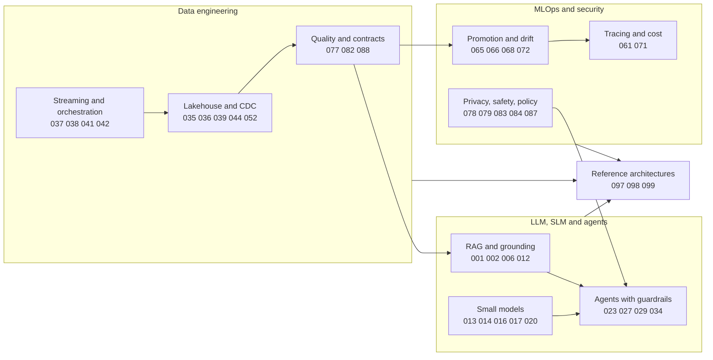
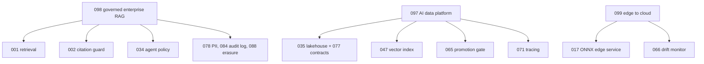
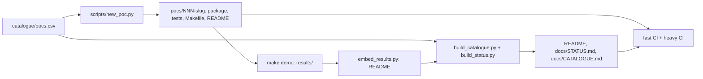

# 100 Real-World AI & Data Engineering POCs

One hundred reproducible proof-of-concepts for data, ML and AI platforms. Each POC isolates one production problem (an unsafe agent tool call, a replayed CDC batch, a model promoted on noise, a cloud stack nobody can deploy cheaply), solves it in code, tests it, and says exactly what was and was not verified. Maintained by Shashwat, a senior data and AI engineer based in Dublin, Ireland.

Everything runs locally on synthetic data with no credentials and no paid service. Where the original idea needs a GPU, a hosted model or an AWS service, the POC is a **labelled local variant** that studies the engineering around it and never claims results from the real thing.

**Contents:** [At a glance](#at-a-glance) · [Flagship projects](#flagship-projects) · [How it fits together](#how-it-fits-together) · [Full scope vs local variants](#full-scope-vs-local-variants) · [Technology and engineering highlights](#technology-and-engineering-highlights) · [Run it](#run-it) · [Testing and CI](#testing-and-ci) · [Catalogue](#catalogue) · [Documentation](#documentation) · [Licence](#licence)

## At a glance
<!-- SUMMARY:START -->
**100 POCs: 71 full-scope, 29 approved local variants.**

| Area | POCs | Full / variant | Focus |
|---|---|---|---|
| [LLM & RAG](#llm--rag) | 12 | 11 / 1 | Retrieval, grounding, citations, evaluation and cost control for LLM applications. |
| [SLM](#slm) | 10 | 4 / 6 | Small and local models: quantisation, distillation, adaptation, serving trade-offs. |
| [Agents & Automation](#agents--automation) | 12 | 12 / 0 | Tool-using agents with policy gates, sandboxing, human approval and evaluation. |
| [Data Engineering](#data-engineering) | 16 | 13 / 3 | Lakehouse, CDC, streaming, orchestration, data products and quality gates. |
| [AWS & Cloud](#aws--cloud) | 14 | 2 / 12 | Infrastructure as code and AWS-shaped architectures validated locally, never deployed. |
| [MLOps & LLMOps](#mlops--llmops) | 12 | 9 / 3 | Registries, promotion gates, drift, rollouts, tracing and cost. |
| [Governance & Security](#governance--security) | 12 | 12 / 0 | Data contracts, privacy, safety filters, red-teaming, audit and policy as code. |
| [ML & Analytics](#ml--analytics) | 8 | 6 / 2 | Forecasting, causal inference, recommendation, entity resolution, fairness. |
| [Capstone](#capstone) | 4 | 2 / 2 | Reference architectures composed from earlier POCs, and the portfolio tooling itself. |

<!-- SUMMARY:END -->

## Flagship projects
Chosen for breadth and for the strength of their evidence, not size. Each folder has a README with a diagram, an evidence table, embedded results and limitations; `make -C pocs/<dir> demo` reproduces it.

<!-- FLAGSHIPS:START -->
| # | Project | Fidelity | What it demonstrates |
|---|---|---|---|
| 003 | [text-to-sql-semantic-layer](pocs/003-text-to-sql-semantic-layer) | full | Governed natural-language-to-SQL with a semantic layer: the broadest guard test-suite in the portfolio (131 parametrised test cases). |
| 098 | [reference-enterprise-rag](pocs/098-reference-enterprise-rag) | full | Reference enterprise RAG that composes earlier POCs (citations, PII, audit log, erasure) with 14 end-to-end scenarios. |
| 035 | [medallion-lakehouse-duckdb](pocs/035-medallion-lakehouse-duckdb) | full | Medallion lakehouse on DuckDB with SCD2, quarantine of known injected defects, replay-safety and a data-contract gate. |
| 039 | [postgres-logical-cdc-to-lake](pocs/039-postgres-logical-cdc-to-lake) | local-variant | Change data capture from a real PostgreSQL 16 logical replication slot into a Parquet lake: snapshot/stream handoff, atomic transactions, crash-safe replay. |
| 097 | [reference-ai-data-platform](pocs/097-reference-ai-data-platform) | local-variant | Platform seam testing: lakehouse + contract gate + incremental vector index + MLflow promotion gate + tracing, with replay and tamper tests. |
| 079 | [prompt-injection-red-team](pocs/079-prompt-injection-red-team) | full | Prompt-injection red team with measurable attack success rates against layered defences (76 parametrised test cases). |
| 027 | [agent-code-sandbox](pocs/027-agent-code-sandbox) | full | Sandbox for agent-generated code with per-layer attack outcomes measured and honestly scoped as defence in depth. |
| 065 | [mlflow-registry-promotion](pocs/065-mlflow-registry-promotion) | full | MLflow registry promotion through a bootstrap-interval gate with subgroup checks, signature checks and rollback. |
| 051 | [terraform-aws-datalake-foundation](pocs/051-terraform-aws-datalake-foundation) | full | Terraform data-lake foundation validated by plan and apply against a local AWS mock (no cloud account touched). |
| 077 | [data-contracts-ci-gate](pocs/077-data-contracts-ci-gate) | full | Data contracts as code with semver-checked evolution and a CI gate that blocks breaking changes (70 parametrised test cases). |

<!-- FLAGSHIPS:END -->

More detail and run commands: [docs/FLAGSHIPS.md](docs/FLAGSHIPS.md).

## How it fits together

The three capstone references compose earlier POCs instead of re-implementing them:


How the repository itself works: the catalogue is the single source of truth; every POC follows one template; documentation is generated and checked in CI.



## Full scope vs local variants
- **71 full-scope POCs** implement the idea as briefed with the named open-source components actually running locally (DuckDB, dbt, Spark, MLflow, ONNX Runtime, FAISS, Terraform plan/apply against a local mock, OPA, Playwright, ...).
- **29 approved local variants** replace a service, model or hardware from the brief (a GPU, Hugging Face models, AWS Bedrock/Redshift/EMR/Lambda/Kinesis/Step Functions, Kafka/Debezium, a vision model, ...) with a local or simulated stand-in. The title says so, the README opens with the original brief and what is covered, and the *Evidence status* table labels each claim as real, simulated, mock, modelled or not tested.

Nothing in this repository was run on AWS, a GPU or a hosted model, and no variant's numbers should be quoted as results from the service or model it stands in for.

<details><summary>The 29 local variants</summary>

<!-- VARIANTS:START -->
| # | Local variant | Category |
|---|---|---|
| 010 | [PDF layout and table-aware question answering (pdfplumber; no vision model)](pocs/010-pdf-layout-table-qa) | LLM & RAG |
| 014 | [Block-quantisation trade-off study: llama.cpp-style Q8/Q5/Q4/Q3/Q2 formats on a small language model (no LLM, no llama.cpp)](pocs/014-gguf-quantisation-study) | SLM |
| 015 | [Local variant: QLoRA mechanics for ticket classification on CPU - NumPy LoRA with a 4-bit frozen base (no transformer, PEFT, bitsandbytes or GPU)](pocs/015-qlora-ticket-classifier) | SLM |
| 016 | [Distilling a heavy teacher's labels into a tiny task model (scikit-learn ensemble teacher; no transformers)](pocs/016-llm-to-slm-distillation) | SLM |
| 019 | [Local variant: reliable tool calling on CPU - LoRA router, slot tagger and strict JSON-Schema gate (no language model generates the calls)](pocs/019-slm-function-calling-finetune) | SLM |
| 020 | [Speculative decoding on toy language models: losslessness and speed-up (NumPy; llama.cpp/transformers not used)](pocs/020-speculative-decoding-demo) | SLM |
| 021 | [LLM serving scheduling study: static vs continuous batching and paged KV cache in a discrete-event model (vLLM, Locust and GPUs not used)](pocs/021-llm-serving-scheduler-study) | SLM |
| 037 | [Streaming windowed aggregates with exactly-once effect under crashes (simulated broker; Kafka/Redpanda not used)](pocs/037-exactly-once-stream-windows) | Data Engineering |
| 039 | [Postgres logical-decoding CDC to a Parquet lake: snapshot plus stream, atomic transactions, crash-safe replay (real Postgres 16; Debezium and Kafka not used)](pocs/039-postgres-logical-cdc-to-lake) | Data Engineering |
| 048 | [End-to-end lineage with OpenLineage (local receiver; Marquez/Airflow not used)](pocs/048-openlineage-lineage) | Data Engineering |
| 052 | [Iceberg lakehouse: evolution, time travel and maintenance (PyIceberg local; Glue/Athena configured on a mock)](pocs/052-glue-athena-iceberg) | AWS & Cloud |
| 053 | [Event-driven ETL with EventBridge, SQS and a Lambda-style handler (local mock; Lambda/LocalStack not used)](pocs/053-eventbridge-lambda-etl) | AWS & Cloud |
| 054 | [ML pipeline orchestrated by a Step Functions-style state machine (own ASL interpreter; CDK/AWS not used)](pocs/054-step-functions-ml-pipeline) | AWS & Cloud |
| 055 | [Local variant: Bedrock knowledge-base RAG as CDK - offline synthesis, template checks and a local mirror pipeline (not deployed; no AWS calls)](pocs/055-bedrock-rag-cdk) | AWS & Cloud |
| 056 | [Inference endpoint autoscaling policy study: a queueing simulation validated against Erlang C (SageMaker not used)](pocs/056-endpoint-autoscaling-study) | AWS & Cloud |
| 057 | [Spark cost/performance tuning study: real local Spark timings, modelled EMR Serverless price (nothing deployed to AWS)](pocs/057-emr-serverless-cost-tuning) | AWS & Cloud |
| 058 | [Streaming ingest via Kinesis and Firehose to S3 (local mock; Terraform/LocalStack not used)](pocs/058-kinesis-firehose-ingest) | AWS & Cloud |
| 059 | [Local variant: Redshift Serverless ELT with dbt - executed on DuckDB with Redshift-dialect and Terraform plan checks (nothing run on Redshift or AWS)](pocs/059-redshift-serverless-elt) | AWS & Cloud |
| 060 | [Fine-grained data access with Lake Formation semantics (simulated on DuckDB; no AWS service)](pocs/060-lakeformation-access-control) | AWS & Cloud |
| 062 | [Multi-account guardrails with SCPs and Config rules (simulated SCP evaluation; Terraform on local mock)](pocs/062-landing-zone-guardrails) | AWS & Cloud |
| 063 | [Reusable AWS integration-test harness (moto server; LocalStack/Docker not used)](pocs/063-aws-mock-test-harness) | AWS & Cloud |
| 064 | [ECS Fargate blue/green deploy with GitHub OIDC: security linting and deployment simulation (nothing deployed)](pocs/064-fargate-bluegreen-api) | AWS & Cloud |
| 068 | [Canary model rollout with automatic rollback (simulated traffic; KServe/kind not used)](pocs/068-canary-model-serving) | MLOps & LLMOps |
| 071 | [LLM tracing and cost telemetry with OpenTelemetry](pocs/071-llm-tracing-otel) | MLOps & LLMOps |
| 075 | [Data versioning with branching (own lakeFS/DVC-style store; lakeFS/DVC not used)](pocs/075-branching-data-store) | MLOps & LLMOps |
| 092 | [Two-tower recommender with offline evaluation (NumPy, FAISS; PyTorch not used)](pocs/092-two-tower-recommender) | ML & Analytics |
| 094 | [Sentiment: SLM vs classical baseline cost/accuracy](pocs/094-sentiment-slm-vs-classical) | ML & Analytics |
| 097 | [Reference AI data platform: lakehouse, contract gate, incremental vector index, model gate and tracing wired end to end (file-batch source; no Debezium)](pocs/097-reference-ai-data-platform) | Capstone |
| 099 | [Edge-to-cloud hybrid serving reference (int8 ONNX edge model, confidence escalation, drift monitor, circuit breaker; cloud modelled, no language model)](pocs/099-reference-edge-cloud-slm) | Capstone |

<!-- VARIANTS:END -->

</details>

## Technology and engineering highlights
**Stack.** Python 3.12/3.13, SQL, DuckDB, SQLite, PostgreSQL 16 (logical decoding), PyIceberg, Parquet/Delta, Apache Spark, dbt, Airflow, Dagster, Terraform, AWS CDK (synthesis only), moto, MLflow, ONNX Runtime, FAISS, scikit-learn, NumPy, OpenTelemetry, OPA, Playwright, pytest, ruff, gitleaks.

**What the POCs emphasise** (each backed by tests in the named POCs):
- *Replay safety and exactly-once effects:* idempotent ingestion, ledgers and ordering rules (035, 037, 039, 047, 053, 059).
- *Gates instead of hope:* data contracts with semver checks (077), statistical model promotion with rollback (065), canary rollouts with fail-closed deadlines (068), strict JSON-Schema tool-call gates (019).
- *Security as tests:* prompt-injection red teaming (079), layered code sandboxing (027), policy as code (083), PII scanning and erasure (078, 088), tamper-evident audit log (084), secret scanning (086).
- *Cloud without the bill:* Terraform plan/apply against a local mock, CDK synthesis and policy checks, cost models with stated assumptions (051, 052, 055, 057, 062, 064).
- *Honest measurement:* models with stated assumptions, validated against closed forms where possible (for example the autoscaling simulator against Erlang C, 056), deterministic seeds, no asserted timings, trained-model results treated as platform-sensitive.

## Run it
```bash
python -m venv .venv && . .venv/bin/activate
pip install -r requirements-dev.txt            # exact pins, Python 3.12+
python scripts/run_tests.py --fast             # every light POC's tests, each in its own process
make -C pocs/098-reference-enterprise-rag demo PY=python    # one demo; results land in results/ and in the POC README
```
Heavy POCs (Spark, Terraform with moto, dbt, Dagster, Playwright, PostgreSQL, CDK, OPA) carry marker files and need extra tools; Airflow (041) uses its own locked virtual environment. Requirements per tier, tool binaries and a ten-minute tour: [docs/DEMO.md](docs/DEMO.md).

## Testing and CI
| Workflow | Runs | Scope |
|---|---|---|
| [`ci.yml`](.github/workflows/ci.yml) | every push, Python 3.12 and 3.13 | ruff lint and format, fast tests of 75 POCs plus shared libraries, secret scan, MCP interoperability test, light demo smoke, freshness of generated docs |
| [`heavy.yml`](.github/workflows/heavy.yml) | path-filtered | 20 heavy POCs (Spark, Terraform/moto, dbt, Dagster, Playwright, PostgreSQL, CDK, OPA) plus a separate Airflow job from an exact lock file |
| [`data-contracts.yml`](.github/workflows/data-contracts.yml), [`ml-pipeline.yml`](.github/workflows/ml-pipeline.yml) | path-filtered | POC 077's contract gate and POC 067's reproducible ML pipeline as real workflows |

Last full verification: 109 local test suites, 1,982 tests passed, 0 failed, 4 skipped (conditional on optional tools or privileges); the GitHub workflows were green on the same code. Details, failures found along the way and how they were fixed: [docs/CI_REPORT.md](docs/CI_REPORT.md). Dependency audit: [docs/DEPENDENCY_AUDIT.md](docs/DEPENDENCY_AUDIT.md).

## Catalogue
<!-- CATALOGUE:START -->
Jump to: [LLM & RAG](#llm--rag) · [SLM](#slm) · [Agents & Automation](#agents--automation) · [Data Engineering](#data-engineering) · [AWS & Cloud](#aws--cloud) · [MLOps & LLMOps](#mlops--llmops) · [Governance & Security](#governance--security) · [ML & Analytics](#ml--analytics) · [Capstone](#capstone)

### LLM & RAG

Retrieval, grounding, citations, evaluation and cost control for LLM applications. (12 POCs)

| # | POC | What it shows | Fidelity |
|---|---|---|---|
| 001 | [rag-hybrid-search-eval](pocs/001-rag-hybrid-search-eval) | Hybrid BM25+vector RAG with retrieval evaluation harness | full |
| 002 | [rag-citation-guard](pocs/002-rag-citation-guard) | RAG with enforced citations and groundedness checks | full |
| 003 | [text-to-sql-semantic-layer](pocs/003-text-to-sql-semantic-layer) | NL-to-SQL over a semantic layer with query validation and guardrails | full |
| 004 | [structured-extraction-pipeline](pocs/004-structured-extraction-pipeline) | Invoice/contract extraction to validated JSON with retries | full |
| 005 | [llm-router-cost-optimiser](pocs/005-llm-router-cost-optimiser) | Confidence-based cascade router (small model first, escalate to large model) | full |
| 006 | [semantic-cache-gateway](pocs/006-semantic-cache-gateway) | LLM gateway with semantic cache budgets and rate limits | full |
| 007 | [prompt-regression-testing](pocs/007-prompt-regression-testing) | Prompt versioning and CI regression tests with golden sets | full |
| 008 | [llm-as-judge-calibration](pocs/008-llm-as-judge-calibration) | LLM-as-judge pairwise eval calibrated against human labels | full |
| 009 | [graph-rag-knowledge-graph](pocs/009-graph-rag-knowledge-graph) | GraphRAG over an entity graph vs plain vector RAG | full |
| 010 | [pdf-layout-table-qa](pocs/010-pdf-layout-table-qa) | PDF layout and table-aware question answering (pdfplumber; no vision model) | local-variant |
| 011 | [conversational-analytics-bot](pocs/011-conversational-analytics-bot) | Chat over governed metrics with safe tool calls | full |
| 012 | [long-context-vs-rag-benchmark](pocs/012-long-context-vs-rag-benchmark) | Benchmark: long-context stuffing vs RAG on cost/latency/accuracy | full |

### SLM

Small and local models: quantisation, distillation, adaptation, serving trade-offs. (10 POCs)

| # | POC | What it shows | Fidelity |
|---|---|---|---|
| 013 | [slm-ollama-benchmark-harness](pocs/013-slm-ollama-benchmark-harness) | Benchmark harness for small models (latency/quality/memory) | full |
| 014 | [gguf-quantisation-study](pocs/014-gguf-quantisation-study) | Block-quantisation trade-off study: llama.cpp-style Q8/Q5/Q4/Q3/Q2 formats on a small language model (no LLM, no llama.cpp) | local-variant |
| 015 | [qlora-ticket-classifier](pocs/015-qlora-ticket-classifier) | Local variant: QLoRA mechanics for ticket classification on CPU - NumPy LoRA with a 4-bit frozen base (no transformer, PEFT, bitsandbytes or GPU) | local-variant |
| 016 | [llm-to-slm-distillation](pocs/016-llm-to-slm-distillation) | Distilling a heavy teacher's labels into a tiny task model (scikit-learn ensemble teacher; no transformers) | local-variant |
| 017 | [onnx-edge-inference-service](pocs/017-onnx-edge-inference-service) | Quantised ONNX model served on CPU with latency SLOs | full |
| 018 | [slm-pii-redaction](pocs/018-slm-pii-redaction) | On-device PII detection and redaction | full |
| 019 | [slm-function-calling-finetune](pocs/019-slm-function-calling-finetune) | Local variant: reliable tool calling on CPU - LoRA router, slot tagger and strict JSON-Schema gate (no language model generates the calls) | local-variant |
| 020 | [speculative-decoding-demo](pocs/020-speculative-decoding-demo) | Speculative decoding on toy language models: losslessness and speed-up (NumPy; llama.cpp/transformers not used) | local-variant |
| 021 | [llm-serving-scheduler-study](pocs/021-llm-serving-scheduler-study) | LLM serving scheduling study: static vs continuous batching and paged KV cache in a discrete-event model (vLLM, Locust and GPUs not used) | local-variant |
| 022 | [slm-log-anomaly-explainer](pocs/022-slm-log-anomaly-explainer) | Small model explains anomalous log clusters | full |

### Agents & Automation

Tool-using agents with policy gates, sandboxing, human approval and evaluation. (12 POCs)

| # | POC | What it shows | Fidelity |
|---|---|---|---|
| 023 | [incident-triage-agent](pocs/023-incident-triage-agent) | Incident triage agent with policy-gated tools, human approval and audit trail | full |
| 024 | [mcp-server-data-catalog](pocs/024-mcp-server-data-catalog) | MCP server exposing a data catalogue read-only | full |
| 025 | [mcp-server-repo-ops-readonly](pocs/025-mcp-server-repo-ops-readonly) | Read-only MCP server for repo/CI insight | full |
| 026 | [multi-agent-dq-fixer](pocs/026-multi-agent-dq-fixer) | Multi-agent data-quality triage and proposed fixes | full |
| 027 | [agent-code-sandbox](pocs/027-agent-code-sandbox) | Sandboxed code-execution tool for agents | full |
| 028 | [agent-trajectory-eval](pocs/028-agent-trajectory-eval) | Trajectory-level agent evaluation and scoring | full |
| 029 | [human-in-loop-approval-workflow](pocs/029-human-in-loop-approval-workflow) | Approval gates for agent actions with audit trail | full |
| 030 | [email-to-ticket-automation](pocs/030-email-to-ticket-automation) | Parse emails into structured tickets with routing | full |
| 031 | [scheduled-insight-report-agent](pocs/031-scheduled-insight-report-agent) | Scheduled metric narrative reports | full |
| 032 | [playwright-web-extractor](pocs/032-playwright-web-extractor) | Resilient browser-automation data extraction | full |
| 033 | [dbt-pr-review-agent](pocs/033-dbt-pr-review-agent) | Agent reviewing dbt model changes in PRs | full |
| 034 | [agent-policy-guardrails](pocs/034-agent-policy-guardrails) | Policy engine limiting agent tools and data scope | full |

### Data Engineering

Lakehouse, CDC, streaming, orchestration, data products and quality gates. (16 POCs)

| # | POC | What it shows | Fidelity |
|---|---|---|---|
| 035 | [medallion-lakehouse-duckdb](pocs/035-medallion-lakehouse-duckdb) | Bronze/silver/gold lakehouse: incremental, idempotent, SCD2, contract-gated | full |
| 036 | [delta-lake-cdc-merge](pocs/036-delta-lake-cdc-merge) | Delta Lake CDC ingestion with idempotent MERGE, tombstones, time travel and compaction | full |
| 037 | [exactly-once-stream-windows](pocs/037-exactly-once-stream-windows) | Streaming windowed aggregates with exactly-once effect under crashes (simulated broker; Kafka/Redpanda not used) | local-variant |
| 038 | [spark-structured-sessionisation](pocs/038-spark-structured-sessionisation) | Sessionisation with Spark Structured Streaming and late data | full |
| 039 | [postgres-logical-cdc-to-lake](pocs/039-postgres-logical-cdc-to-lake) | Postgres logical-decoding CDC to a Parquet lake: snapshot plus stream, atomic transactions, crash-safe replay (real Postgres 16; Debezium and Kafka not used) | local-variant |
| 040 | [dbt-scd2-snapshots](pocs/040-dbt-scd2-snapshots) | Star schema with SCD2 snapshots and metrics | full |
| 041 | [airflow-dag-factory](pocs/041-airflow-dag-factory) | Config-driven Airflow DAG factory with tests | full |
| 042 | [dagster-asset-pipeline](pocs/042-dagster-asset-pipeline) | Asset-based pipeline with partitions and checks | full |
| 043 | [spark-skew-optimisation](pocs/043-spark-skew-optimisation) | Spark join-skew diagnosis and fixes with local before/after benchmarks | full |
| 044 | [parquet-compaction-lab](pocs/044-parquet-compaction-lab) | Parquet small-file compaction lab: pruning, sorting and codecs | full |
| 045 | [incremental-api-ingestion](pocs/045-incremental-api-ingestion) | Idempotent API ingestion with watermarks and backoff | full |
| 046 | [pit-feature-store](pocs/046-pit-feature-store) | Feature store offline/online with point-in-time joins (own implementation, Feast not used) | full |
| 047 | [idempotent-vector-ingestion](pocs/047-idempotent-vector-ingestion) | Idempotent vector ingestion: re-embed only changed chunks | full |
| 048 | [openlineage-lineage](pocs/048-openlineage-lineage) | End-to-end lineage with OpenLineage (local receiver; Marquez/Airflow not used) | local-variant |
| 049 | [reverse-etl-sync](pocs/049-reverse-etl-sync) | Reverse ETL to a mock CRM with diff-based sync | full |
| 050 | [data-product-template](pocs/050-data-product-template) | Data-mesh data product template with contract and SLOs | full |

### AWS & Cloud

Infrastructure as code and AWS-shaped architectures validated locally, never deployed. (14 POCs)

| # | POC | What it shows | Fidelity |
|---|---|---|---|
| 051 | [terraform-aws-datalake-foundation](pocs/051-terraform-aws-datalake-foundation) | Secure data-lake foundation (S3/KMS/IAM) in Terraform, checked with plan rules and a mock AWS | full |
| 052 | [glue-athena-iceberg](pocs/052-glue-athena-iceberg) | Iceberg lakehouse: evolution, time travel and maintenance (PyIceberg local; Glue/Athena configured on a mock) | local-variant |
| 053 | [eventbridge-lambda-etl](pocs/053-eventbridge-lambda-etl) | Event-driven ETL with EventBridge, SQS and a Lambda-style handler (local mock; Lambda/LocalStack not used) | local-variant |
| 054 | [step-functions-ml-pipeline](pocs/054-step-functions-ml-pipeline) | ML pipeline orchestrated by a Step Functions-style state machine (own ASL interpreter; CDK/AWS not used) | local-variant |
| 055 | [bedrock-rag-cdk](pocs/055-bedrock-rag-cdk) | Local variant: Bedrock knowledge-base RAG as CDK - offline synthesis, template checks and a local mirror pipeline (not deployed; no AWS calls) | local-variant |
| 056 | [endpoint-autoscaling-study](pocs/056-endpoint-autoscaling-study) | Inference endpoint autoscaling policy study: a queueing simulation validated against Erlang C (SageMaker not used) | local-variant |
| 057 | [emr-serverless-cost-tuning](pocs/057-emr-serverless-cost-tuning) | Spark cost/performance tuning study: real local Spark timings, modelled EMR Serverless price (nothing deployed to AWS) | local-variant |
| 058 | [kinesis-firehose-ingest](pocs/058-kinesis-firehose-ingest) | Streaming ingest via Kinesis and Firehose to S3 (local mock; Terraform/LocalStack not used) | local-variant |
| 059 | [redshift-serverless-elt](pocs/059-redshift-serverless-elt) | Local variant: Redshift Serverless ELT with dbt - executed on DuckDB with Redshift-dialect and Terraform plan checks (nothing run on Redshift or AWS) | local-variant |
| 060 | [lakeformation-access-control](pocs/060-lakeformation-access-control) | Fine-grained data access with Lake Formation semantics (simulated on DuckDB; no AWS service) | local-variant |
| 061 | [finops-cost-anomaly](pocs/061-finops-cost-anomaly) | FinOps cost anomaly detection and tagging audit | full |
| 062 | [landing-zone-guardrails](pocs/062-landing-zone-guardrails) | Multi-account guardrails with SCPs and Config rules (simulated SCP evaluation; Terraform on local mock) | local-variant |
| 063 | [aws-mock-test-harness](pocs/063-aws-mock-test-harness) | Reusable AWS integration-test harness (moto server; LocalStack/Docker not used) | local-variant |
| 064 | [fargate-bluegreen-api](pocs/064-fargate-bluegreen-api) | ECS Fargate blue/green deploy with GitHub OIDC: security linting and deployment simulation (nothing deployed) | local-variant |

### MLOps & LLMOps

Registries, promotion gates, drift, rollouts, tracing and cost. (12 POCs)

| # | POC | What it shows | Fidelity |
|---|---|---|---|
| 065 | [mlflow-registry-promotion](pocs/065-mlflow-registry-promotion) | Model registry promotion with gated checks | full |
| 066 | [drift-monitoring](pocs/066-drift-monitoring) | Data and prediction drift monitoring with alerts | full |
| 067 | [cicd-for-ml](pocs/067-cicd-for-ml) | CI/CD for ML: tests data checks and reproducible builds | full |
| 068 | [canary-model-serving](pocs/068-canary-model-serving) | Canary model rollout with automatic rollback (simulated traffic; KServe/kind not used) | local-variant |
| 069 | [shadow-ab-testing](pocs/069-shadow-ab-testing) | Shadow deployment and A/B test analysis | full |
| 070 | [train-serve-skew-detector](pocs/070-train-serve-skew-detector) | Training/serving skew detector | full |
| 071 | [llm-tracing-otel](pocs/071-llm-tracing-otel) | LLM tracing and cost telemetry with OpenTelemetry | local-variant |
| 072 | [auto-retraining-trigger](pocs/072-auto-retraining-trigger) | Drift-triggered automated retraining pipeline | full |
| 073 | [model-card-generator](pocs/073-model-card-generator) | Auto-generated model cards from run metadata | full |
| 074 | [batch-inference-scheduler](pocs/074-batch-inference-scheduler) | Cost-aware batch inference scheduler | full |
| 075 | [branching-data-store](pocs/075-branching-data-store) | Data versioning with branching (own lakeFS/DVC-style store; lakeFS/DVC not used) | local-variant |
| 076 | [reproducibility-kit](pocs/076-reproducibility-kit) | Experiment reproducibility kit (seed env data hash) | full |

### Governance & Security

Data contracts, privacy, safety filters, red-teaming, audit and policy as code. (12 POCs)

| # | POC | What it shows | Fidelity |
|---|---|---|---|
| 077 | [data-contracts-ci-gate](pocs/077-data-contracts-ci-gate) | Data contracts enforced as a CI gate with breaking-change detection | full |
| 078 | [pii-scanner-classifier](pocs/078-pii-scanner-classifier) | PII discovery and classification scanner for tables/files | full |
| 079 | [prompt-injection-red-team](pocs/079-prompt-injection-red-team) | Prompt-injection evaluation against the triage agent and MCP server, with and without defences | full |
| 080 | [ai-risk-register-generator](pocs/080-ai-risk-register-generator) | AI risk register generator aligned to EU AI Act categories | full |
| 081 | [fairness-audit](pocs/081-fairness-audit) | Model bias and fairness audit report | full |
| 082 | [lineage-impact-analysis](pocs/082-lineage-impact-analysis) | Column-level lineage and change impact analysis | full |
| 083 | [policy-as-code-opa](pocs/083-policy-as-code-opa) | RBAC/ABAC data access policy-as-code | full |
| 084 | [tamper-evident-audit-log](pocs/084-tamper-evident-audit-log) | Tamper-evident audit log with hash chaining | full |
| 085 | [synthetic-data-privacy](pocs/085-synthetic-data-privacy) | Synthetic data generation with privacy metrics | full |
| 086 | [secrets-scanning-kit](pocs/086-secrets-scanning-kit) | Pre-commit and CI secrets scanning kit | full |
| 087 | [llm-output-safety-filter](pocs/087-llm-output-safety-filter) | Layered LLM output safety filter with eval | full |
| 088 | [gdpr-erasure-pipeline](pocs/088-gdpr-erasure-pipeline) | GDPR erasure and retention pipeline for lake + vector store | full |

### ML & Analytics

Forecasting, causal inference, recommendation, entity resolution, fairness. (8 POCs)

| # | POC | What it shows | Fidelity |
|---|---|---|---|
| 089 | [timeseries-forecast-benchmark](pocs/089-timeseries-forecast-benchmark) | Forecasting benchmark: classical vs ML vs foundation models | full |
| 090 | [streaming-anomaly-detection](pocs/090-streaming-anomaly-detection) | Streaming anomaly detection on metrics | full |
| 091 | [churn-uplift-modeling](pocs/091-churn-uplift-modeling) | Churn and uplift modelling with decision thresholds | full |
| 092 | [two-tower-recommender](pocs/092-two-tower-recommender) | Two-tower recommender with offline evaluation (NumPy, FAISS; PyTorch not used) | local-variant |
| 093 | [causal-diff-in-diff](pocs/093-causal-diff-in-diff) | Causal impact via diff-in-diff and synthetic control | full |
| 094 | [sentiment-slm-vs-classical](pocs/094-sentiment-slm-vs-classical) | Sentiment: SLM vs classical baseline cost/accuracy | local-variant |
| 095 | [entity-resolution](pocs/095-entity-resolution) | Entity resolution and deduplication at scale | full |
| 096 | [hierarchical-forecast-reconciliation](pocs/096-hierarchical-forecast-reconciliation) | Hierarchical demand forecasting with reconciliation | full |

### Capstone

Reference architectures composed from earlier POCs, and the portfolio tooling itself. (4 POCs)

| # | POC | What it shows | Fidelity |
|---|---|---|---|
| 097 | [reference-ai-data-platform](pocs/097-reference-ai-data-platform) | Reference AI data platform: lakehouse, contract gate, incremental vector index, model gate and tracing wired end to end (file-batch source; no Debezium) | local-variant |
| 098 | [reference-enterprise-rag](pocs/098-reference-enterprise-rag) | Reference architecture: governed enterprise RAG platform | full |
| 099 | [reference-edge-cloud-slm](pocs/099-reference-edge-cloud-slm) | Edge-to-cloud hybrid serving reference (int8 ONNX edge model, confidence escalation, drift monitor, circuit breaker; cloud modelled, no language model) | local-variant |
| 100 | [poc-portfolio-site](pocs/100-poc-portfolio-site) | Auto-generated portfolio site and POC scaffolding CLI | full |

<!-- CATALOGUE:END -->

## Documentation
| Document | Purpose |
|---|---|
| [docs/FLAGSHIPS.md](docs/FLAGSHIPS.md) | the ten flagship projects and how to run them |
| [docs/STATUS.md](docs/STATUS.md) | maturity, fidelity, tests, evidence labels and where each POC runs (generated) |
| [docs/CATALOGUE.md](docs/CATALOGUE.md) | the catalogue with stacks and waves (generated) |
| [docs/ARCHITECTURE.md](docs/ARCHITECTURE.md) | repository architecture and standards |
| [docs/DEMO.md](docs/DEMO.md) | demo instructions and requirements per tier |
| [docs/EVIDENCE.md](docs/EVIDENCE.md) | what each evidence label means; platform-sensitivity note |
| [docs/CI_REPORT.md](docs/CI_REPORT.md) | test and CI report |
| [docs/DEPENDENCY_AUDIT.md](docs/DEPENDENCY_AUDIT.md) | `pip-audit` review and hardening log |
| [docs/RELEASE_SUMMARY.md](docs/RELEASE_SUMMARY.md), [docs/READINESS.md](docs/READINESS.md), [docs/PUBLISHING_CHECKLIST.md](docs/PUBLISHING_CHECKLIST.md) | release summary, limitations, readiness review, publishing checklist |

## Licence
Apache-2.0 (see [LICENSE](LICENSE) and [NOTICE](NOTICE); third-party packages in [docs/THIRD_PARTY_NOTICES.md](docs/THIRD_PARTY_NOTICES.md)). The copyright holder in `NOTICE` is a marked placeholder (`[COPYRIGHT HOLDER - PLACEHOLDER]`) until the owner confirms the correct name.
