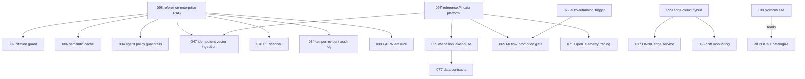

# Proposed Repository Architecture

Monorepo, one folder per POC, shared code in `libs/`. A new POC is scaffolded from a template, not written from scratch.

```
.
├── README.md                  # portfolio landing page (table auto-generated)
├── catalogue/pocs.csv         # single source of truth for all 100 POCs
├── docs/                      # generated and hand-written documentation (see README)
├── templates/poc/             # scaffold: README, Makefile, pytest.ini, package + test stubs
├── scripts/                   # build_catalogue.py, build_status.py, new_poc.py, run_tests.py, run_demos.py, check_*.py
├── libs/                      # reusable packages (on PYTHONPATH), tested in libs/tests
│   ├── pocs_common/           # config, deterministic randomness, timing, cost ledger + budget, reports
│   ├── llm_client/            # LLMClient protocol, OllamaClient (stdlib HTTP), StubClient
│   ├── eval_kit/              # ranking metrics, answer checks, bootstrap CIs
│   ├── retrieval_kit/         # BM25, LSA/Ollama dense, RRF + weighted fusion, retrievers
│   └── data_gen/              # seeded synthetic data (policy knowledge base + labelled questions; retail warehouse SQLite)
├── pocs/NNN-slug/             # one self-contained POC each
│   ├── README.md  Makefile  pytest.ini  .env.example  results/ (generated)
│   └── <package>/  tests/
└── .github/workflows/         # ci.yml (fast), heavy.yml, data-contracts.yml, ml-pipeline.yml
```

## Standards (apply to every POC)
- **Runs without credentials:** local stand-ins instead of cloud services (DuckDB, SQLite, a throw-away PostgreSQL, moto, local Spark, MLflow on SQLite); AWS-shaped POCs are validated by Terraform plan/apply against a local mock or by offline CDK synthesis and never deployed.
- **Synthetic or public data only**, generated by `libs/data_gen` with fixed seeds.
- **Tooling:** Python 3.12+ (numpy 2.5.x does not install on 3.11), `ruff`, `pytest`, root `requirements.txt` (runtime) / `requirements-dev.txt` / optional `requirements-neural.txt`, `Makefile` targets `setup/demo/test/lint/clean` per POC and `make check` at the root. Each POC is a uniquely named package and its tests run in their own process (`scripts/run_tests.py`).
- **Evidence over claims:** `make demo` writes measured results (latency, cost, accuracy) to `results/`; README embeds them.
- **Security:** `.env` git-ignored, `scripts/check_secrets.py` in `make check`/CI (a simple regex scanner; consider gitleaks for stronger coverage), exactly pinned dependencies (`requirements*.txt`), no real keys, no employer/proprietary material.
- **CI:** fast `ci.yml` (lint, fast tests, secret scan, light demo smoke, generated-docs freshness and link check), path-filtered `heavy.yml` for the heavy tier; see [CI_REPORT.md](CI_REPORT.md).
- **Definition of done:** README complete (limitations stated), tests green, results generated by `make demo` and embedded by `scripts/embed_results.py`, catalogue regenerated.

## Original plan
The monorepo was planned in four waves (flagship ten, next 30, breadth, capstones). All 100 POCs are built; the original planning notes are archived in [archive/](archive/). The current state is in [STATUS.md](STATUS.md).

## As built (end state)
The plan above was followed with these changes.

**Execution tiers.** Fast CI (`python scripts/run_tests.py --fast`, Python 3.12 and 3.13) runs every light POC in its own process; POCs marked `.heavy-tests` / `.heavy-demo` (Spark, Terraform + moto, Playwright, dbt, Dagster, PostgreSQL, ...) run in `heavy.yml`, path-filtered; POCs marked `.own-env` (Airflow 3 pins conflicting dependencies) run in a separate job with its own virtual environment. Requirements are split into `requirements-*.txt` extras by tool.

**Shared libraries** (`libs/`): `pocs_common` (config, deterministic randomness, timing, costs, reports), `llm_client` (protocol, Ollama client over stdlib HTTP, stub), `eval_kit`, `retrieval_kit`, `data_gen`.

**Reference compositions.** Later POCs reuse earlier ones by adding sibling directories to `pythonpath` (see each `pytest.ini`), so the composed behaviour is tested rather than re-implemented:



**Generated documentation.** `scripts/build_catalogue.py` renders `docs/CATALOGUE.md` and the README tables; `scripts/build_status.py` renders `docs/STATUS.md` and `docs/FLAGSHIPS.md` using the model of POC 100; CI fails if they are stale.

**Safety conventions.** AWS-flavoured POCs never contact AWS: Terraform runs `plan` offline or `apply` against a local moto server with the literal credentials `mock`; Lambda/ECS/Bedrock/Redshift behaviour that moto cannot reproduce is labelled untested. Real local services used instead of cloud ones: DuckDB, SQLite, a throw-away PostgreSQL 16 on a unix socket, local Spark, MLflow on SQLite, Chromium for Playwright.
