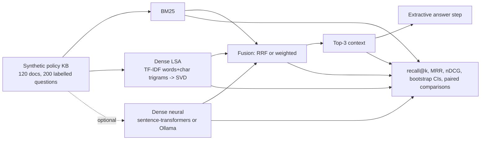

# POC 001: Hybrid RAG retrieval with an evaluation harness

**Category:** LLM & RAG | **Stack:** Python, NumPy, BM25 (own implementation), LSA, optional neural embeddings, pytest

## Problem
Most RAG demos show a plausible answer and never measure retrieval. This POC builds keyword,
dense and hybrid retrievers and evaluates them the way a team would before trusting them:
labelled questions, ranking metrics with confidence intervals, paired comparisons between
retrievers, a per-question-type breakdown, ablations, and an end-to-end check that the retrieved
context actually contains the answer.

## Evidence status (what is and is not proven)
| Item | Status |
|---|---|
| BM25, LSA dense, LSA+BM25 hybrids on the synthetic KB | **Measured here**, deterministic, reproducible with `make demo` (tables below) |
| Neural embedding retriever (sentence-transformers or Ollama) | **Implemented and unit-tested with fake embedders only. Not measured**: the development sandbox cannot reach Hugging Face or Ollama, so no neural numbers exist in this repo. The section below stays empty until someone runs it |
| Generalisation to real corpora | **Not tested**; data is synthetic and templated |
| LLM answer generation / groundedness | **Not implemented**; the answer step is extractive |

## Approach


- **Data** (`libs/data_gen`): 24 fictional systems x 5 policy areas = 120 near-duplicate documents,
  so retrievers must use both the system name and the topic. Four question kinds: `keyword`
  (runbook-code lookup), `natural`, `paraphrase` (the topic word is a synonym that does *not*
  occur in the gold document), `typo`. Seeded and deterministic.
- **Baselines** (always run): `bm25` (inverted index, k1=1.5, b=0.75), `dense_lsa` (TF-IDF over
  words plus character trigrams, truncated SVD; classical, no model download), and their hybrids
  `hybrid_lsa_rrf` / `hybrid_lsa_weighted`.
- **Optional neural** (`--neural`): adds `dense_neural`, `hybrid_neural_rrf`,
  `hybrid_neural_weighted` next to the baselines, never replacing them. Embeddings are cached so
  each text is encoded once. Default model for sentence-transformers is `BAAI/bge-small-en-v1.5`
  (queries get BGE's recommended instruction prefix); for Ollama, `nomic-embed-text`.
- **Comparisons**: paired bootstrap on per-question reciprocal rank, so "hybrid beats BM25" is
  only claimed when the interval excludes zero.
- **Fusion**: reciprocal rank fusion (rank-based) and weighted fusion of max-normalised scores.
  An early min-max version let the weakest BM25 hit tie with unreturned documents; a unit test
  caught it.
- **Answer step**: an extractive sentence picker, deliberately simple so results do not depend on
  an LLM. The retrieval-sensitive end-to-end metric is `context_has_answer@3`.

## Run it
Default (no credentials, no downloads, numpy only):
```bash
pip install -r ../../requirements-dev.txt
make demo      # writes results/results.{md,json}
make test      # 12 tests
```
Optional neural run (free and local; writes `results/results_neural.*`, leaves the default files alone):
```bash
# Option A: sentence-transformers (large PyTorch download + one-time model download from Hugging Face)
pip install -r ../../requirements-neural.txt
PYTHONPATH=.:../../libs python3 -m rag_hybrid_search_eval.main --neural sentence-transformers
#   other model: --neural-model sentence-transformers/all-MiniLM-L6-v2

# Option B: Ollama (https://ollama.com)
ollama pull nomic-embed-text
PYTHONPATH=.:../../libs python3 -m rag_hybrid_search_eval.main --neural ollama
```
If the package, server or model is missing the command exits with a message and writes nothing.
After a neural run, `python3 ../../scripts/embed_results.py` copies the numbers into this README.

## Results: default run (measured, deterministic)
<!-- RESULTS:START -->

**Results (generated by `make demo`; do not edit)**
- 120 documents, 200 questions (50 per kind); LSA dims=64
- dataset fingerprint `2433ddb42b571950`, python 3.13.16, numpy 2.5.4
- Synthetic data; absolute numbers say nothing about real corpora. Compare retrievers against each other only.

#### Retrieval quality (all question kinds)

| retriever | recall@1 | recall@3 | recall@5 | mrr@10 | ndcg@10 | mrr 95% CI |
|---|---|---|---|---|---|---|
| bm25 | 0.780 | 0.975 | 1.000 | 0.868 | 0.902 | 0.833-0.901 |
| dense_lsa | 0.840 | 0.930 | 1.000 | 0.891 | 0.918 | 0.857-0.927 |
| hybrid_lsa_rrf | 0.795 | 0.960 | 1.000 | 0.877 | 0.908 | 0.843-0.909 |
| hybrid_lsa_weighted | 0.825 | 0.940 | 1.000 | 0.885 | 0.914 | 0.850-0.919 |

#### MRR@10 by question kind

| retriever | keyword | natural | paraphrase | typo |
|---|---|---|---|---|
| bm25 | 1.000 | 1.000 | 0.540 | 0.933 |
| dense_lsa | 1.000 | 1.000 | 0.564 | 1.000 |
| hybrid_lsa_rrf | 1.000 | 1.000 | 0.547 | 0.960 |
| hybrid_lsa_weighted | 1.000 | 1.000 | 0.541 | 1.000 |

#### Paired comparisons (difference in reciprocal rank, a minus b)

A difference is only credible when its 95% paired-bootstrap interval excludes 0.

| a | b | mean diff | 95% CI | excludes 0? |
|---|---|---|---|---|
| hybrid_lsa_rrf | bm25 | 0.009 | -0.004 to +0.022 | no |
| hybrid_lsa_rrf | dense_lsa | -0.014 | -0.033 to +0.004 | no |

#### End-to-end (top-3 contexts, extractive answer step)

| retriever | context_has_answer@3 | extractive_accuracy@3 | groundedness |
|---|---|---|---|
| bm25 | 0.975 | 0.440 | 1.000 |
| dense_lsa | 0.940 | 0.450 | 1.000 |
| hybrid_lsa_rrf | 0.960 | 0.445 | 1.000 |
| hybrid_lsa_weighted | 0.950 | 0.450 | 1.000 |

`groundedness` is 1.0 by construction for an extractive answer; it becomes informative when an LLM generator is plugged in.

#### Ablation: weighted fusion, alpha = weight on dense (0 = BM25 only, 1 = dense only)

| alpha | LSA mrr@10 |
|---|---|
| 0.000 | 0.868 |
| 0.250 | 0.889 |
| 0.500 | 0.885 |
| 0.750 | 0.886 |
| 1.000 | 0.891 |

#### Ablation: LSA dimensions

| dims | dense_lsa mrr@10 | hybrid_lsa_rrf mrr@10 |
|---|---|---|
| 8 | 0.570 | 0.900 |
| 16 | 0.761 | 0.896 |
| 32 | 0.888 | 0.882 |
| 64 | 0.891 | 0.877 |
| 96 | 0.884 | 0.874 |

<!-- RESULTS:END -->

## Results: neural run
<!-- RESULTS_NEURAL:START -->

_No `results/results_neural.md` exists in this repository: this configuration has **not been run here**, so there are no numbers to show. See the run instructions above._

<!-- RESULTS_NEURAL:END -->

## Limitations
- **Finding of the default run:** neither LSA hybrid differs from BM25 or from LSA-dense by a
  margin whose paired interval excludes zero (see the comparison table), so this POC does not show
  that hybrid fusion helps on this corpus. It shows how to find that out.
- Data is synthetic and templated; absolute scores say nothing about a real corpus. Use the
  results to compare retrievers and see failure modes, not to predict production accuracy.
- The default dense retriever is LSA, not a neural model, and on this corpus it is competitive
  partly because the documents share vocabulary. No claim is made about neural embeddings until a
  neural run exists.
- With 200 questions the confidence intervals are wide; see the paired-comparison table before
  reading anything into a 1-2 point MRR difference.
- The extractive answer step is basic, so `extractive_accuracy` is bounded by sentence selection
  (e.g. runbook-code questions match the "Runbook code" sentence). `groundedness` is 1.0 by
  construction here and only becomes informative with an LLM generator, which is not implemented.

## Data and security
Synthetic data only, generated at run time. The default path makes no network calls. The optional
neural paths download a public model (sentence-transformers) or call a local server (Ollama); no
credentials are involved.
