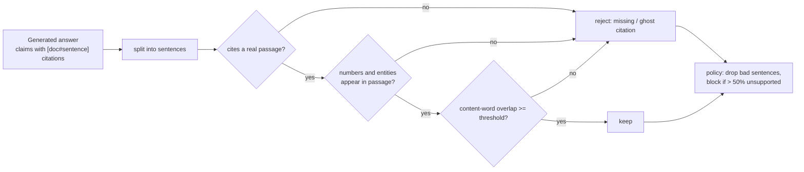

# POC 002: RAG citation guard: no claim ships without a supporting citation

**Category:** LLM & RAG | **Stack:** Python, deterministic lexical verifier, synthetic policy KB

## Problem
A RAG answer can sound grounded while citing a passage that does not say what the answer claims, or citing nothing. This POC verifies every sentence of a generated answer against the passage it cites, removes unsupported sentences, and blocks answers that are mostly unsupported.

## Approach

- Checks in order of cost and precision: citation exists, numbers match, named entities match, lexical support above a threshold.
- Evaluation uses 600 labelled sentences built from the shared synthetic knowledge base: faithful quotes, reworded paraphrases (must pass) and six corruptions: wrong number, wrong entity, invented claim, fake citation, wrong-document citation, no citation.
- The report gives precision/recall/false-block rate over a threshold sweep, per-type accuracy and whole-answer blocking, and names the weakest corruption type.
- Reuses the `data_gen` knowledge base from POC 001; no model is called.

## Run it
```bash
make demo && make test   # 8 tests
```

## Evidence status
| Claim | Status |
|---|---|
| Detection rates by corruption type on synthetic answers; whole-answer policy | Measured (deterministic) |
| Real LLM-generated answers, entailment models, negation or logical contradiction | Not tested; the lexical verifier cannot see negation (tested as a documented limitation) |

## Results
<!-- RESULTS:START -->

**Results: synthetic answers with known faithfulness (generated by `make demo`)**
600 sentences from the seeded policy knowledge base: faithful quotes, reworded-but-faithful paraphrases and six corruption types. A sentence is 'flagged' if the guard rejects it; correct = flagged exactly when it was corrupted.

| overlap threshold | precision | recall | false-block rate |
|---|---|---|---|
| 0.300 | 1.000 | 0.963 | 0.000 |
| 0.500 | 1.000 | 0.963 | 0.000 |
| 0.600 | 1.000 | 0.963 | 0.000 |
| 0.800 | 1.000 | 0.963 | 0.000 |
| 1.000 | 1.000 | 1.000 | 0.000 |

#### Correct decisions by sentence type at threshold 0.6

| type | correct / total |
|---|---|
| faithful | 96 / 96 |
| paraphrase | 48 / 48 |
| wrong_number | 31 / 31 |
| wrong_entity | 71 / 88 |
| invented_claim | 80 / 80 |
| fake_citation | 97 / 97 |
| wrong_doc_citation | 80 / 80 |
| uncited | 80 / 80 |

Whole answers (3 sentences each): 81/100 blocked (more than half the sentences unsupported); 0/5 fully faithful answers were wrongly blocked.

Weakest type: `wrong_entity` (71/88 correct). A lexical verifier cannot catch a wrong claim assembled from supported words; it is a cheap first filter, not proof of faithfulness.

<!-- RESULTS:END -->

## Limitations
- The synthetic corruptions are crafted to be detectable by lexical checks; real hallucinations are subtler, so the near-perfect recall is an upper bound.
- Needs a natural-language-inference model for claims that are wrong but built from supported words; that integration is not included.
- Sentence-level citations only; multi-hop claims spanning passages would need aggregation.

## Data and security
Synthetic documents only; no network.
