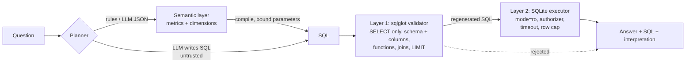

# POC 003: Natural-language analytics with a semantic layer and a two-layer SQL guard

**Category:** LLM & RAG | **Stack:** Python, SQLite, sqlglot, optional local Ollama

## Problem
"Chat with your data" fails in two ways: the model computes the wrong number (bad joins, wrong
metric definition) or it runs something it should not (writes, PII, runaway queries). This POC
separates the two concerns: questions compile to governed metrics (correct by construction), and
*every* SQL string, whoever wrote it, passes an AST validator and then a database-enforced
read-only executor.

## Evidence status
| Item | Status |
|---|---|
| Execution accuracy of the rule-based planner on 30 author-written questions | **Measured** (deterministic). Optimistic: the author wrote both the planner and the questions |
| Guard against 43 attack queries and 13 legitimate queries | **Measured** (deterministic regression suite, not a security audit) |
| `--planner llm` (model emits a JSON plan) and `--planner llm-sql` (model writes SQL) | **Implemented, tested with a stub model only. Not measured with a real model** |
| Other databases, multi-user access control, large data | **Not tested** |

## Architecture


## Security boundaries
| Threat | Layer 1 (validator) | Layer 2 (executor, validator bypassed) |
|---|---|---|
| Writes, DDL, `PRAGMA`, `ATTACH`, `VACUUM INTO` | Only a single `SELECT` is accepted | `mode=ro`, `query_only`, authorizer denies every non-read action |
| Stacked statements | Exactly one statement | sqlite3 refuses multiple statements |
| Restricted columns (`customers.email`), incl. `SELECT *`, aliases, CTEs, subqueries | Columns resolved after star expansion, then checked | Authorizer denies reads of the column |
| Engine internals (`sqlite_master`, table functions, `main.` prefix) | Rejected by name/shape | Authorizer allows only known tables |
| Dangerous functions (`load_extension`, `readfile`, `randomblob`, `zeroblob`) | Function allowlist | Authorizer function allowlist |
| Runaway cost (cartesian joins, recursive CTEs, huge `LIMIT`) | Joins need `ON`; no recursion/window functions; `LIMIT` required and capped | Wall-clock timeout, row cap, SQLite size limits |
| Value injection through the semantic layer | Values are bound parameters, never interpolated | n/a |

The validator executes SQL it *regenerated from the parsed tree*, not the raw input, to avoid
parser differentials. Documented gap: a cartesian join small enough to finish is blocked only by the
validator (see Results).

## Run it
```bash
pip install -r ../../requirements-dev.txt
make demo      # builds a synthetic warehouse, prints sample answers, writes results/
make test
PYTHONPATH=.:../../libs python3 -m text_to_sql_semantic_layer.main --ask "Top 5 products by revenue"
# optional, local model via Ollama (https://ollama.com); not run in this repo:
PYTHONPATH=.:../../libs python3 -m text_to_sql_semantic_layer.main --planner llm --model llama3.2:3b --ask "Revenue by country"
```

## Results
<!-- RESULTS:START -->

**Results: deterministic measurements (generated by `make demo`; do not edit)**
- Synthetic warehouse; rule-based planner; no language model involved. The question set was written by the POC author, so accuracy is optimistic for unseen phrasing.

#### Execution accuracy (result set equals gold SQL's result set)

| kind | questions | correct | rate |
|---|---|---|---|
| canonical | 15 | 15 | 1.000 |
| paraphrase | 10 | 10 | 1.000 |
| out_of_scope | 5 | 5 | 1.000 |

`out_of_scope` counts a correct refusal as correct.

#### Guard: attack suite

43 attack queries. Validator alone blocked (or capped) **43**. With the validator bypassed, SQLite-level enforcement alone contained **42** (denied, errored, timed out or row-capped).

| category | attacks | validator blocked or capped | executor alone contained |
|---|---|---|---|
| stacked | 2 | 2 | 2 |
| write | 7 | 7 | 7 |
| engine | 4 | 4 | 4 |
| schema | 4 | 4 | 4 |
| function | 6 | 6 | 6 |
| pii | 10 | 10 | 10 |
| resource | 6 | 6 | 5 |
| obfuscation | 2 | 2 | 2 |
| unknown | 2 | 2 | 2 |

Executor alone allowed these (the validator is the only barrier for them):

- `SELECT COUNT(*) FROM order_items a CROSS JOIN order_items b`

#### False positives: 0 of 13 legitimate queries rejected

<!-- RESULTS:END -->

## Limitations
- The rule planner understands a small vocabulary (6 metrics, 7 dimensions, years and the values
  present in the data). Unfamiliar wording is refused rather than guessed, but qualifiers it does not
  know *outside* a "by ..." clause (e.g. "VIP customers") are ignored, so always read the
  `interpreted as` line.
- Accuracy numbers come from questions written by the same author as the planner. Use them as a
  regression suite, not as evidence about unseen users.
- The guard is a tested allowlist, not a proof; SQLite-specific. PII is one configured column list.
  There is no per-user access control or auditing.
- Timeouts are enforced every ~10k VM steps, so they are approximate.
- The LLM paths are exercised only with a stub model; a real model's behaviour is unmeasured.

## Data and security
Synthetic data only (`libs/data_gen/warehouse.py`; emails are fabricated on example.com). No
credentials, network access or paid services in the default path.
