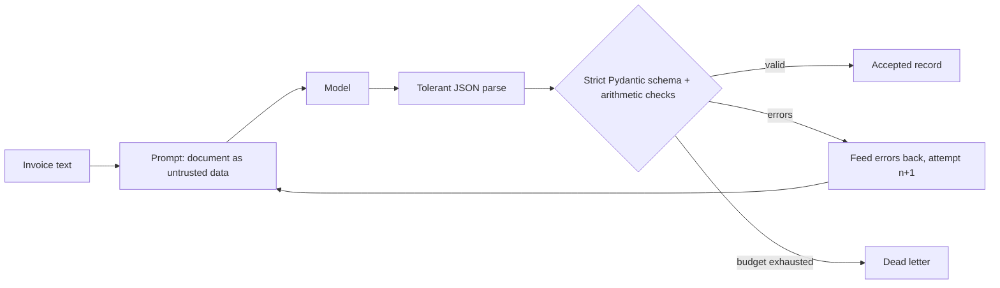

# POC 004: Structured extraction pipeline with validated retries

**Category:** LLM & RAG | **Stack:** Python, Pydantic v2, simulated extractor (no real LLM measured)

## Problem
LLM extraction fails in quiet ways: JSON wrapped in prose, wrong date formats, totals that do not add up, a missing field. Downstream systems need records that are guaranteed valid, and a clear place for the documents that are not.

## Approach

- Strict Pydantic v2 schema (no coercion, unknown fields forbidden, ISO dates, currency enum) plus cross-field checks: line items must sum to the subtotal and subtotal + tax must equal the total.
- On failure the pipeline feeds a short list of field errors back to the model and retries up to a budget; anything that never validates goes to a dead letter, never downstream.
- The document is wrapped as untrusted data and cannot close its own delimiter. A forged total that disagrees with the line items is rejected by the arithmetic check.
- The model here is a seeded simulation, so retry behaviour can be measured offline and tests are deterministic.

## Run it
```bash
make install
make test
make demo
```

## Evidence status
| Claim | Status |
|---|---|
| Schema validation, arithmetic checks, retry loop, dead-lettering | Real: Pydantic v2 and the pipeline run locally |
| Extractor model | Simulated (regex reader with injected, seeded faults); no LLM was called |
| Repair rate after validation feedback (80%) | An assumption, not measured on a real model |
| Ollama or any hosted model | Not run; the client interface accepts one but nothing here is verified against it |

## Results
<!-- RESULTS:START -->

**Results: schema-validated extraction on 200 synthetic invoices (8 contain a prompt-injection line)**
The extractor is a SIMULATED model (regex reader with seeded, realistic format faults: fenced or trailing-comma JSON, wrong date format, string amounts, wrong total, missing field, bad currency, chatty prose). 55% of first attempts are faulty; with validation feedback a fault is repaired with an assumed 80% probability per retry. The repair rate for a real model is not measured.

| max attempts | valid rate | dead-lettered | exact match (accepted) | mean attempts | input tokens (est.) | injected docs with total=0 |
|---|---|---|---|---|---|---|
| 1 | 0.580 | 84 | 1.000 | 1.000 | 24762 | 0 |
| 2 | 0.880 | 24 | 1.000 | 1.420 | 38249 | 0 |
| 3 | 0.975 | 5 | 1.000 | 1.540 | 42041 | 0 |
| 5 | 0.995 | 1 | 1.000 | 1.575 | 43209 | 0 |

Accepted records are always schema-valid and arithmetically consistent; documents that never validate are dead-lettered, never passed on.

<!-- RESULTS:END -->

## Limitations
- Retry gains in the table come from the assumed repair probability; do not quote them as properties of any real model.
- A forged record that is internally consistent (items, subtotal, tax and total all rewritten) passes validation; a test documents this. Cross-checking against a system of record is needed for that.
- Prompt-injection resistance of a real model is not tested; the simulated reader ignores injected text by construction.
- Synthetic text invoices only: no scans, OCR, tables spanning pages, multiple languages or contracts.
- Token counts are a 4-characters-per-token estimate.

## Data and security
Invoices are generated from a seed with fictional vendors. The pipeline does not log document text, only field-level error messages truncated to 160 characters.
