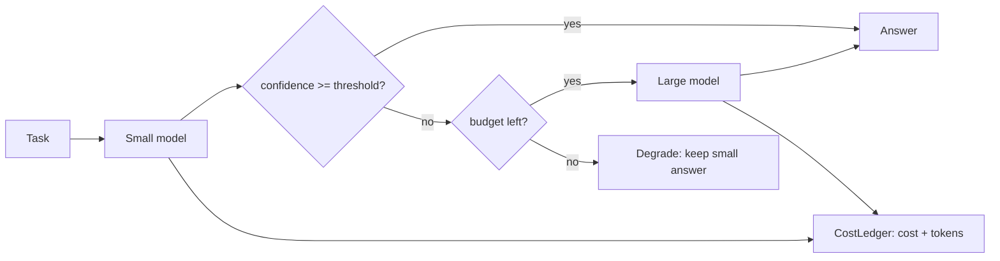

# POC 005: LLM cost router (small model first, escalate on low confidence)

**Category:** LLM & RAG | **Stack:** Python, pytest, optional Ollama

## Problem
Sending every request to the largest model is expensive and slow. A cascade answers with a small
model and escalates only when it is unsure. This POC implements several routing policies, a cost
ledger with a hard budget guard, and an evaluation that reports the cost/accuracy/latency
trade-off, including how much it depends on the small model's confidence being informative.

## Evidence status (what is and is not proven)
| Item | Status |
|---|---|
| Default demo (`make demo`) | **Simulated.** Model accuracy, confidence and latency are assumed profiles; prices are placeholders. It shows the routing mechanism under stated assumptions, not real model quality or bills |
| Real local models via Ollama (`--backend ollama`) | **Implemented, tested against a protocol-faithful stub server only. Not measured on real models**: the development sandbox cannot reach Ollama or model registries, so no real-model results exist in this repo. The section below stays empty until someone runs it |
| Real cost savings | **Not claimed.** Local inference has no per-token bill. Ollama runs report token counts and latency (measured) and cost only at *hypothetical* prices |
| Production traffic | **Not tested**; tasks are synthetic |

## Approach


Policies (`router.py`): `always_small`, `always_large`, `CascadeRouter` (confidence threshold),
`FeatureRouter` (prompt-only difficulty heuristic, optionally combined with the cascade), and an
`OracleRouter` that uses ground truth and is a **reference bound, not deployable**.
`evaluate.py` sweeps thresholds 0.00-1.00, picks the cheapest cascade within a chosen accuracy
drop of `always_large`, reports a paired-bootstrap CI on that drop, and runs a budget-guard
scenario. Simulation only: it also re-runs the selection for different confidence-signal qualities.

Cascade costs include the wasted small call on escalated requests, and latency is sequential
(small then large), so escalation is not free.

Tasks are synthetic and auto-graded: ticket classification (harder when the text mixes in phrases
of other categories) and multi-step arithmetic (harder with more steps).

## The simulation (read before the simulated numbers)
Each simulated model is a hash-seeded stand-in whose behaviour follows assumed parameters in
`models.py`. These are assumptions, **not measurements** of any real model:

| | sim-slm-3b | sim-llm-xl |
|---|---|---|
| capability (difficulty where P(correct)=0.5) | 0.45 | 0.85 |
| confidence calibration / noise sd | 0.35 / 0.22 | 0.35 / 0.22 |
| latency | 60 ms + 4 ms/output token | 600 ms + 25 ms/output token |
| placeholder price, $/M tokens in/out | 0.05 / 0.10 | 3.00 / 15.00 |

## Run it
Default simulation (no credentials, no downloads):
```bash
pip install -r ../../requirements-dev.txt
make demo      # writes results/results.{md,json}
make test      # 18 tests
```
Real local models with Ollama (free; writes `results/results_ollama.*`, leaves the simulation alone):
```bash
# 1. install Ollama (https://ollama.com), start it, and pull two models of different size
ollama pull llama3.2:3b
ollama pull llama3.1:8b
# 2. hypothetical prices for those names live in config/prices.json (edit or add your own models)
# 3. run; start small, real models are slow on CPU
PYTHONPATH=.:../../libs python3 -m llm_router_cost_optimiser.main --backend ollama \
    --small-model llama3.2:3b --large-model llama3.1:8b --n-tasks 20
```
Models can also be set with `OLLAMA_SMALL_MODEL` / `OLLAMA_LARGE_MODEL` / `OLLAMA_URL` (see
`.env.example`). The run first checks the server and that both models are installed (printing the
`ollama pull` command if not), warms each model up so load time is not measured, then uses
temperature 0 and a fixed seed. Replies that miss the `ANSWER:/CONFIDENCE:` format are counted and
reported as a malformed rate. Other options: `--num-predict`, `--timeout`, `--no-warmup`,
`--max-acc-drop`. After a run, `python3 ../../scripts/embed_results.py` copies the numbers here.

What a real run will and will not tell you: accuracy, latency and token counts are measurements of
those two models on those tasks on your machine. Confidence is *verbalised* by the model, which is
often poorly calibrated; if the cascade does not help, that is a finding, not a bug.

## Results: simulated (default)
<!-- RESULTS:START -->

**Results: simulated (generated by `make demo`; do not edit)**
- backend: **sim**, 400 tasks, seed 11, small=`sim-slm-3b`, large=`sim-llm-xl`
- **Simulation.** Model accuracy, confidence and latency are assumed profiles (see README), and prices are illustrative placeholders. These numbers show the routing mechanism's behaviour under stated assumptions, not real model quality or real bills.

#### Policies

| policy | accuracy | cost $/1k req | tokens/req | escalation | degraded | mean ms | p95 ms |
|---|---|---|---|---|---|---|---|
| always_small | 0.458 | 0.005 | 83.865 | 0.000 | 0.000 | 90.000 | 92.000 |
| always_large | 0.823 | 0.852 | 117.865 | 0.000 | 0.000 | 1637.500 | 1650.000 |
| cascade_best | 0.807 | 0.439 | 144.825 | 0.505 | 0.000 | 917.250 | 1742.000 |
| cascade_best+budget | 0.623 | 0.224 | 114.653 | 0.255 | 0.250 | 507.688 | 1742.000 |
| feature_router | 0.760 | 0.505 | 103.585 | 0.580 | 0.000 | 988.810 | 1650.000 |
| feature_then_cascade | 0.825 | 0.477 | 122.513 | 0.550 | 0.000 | 963.178 | 1742.000 |
| oracle | 0.843 | 0.470 | 102.310 | 0.542 | 0.000 | 930.018 | 1650.000 |

#### Operating point (cheapest cascade within 2% accuracy of always_large)

- threshold **0.45**, cost saving vs always_large **48.4%**
- accuracy difference vs always_large: -0.015 (95% paired bootstrap CI -0.040 to +0.007)

#### Threshold sweep (every other threshold shown; full data in results.json)

| threshold | accuracy | cost $/1k req | escalation | mean ms |
|---|---|---|---|---|
| 0.000 | 0.458 | 0.005 | 0.000 | 90.000 |
| 0.100 | 0.620 | 0.211 | 0.240 | 483.000 |
| 0.200 | 0.685 | 0.286 | 0.328 | 626.312 |
| 0.300 | 0.748 | 0.364 | 0.417 | 774.000 |
| 0.400 | 0.800 | 0.426 | 0.490 | 892.625 |
| 0.500 | 0.812 | 0.454 | 0.522 | 945.812 |
| 0.600 | 0.833 | 0.496 | 0.573 | 1027.688 |
| 0.700 | 0.835 | 0.549 | 0.635 | 1129.938 |
| 0.800 | 0.838 | 0.614 | 0.713 | 1256.812 |
| 0.900 | 0.835 | 0.684 | 0.795 | 1392.062 |
| 1.000 | 0.823 | 0.856 | 1.000 | 1727.500 |

#### Sensitivity: how informative the small model's confidence is

Calibration 0 means confidence carries no signal about correctness.

| calibration | threshold | accuracy | escalation | cost saving |
|---|---|---|---|---|
| 0.000 | 0.900 | 0.810 | 0.955 | 0.041 |
| 0.100 | 0.800 | 0.810 | 0.870 | 0.125 |
| 0.200 | 0.600 | 0.802 | 0.618 | 0.374 |
| 0.350 | 0.450 | 0.807 | 0.505 | 0.484 |
| 0.500 | 0.300 | 0.807 | 0.492 | 0.497 |

#### Budget guard

With spend capped at $0.087818 (half the unconstrained cascade cost), accuracy was 0.623, 25.0% of requests were degraded to the small model's answer once the budget ran out.

<!-- RESULTS:END -->

## Results: measured with real local models (Ollama)
<!-- RESULTS_OLLAMA:START -->

_No `results/results_ollama.md` exists in this repository: this configuration has **not been run here**, so there are no numbers to show. See the run instructions above._

<!-- RESULTS_OLLAMA:END -->

## Limitations
- The default numbers are a simulation under stated assumptions.
- The small model's confidence is the whole game: the sensitivity table shows savings shrink to a
  few percent when confidence carries no signal. Token log-probabilities or a trained verifier
  would likely be needed for real models.
- `heuristic_difficulty` is written for this synthetic generator, so `feature_router` is flattered.
- Latency in the simulation is arithmetic; no concurrency or queueing is modelled in either mode.
- The Ollama path is tested with a stub server (wiring, parsing, preflight, failure messages), not
  with a real model. Small `--n-tasks` gives wide intervals.

## Data and security
Synthetic tasks only. No credentials or paid APIs are used or required.
