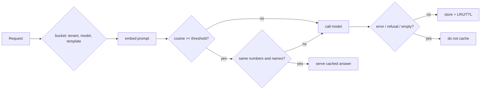

# POC 006: Semantic cache gateway for LLM calls, with a fact guard

**Category:** LLM & RAG | **Stack:** Python, numpy, hashing embedder (POC 047)

## Problem
Support traffic repeats itself in different words, so caching LLM answers by meaning can cut cost and latency. But "refund for order 1042" and "refund for order 2051" are 95% similar and need different answers. This POC builds a semantic cache whose hits are gated by tenant, model, template version, TTL and, crucially, agreement on the numbers and names that decide the answer.

## Approach

- Evaluation set: 120 questions, each with a paraphrase (should hit) and a near-miss twin that differs in one decisive fact (a hit is a wrong answer). The grid reports paraphrase hit rate and false-hit rate for 5 thresholds with and without the fact guard.
- Gateway simulation: 1,000 requests through a wrapped model function, counting model calls, cache stats and wrong answers served; the dollar figure uses an assumed price and illustrates the arithmetic only.
- Isolation and hygiene: per-tenant/model/template buckets, TTL, bounded LRU, refusals and errors never cached.
- The embedder is the lexical hashing stand-in from POC 047, so paraphrase recall is modest; a real embedding model would raise it, and the guard would still be needed.

## Run it
```bash
make demo && make test   # 14 tests
```

## Evidence status
| Claim | Status |
|---|---|
| Hit/false-hit rates with and without the guard, isolation, TTL, LRU, gateway counters | Measured / tested (deterministic, synthetic) |
| Paraphrase recall with a real embedding model; real traffic repeat rates; real cost savings | **Not measured** |

## Results
<!-- RESULTS:START -->

**Results: deterministic, synthetic questions (generated by `make demo`)**
120 questions with one paraphrase each (a hit must return the original's answer) and one near-miss twin each (same wording, different order number or product; a hit whose cached question differs in a decisive fact is a wrong answer). Embedding: hashing unigrams+bigrams (lexical stand-in, no model).

| fact guard | similarity threshold | paraphrase hit rate | false-hit rate on twins |
|---|---|---|---|
| False | 0.500 | 0.525 | 0.658 |
| False | 0.600 | 0.375 | 0.658 |
| False | 0.700 | 0.175 | 0.658 |
| False | 0.800 | 0.067 | 0.650 |
| False | 0.900 | 0.000 | 0.258 |
| True | 0.500 | 0.533 | 0.000 |
| True | 0.600 | 0.375 | 0.000 |
| True | 0.700 | 0.175 | 0.000 |
| True | 0.800 | 0.067 | 0.000 |
| True | 0.900 | 0.000 | 0.000 |

Without the fact guard, every threshold that finds paraphrases also returns another customer's order answer for a near-identical question. With it, false hits fall to zero at the cost of some paraphrase recall.

#### Gateway simulation (1,000 requests, threshold 0.7, guard on)

Model calls: 242 of 1,000; cache stats: {'lookups': 1000, 'hits': 758, 'misses': 242, 'rejected_by_fact_guard': 3487, 'expired': 0, 'evicted': 0, 'not_cached': 0}; estimated tokens saved: 52,281 (about $0.1046 at an assumed $0.002 per 1k tokens: an illustration of the arithmetic, not a measured saving). Answers served from the cache that did not match the question: 0 (should be 0).

<!-- RESULTS:END -->

## Limitations
- Paraphrase recall is low by construction (lexical embedder). Treat the hit-rate column as a lower bound, and the zero false-hit result as the point.
- The fact guard is rule-based (numbers and capitalised names); facts expressed in other ways (dates in words, lower-case product names, negation) are not covered.
- Single process, in-memory; no persistence, no concurrency control, no cache-poisoning defence beyond not caching error-like responses.

## Data and security
Synthetic questions; no network; no real customer data.
