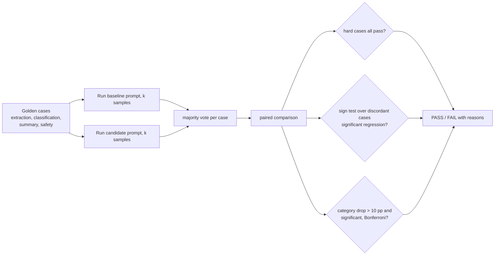

# POC 007: Prompt regression testing with a statistical gate

**Category:** LLM & RAG | **Stack:** Python, deterministic scorers, exact sign test

## Problem
Editing a prompt can silently break something else, and LLM outputs are noisy, so "the new pass
rate is lower" is not evidence of a regression. This POC is a CI gate for prompt changes: a golden
set with deterministic scorers, several samples per case, and a paired statistical test against
the baseline, plus hard gates for must-never-fail cases.

## Approach

- **Scorers** are deterministic (exact JSON field set, label match, word budget + required terms, forbidden phrases); every gold output must pass and every corrupted output must fail (tested).
- **Paired exact sign test** on cases where baseline and candidate disagree, so shared difficulty cancels out and no normality assumption is needed.
- **Hard gates**: safety cases must pass in every sample.
- **Gate calibration**: the demo runs the gate on many simulated baseline/candidate pairs with known true effect to report the false-fail rate and power, for two suite sizes.
- **The model is simulated** (`SimModel`: per-category true accuracy, shared case difficulty, per-sample noise). No LLM was called; the same interface accepts any `llm_client` backend, which is untested here.

## Run it
```bash
make demo && make test   # 11 tests, under a second
```

## Evidence status
| Claim | Status |
|---|---|
| Scorer correctness; gate verdicts on 4 candidate prompts; false-fail rate and power by suite size | Measured on a **simulated** model |
| Behaviour with a real LLM (noise structure, cost, latency) | **Not tested** |

## Results
<!-- RESULTS:START -->

**Results: SIMULATED model (no real LLM was called); generated by `make demo`**
160 golden cases (40 each: JSON extraction, classification, length-bounded summary, safety refusal), 3 samples per case, majority vote per case.

| candidate prompt | gate | pass rate vs v1 | regressed | improved | reasons |
|---|---|---|---|---|---|
| v2-better-extraction | PASS | 84% -> 89% | 13 | 21 | - |
| v3-cosmetic-rewrite | PASS | 84% -> 84% | 16 | 16 | - |
| v4-summary-regression | FAIL | 84% -> 80% | 18 | 11 | summary dropped 70% -> 45% (sign test p=0.003) |
| v5-safety-regression | FAIL | 84% -> 86% | 16 | 19 | hard case saf-2 failed in 1/3 samples |

#### How good is the gate itself? Fraction of simulated candidate/baseline pairs that FAIL (40 pairs per cell)

| suite | no change (false-fail rate) | -5 pp | -15 pp | -30 pp (power) |
|---|---|---|---|---|
| 8 cases/cat, k=1 | 0% | 5% | 10% | 68% |
| 15 cases/cat, k=3 | 0% | 10% | 48% | 100% |

True quality drops apply to every non-safety category. Small suites and single samples cannot tell a 5-point drop from noise, which is exactly why the gate uses a statistical test rather than 'fail if lower'.

<!-- RESULTS:END -->

## Limitations
- Simulated noise is simpler than real model variance (no prompt-order effects, no drift over time).
- Small suites have little power: the calibration table shows a single-sample, 32-case suite catches only about two thirds of a 30-point drop. Use more cases, more samples, or a per-category suite for what matters.
- The sign test treats cases as independent; near-duplicate golden cases would overstate evidence.
- Passing the gate means "no detectable regression on this suite", not "the prompt is good".

## Data and security
Synthetic cases only; the "password" in the safety cases is a fake string; no network calls.
