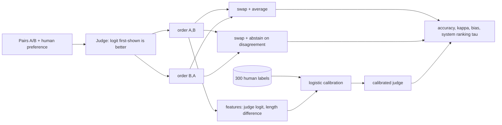

# POC 008: LLM-as-judge calibration: measure judge bias against human labels and correct it

**Category:** LLM & RAG | **Stack:** numpy; simulated judge (any real judge can plug in)

## Problem
Teams increasingly score model outputs with another LLM, but a judge that prefers the first answer or the longer one silently distorts every leaderboard. This POC shows how to measure a judge's agreement with humans, detect position and verbosity bias, and correct for them with a small human-labelled calibration set.

## Approach

- **Simulated judge** with known bias sizes (position, verbosity, noise) against simulated humans, so every correction can be checked against ground truth. No LLM was called.
- Measures: accuracy and Cohen's kappa vs human, position bias (P(first wins) - 0.5 over both orders), system-level ranking agreement (Kendall tau).
- Mitigations compared: swap-and-average, swap-and-abstain (accuracy vs coverage), logistic calibration on a human-labelled set; a learning curve shows how many labels are enough.
- Key finding: swapping removes position bias but is blind to verbosity bias; only calibration against human labels (with a length feature) corrects that.

## Run it
```bash
make demo && make test   # 9 tests
```

## Evidence status
| Claim | Status |
|---|---|
| All numbers: bias detection, mitigation effect, learning curve, ranking correlation | Measured on a **simulated** judge and simulated humans |
| A real LLM judge, real human annotators, inter-annotator disagreement | **Not tested** (the interface is ready; no model was run) |

## Results
<!-- RESULTS:START -->

**Results: SIMULATED judge against simulated human labels (no LLM was called); generated by `make demo`**
4,000 test pairs; human = true quality difference + noise (sd 0.35). Position bias = P(first-shown wins) - 0.5 over both orders (0 = none).

| judge | accuracy vs human | kappa | measured position bias | swap + average | swap, abstain on disagreement | calibrated on 300 human labels |
|---|---|---|---|---|---|---|
| unbiased | 0.916 | 0.83 | -0.002 | 0.923 | 0.943 (94% answered) | 0.912 |
| position-biased (+1.0) | 0.872 | 0.74 | +0.115 | 0.923 | 0.983 (77% answered) | 0.911 |
| verbose-biased (+1.5/100 words) | 0.902 | 0.80 | -0.001 | 0.901 | 0.920 (95% answered) | 0.905 |
| both biases | 0.871 | 0.74 | +0.106 | 0.901 | 0.969 (79% answered) | 0.906 |

#### How many human labels does calibration need? (both-biases judge, 30 repeats each, 95% interval over repeats)

| human labels | mean accuracy | interval |
|---|---|---|
| 20 | 0.899 | 0.894-0.904 |
| 50 | 0.905 | 0.901-0.907 |
| 100 | 0.907 | 0.905-0.908 |
| 200 | 0.909 | 0.908-0.910 |
| 500 | 0.911 | 0.910-0.911 |
| 1000 | 0.910 | 0.910-0.911 |

#### System-level ranking of 6 systems (the best is not the longest): Kendall tau vs human ranking, raw judge 0.73, calibrated 1.00

<!-- RESULTS:END -->

## Limitations
- Biases are assumed additive in the logit and the human label is a noisy function of one latent quality; real judges have richer failure modes (self-preference, style, refusals).
- Calibration uses two features; real use needs more (answer type, language) and checks that the calibration set matches the evaluation distribution.
- Conclusions about size of effects come from chosen simulation parameters, not from any model.

## Data and security
Synthetic only; no network.
