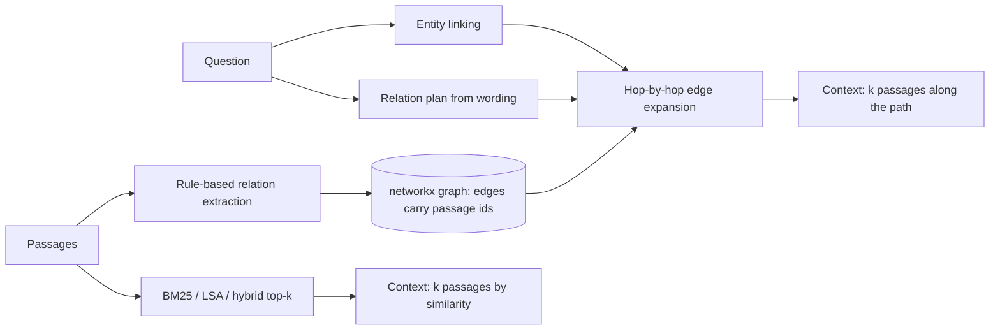

# POC 009: GraphRAG over an entity graph vs plain retrieval

**Category:** LLM & RAG | **Stack:** Python, networkx, retrieval_kit (BM25, LSA); no spaCy, no Neo4j, no LLM

## Problem
Questions such as "who is the CEO of the supplier of the company that acquired X?" need facts that are spread over several passages and do not share words with the question. Similarity search finds the first hop and misses the rest. This POC measures how much an entity graph helps.

## Approach

- Facts (acquired, supplies, CEO, headquarters) are written as passages with three paraphrases each, plus filler distractors; questions need 1, 2 or 3 hops and the gold supporting passages are known.
- Baselines: BM25, an LSA dense retriever and RRF hybrid, all at the same context budget (6 passages).
- Graph retrieval extracts relations by regex, links entities by name, and expands hop by hop. Two variants: edges scored by BM25 against the question, and edges chosen by a relation plan read from the question wording (a rule-based stand-in for an LLM planner).
- Metric is retrieval-level: share of questions whose context holds all gold supporting passages. A degraded-extractor sweep drops relations at random.

## Run it
```bash
make install
make test
make demo
```

## Evidence status
| Claim | Status |
|---|---|
| Retrieval comparison on synthetic multi-hop questions | Real: runs locally, deterministic |
| Answer generation or answer accuracy | Not measured: no LLM is used |
| Relation extraction on real text | Not tested: regex over templated sentences is far easier than real prose |
| Neo4j, spaCy, LLM query planner | Not used; networkx and rules instead |

## Results
<!-- RESULTS:START -->

**Results: multi-hop retrieval on a synthetic corpus (270 passages, 90 questions)**
Metric: share of questions whose retrieved context (top 6 passages) contains ALL gold supporting passages. No generator model is involved, so this measures retrieval only, not answer quality. Relation extraction by regex recovered 210 of 210 true facts (60 passages unmatched, the rest are filler). Edge-loss rows randomly drop extracted relations to mimic a weaker extractor.

| method | 1-hop | 2-hop | 3-hop |
|---|---|---|---|
| bm25 | 0.77 | 0.03 | 0.00 |
| dense_lsa | 0.43 | 0.07 | 0.00 |
| hybrid_rrf | 0.60 | 0.07 | 0.00 |
| graph (BM25 edge scoring), edge loss 0% | 0.57 | 0.27 | 0.20 |
| graph (BM25 edge scoring), edge loss 20% | 0.49 | 0.21 | 0.10 |
| graph (BM25 edge scoring), edge loss 40% | 0.47 | 0.20 | 0.09 |
| graph + relation plan, edge loss 0% | 1.00 | 1.00 | 0.70 |
| graph + relation plan, edge loss 20% | 0.80 | 0.62 | 0.40 |
| graph + relation plan, edge loss 40% | 0.62 | 0.40 | 0.23 |

Caveat: the corpus is templated with three paraphrases per relation, so the rule-based extractor is far more accurate than a real one on messy text.

<!-- RESULTS:END -->

## Limitations
- The query planner is rules matched to the question templates used here; it will not transfer to free-form questions, and direction (supplier of versus supplied by) is not modelled, which caps 3-hop recall below 100% even with a perfect graph.
- Edge-loss rows only drop extracted relations; real extractors also add wrong ones.
- The corpus has 210 facts and about 90 questions: small, so differences of a few points are noise.
- The advantage shown depends on questions that chain through named entities; for single-passage questions plain retrieval is as good or better (BM25 beats the BM25-scored graph variant on 1-hop).
- Indexing cost and latency of building a graph are not measured.

## Data and security
Companies, people and cities are fictional and generated from a seed. No external data or services are used.
