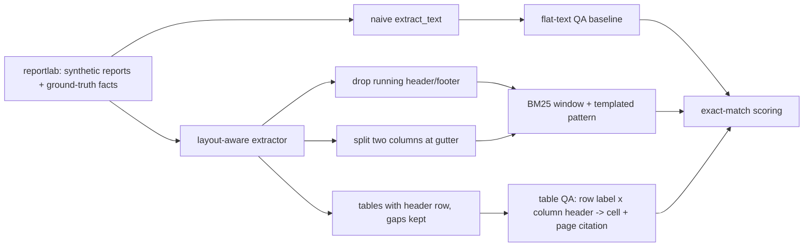

# POC 010: PDF layout and table-aware question answering (no vision model)

**Category:** LLM & RAG | **Stack:** pdfplumber (MIT) for extraction, reportlab (BSD) for synthetic PDFs, BM25; PyMuPDF/unstructured/vision LLM NOT used

## Problem
Dumping PDF text destroys what makes reports readable: two-column prose is interleaved line by line, running headers pollute every page, and tables lose their columns (an empty cell shifts every value after it). This POC compares a naive text dump against a layout-aware extractor (column gutter detection, header/footer removal, ruled-table extraction with empty cells preserved) by answering templated questions against synthetic annual-report PDFs whose facts are known exactly.

## Approach

- Four 4-page PDFs per run: two-column prose with plant facts, a revenue table with deliberately empty and negative `(12.5)` cells, a headcount table, running header and `Page n of 4` footer.
- Layout-aware extraction crops the body between detected margins, removes table regions from prose, splits columns at a detected empty gutter, and returns tables as header + rows with empty cells kept.
- Table answers carry a page citation; empty cells yield *no answer* rather than a shifted neighbour. The baseline maps whitespace-split numbers to headers and so invents values for empty cells.
- QA is rule-based extractive over a small template family: it measures the extraction layer, not language understanding.

## Run it
```bash
make demo PY=python
make test
```

## Evidence status
| Claim | Status |
|---|---|
| Naive vs layout-aware extraction, scored on exact match with known facts | Measured (synthetic PDFs, real pdfplumber) |
| Reading-order, header/footer, table-gap and citation behaviour | Tested |
| Vision-LLM page understanding, scanned/OCR documents, charts, borderless tables, real-world PDFs | NOT implemented / unverified |
| PyMuPDF and unstructured | Not used (PyMuPDF is AGPL; pdfplumber/reportlab are MIT/BSD) |

## Results
<!-- RESULTS:START -->

**Results (measured by `python -m multimodal_doc_qa.main`; 4 synthetic reports x 4 pages, reportlab PDFs, exact match)**
| question kind | extraction | correct | n | accuracy |
|---|---|---|---|---|
| text_open | naive | 6 | 24 | 0.250 |
| text_open | layout | 24 | 24 | 1.000 |
| text_staff | naive | 0 | 24 | 0.000 |
| text_staff | layout | 24 | 24 | 1.000 |
| table_cell | naive | 70 | 86 | 0.814 |
| table_cell | layout | 86 | 86 | 1.000 |
| table_gap | naive | 1 | 10 | 0.100 |
| table_gap | layout | 10 | 10 | 1.000 |

- pages whose extracted text still contains the running header: {'naive': 16, 'layout': 0}
- correct table answers carrying the right page citation: 86/86
- `table_gap` = questions whose cell is empty in the PDF; the correct answer is *no answer*.

<!-- RESULTS:END -->

## Limitations
- The layout-aware extractor is 100% on its own synthetic documents because it was built against the same layout family; do not read this as real-world accuracy.
- Only ruled tables are handled (pdfplumber line detection); borderless or merged-cell tables are not.
- Two-column detection assumes a centred gutter on pages with enough text; irregular layouts will fall back to single-column reading.
- Questions are templated and the reader is regex-based, so this is not a language-model QA evaluation.

## Data and security
Synthetic reports generated with reportlab from a seeded RNG; no real documents.
