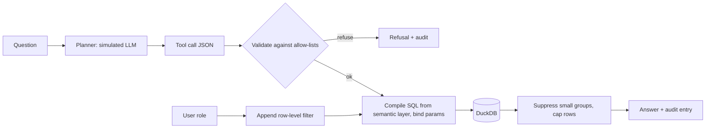

# POC 011: Conversational analytics over governed metrics

**Category:** LLM & RAG | **Stack:** Python, DuckDB (simulated planner; no Streamlit, no LLM)

## Problem
Letting people ask questions in plain language over company data is useful, and dangerous if the model can write SQL: wrong metric definitions, PII exposure, cross-region leaks and injection. The safer pattern is to let the model choose from governed metrics, and compile SQL from a fixed layer.

## Approach

- The semantic layer defines metrics, dimensions and the join once. User text never becomes SQL: only allow-listed metric and dimension names are accepted, and filter values are bound parameters with a strict character set.
- Row-level security is appended after user filters, so a regional manager cannot filter their way into another country. Groups with fewer than 5 customers are suppressed, rows are capped at 50, PII columns are not exposed as dimensions.
- Every call, including refusals, is audited with the compiled SQL but no result values.
- The planner is a keyword-rule stand-in for an LLM, so the tests exercise the part that must hold for ANY planner output: validation and governance.

## Run it
```bash
make install
make test
make demo
```

## Evidence status
| Claim | Status |
|---|---|
| Validation, governed SQL, RLS, suppression, audit | Real: DuckDB executes the compiled queries |
| Answer correctness | 4 headline numbers checked against independently written SQL; others checked structurally |
| Natural-language planning by an LLM | Simulated: not measured |
| Streamlit UI | Not built |
| Hostile tool calls (injection, unknown tools, PII dimensions) | Real tests; all refused or bounded |

## Results
<!-- RESULTS:START -->

**Results: governed conversational analytics on the synthetic retail warehouse**
The natural-language planner is SIMULATED (keyword rules emitting tool-call JSON); no LLM was run and Streamlit was not used. Everything after the planner is real: schema validation, governed metric SQL, parameter binding, row-level security, small-group suppression and the audit log.

| question | user | result | rows | equals independent SQL |
|---|---|---|---|---|
| What is total revenue? | ana | ok | 1 | True |
| revenue by country | ana | ok | 8 | - |
| orders per segment | ana | ok | 3 | - |
| revenue by category in 2024 | ana | ok | 5 | - |
| units by month for Electronics | ana | ok | 24 | - |
| how many customers by country | ana | ok | 8 | - |
| top 3 revenue by country | ana | ok | 3 | - |
| revenue for Japan in 2023 | ana | ok | 1 | True |
| orders in March 2024 | ana | ok | 1 | True |
| revenue by segment for Germany | ana | ok | 2 | - |
| revenue by country | mia | ok | 1 | - |
| total revenue | mia | ok | 1 | True |

Independent-SQL checks: 4/4 match. Adversarial prompts refused: 8/8. Hostile tool calls refused or bounded: 7/7. Manager (Germany) sees countries ['Germany']; asking for Japan returns 0 rows. Tables intact after all attacks: True. Audit entries: 29.

<!-- RESULTS:END -->

## Limitations
- A real LLM may choose wrong metrics or dimensions for ambiguous questions; that error rate is not measured.
- Small-group suppression is a simple threshold and does not stop differencing attacks across several queries.
- Two operators (eq, in) and two-level grouping only: no joins across metrics, ratios, time windows or follow-up questions.
- Authentication is assumed: the user object is supplied by the caller.
- The warehouse is a seeded synthetic retail dataset loaded from SQLite into in-memory DuckDB.

## Data and security
All data is synthetic (fictional customers on example.com). The bot has no write path: the compiled statements are SELECTs only and the semantic layer contains no PII columns.
