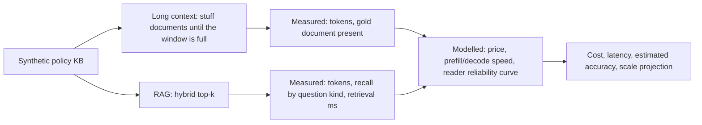

# POC 012: Long-context stuffing vs RAG: cost, latency and accuracy

**Category:** LLM & RAG | **Stack:** Python, retrieval_kit (BM25 + LSA hybrid); cost, latency and reader are modelled

## Problem
Teams ask whether to paste the whole knowledge base into a large context window or retrieve a few passages. The answer depends on corpus size, price, speed and how well the reader copes with long inputs. This harness separates what can be measured offline from what must be assumed.

## Approach

- Measured for real: token counts, whether the gold document reaches the context (long context truncates when the window is too small), retrieval recall by question kind (keyword, natural, paraphrase, typo) and retrieval time.
- Modelled with explicit parameters: price per million tokens, prefill and decode speed, and an accuracy-vs-length reliability curve (none, mild, steep). All are illustrative and exposed in `results.json`.
- Estimated accuracy is gold-in-context times the assumed reliability, not a measured answer accuracy.
- A scale projection extrapolates context size and cost to 100 to 100,000 documents; it does not extrapolate retrieval quality.

## Run it
```bash
make install
make test
make demo
```

## Evidence status
| Claim | Status |
|---|---|
| Context tokens, gold-in-context, retrieval recall and time | Real: measured on the synthetic KB |
| Cost and latency | Modelled from stated assumptions; not vendor prices or measured model speeds |
| Reader accuracy on long contexts | Assumed curves; no LLM was called, so lost-in-the-middle effects are NOT measured |
| Ollama or hosted models | Not run |

## Results
<!-- RESULTS:START -->

**Results: long-context vs RAG on a synthetic policy KB (120 documents, 9671 tokens)**
MEASURED: context token counts, whether the gold document reaches the context, retrieval time. MODELLED (assumptions listed in results.json; illustrative, not vendor prices): cost, latency, and how reader accuracy falls with context length. No LLM was called, so `est_accuracy` = gold-in-context x an assumed reliability curve, not a measured answer accuracy.

| reader degradation assumed | LC tokens | LC est. acc | LC $/1k queries | LC s | RAG tokens | RAG est. acc | RAG $/1k queries | RAG s |
|---|---|---|---|---|---|---|---|---|
| no degradation | 9671 | 1.000 | 9.790 | 2.530 | 235.100 | 0.975 | 0.355 | 0.647 |
| mild (3%/doubling) | 9671 | 0.902 | 9.790 | 2.530 | 235.100 | 0.975 | 0.355 | 0.647 |
| steep (8%/doubling) | 9671 | 0.738 | 9.790 | 2.530 | 235.100 | 0.975 | 0.355 | 0.647 |

RAG retrieval time (measured): 0.3 ms/query; RAG gold-document recall@3 by question kind: {'keyword': 1.0, 'natural': 1.0, 'paraphrase': 0.9, 'typo': 1.0}.

If the corpus does not fit the window (2,000 tokens here), long-context stuffing truncates: gold document present for 23% of questions.

RAG recall@3 as the corpus grows (measured): [{'n_docs': 15, 'rag_recall': 0.944}, {'n_docs': 30, 'rag_recall': 0.903}, {'n_docs': 60, 'rag_recall': 0.931}, {'n_docs': 120, 'rag_recall': 0.975}].

| docs | corpus tokens | fits 128k window | long-ctx $/query | RAG $/1k queries | cost ratio |
|---|---|---|---|---|---|
| 100 | 8059 | True | 0.008 | 0.000 | 23.000 |
| 1000 | 80591 | True | 0.081 | 0.000 | 227.400 |
| 10000 | 805916 | False | None | 0.000 | None |
| 100000 | 8059166 | False | None | 0.000 | None |

The projection extrapolates token counts and cost only; retrieval quality at 10k+ documents is not measured.

<!-- RESULTS:END -->

## Limitations
- Whether long context beats RAG on accuracy flips with the assumed reliability curve; this POC shows where, it does not decide it for a real model.
- The KB is small (96 documents, about 10k tokens); behaviour at 100k+ tokens is projected for cost only.
- No caching or batching effects (prompt caching would change the long-context economics a lot).
- Recall is measured for single-document lookups; multi-document questions favour long context more than shown.
- Token counts use a 4 characters per token heuristic.

## Data and security
All documents and questions are synthetic and seeded. No network calls and no API keys.
