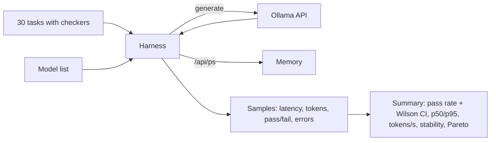

# POC 013: Small-model benchmark harness for Ollama

**Category:** SLM | **Stack:** Python, pandas, OllamaClient; fake Ollama HTTP server for the demo

## Problem
Choosing a small language model for an edge or cost-limited job needs numbers for quality, latency and memory on your own tasks, with uncertainty, not a leaderboard rank. This is a repeatable harness for that comparison.

## Approach

- Tasks: arithmetic, classification, JSON extraction, constrained writing and short reasoning, each with a deterministic checker, all synthetic.
- For every model: skip if not installed, warm up to avoid cold-start bias, run each task several times, record latency, output tokens, errors and text.
- Reports pass rate with a Wilson 95% interval, p50/p95 latency, median tokens/s, loaded memory from `/api/ps` (None if the server does not say; never guessed), output stability across repeats, and a Pareto flag on quality, latency and memory.
- Failures of the server or a model are recorded as failed samples with the error class; an unreachable server skips all models rather than crashing.

## Run it
```bash
make install
make test
make demo      # runs against the built-in fake server
```

## Evidence status
| Claim | Status |
|---|---|
| Harness logic, checkers, statistics, error handling, HTTP path via OllamaClient | Real: tested over HTTP against a local fake server |
| Any real model's quality, latency or memory | NOT measured: no Ollama server or model was available in this environment |
| Demo numbers in Results | From a scripted fake backend; they illustrate the report, nothing more |
| Time to first token | Not measured (non-streaming API) |

## Results
<!-- RESULTS:START -->

**Results: SLM benchmark harness run against a FAKE Ollama server**
WARNING: the backend here is a local fake HTTP server with scripted accuracy, latency and memory. These numbers demonstrate that the harness works; they say nothing about any real model. No real Ollama server or model was available, so the real-model path is UNVERIFIED.

30 tasks x 3 repeats per model. Skipped: {'llama3.2:3b': 'not installed'}.

| model | pass rate | 95% CI | p50 ms | p95 ms | tokens/s | memory MB | Pareto-optimal |
|---|---|---|---|---|---|---|---|
| fake-mid:7b | 0.933 | 0.862-0.969 | 18.200 | 18.700 | 55.600 | 5200.000 | yes |
| fake-small:3b | 0.800 | 0.706-0.87 | 9.000 | 9.800 | 425.300 | 2300.000 | yes |
| fake-wasteful:7b | 0.700 | 0.599-0.785 | 22.100 | 22.700 | 177.200 | 6100.000 | no |
| fake-tiny:1b | 0.633 | 0.53-0.726 | 4.800 | 5.300 | 783.600 | 900.000 | yes |

<!-- RESULTS:END -->

## Limitations
- Run it against a real Ollama install before drawing any conclusion about models; the real-model integration is unverified.
- 30 tasks give wide intervals (roughly +/-8 points); differences between close models are not significant.
- Latency here is wall-clock per non-streaming request and includes server queueing; memory is what the server reports for the loaded model, not process RSS.
- Checkers are strict string/JSON matches, so quality understates models that answer correctly in other phrasing.
- Tasks are small and English only.

## Data and security
Prompts and gold answers are synthetic. The fake server binds to 127.0.0.1 on an ephemeral port and only runs during the demo and tests.
