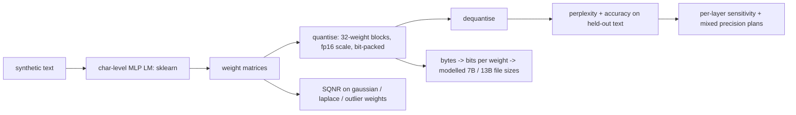

# POC 014: Block-quantisation trade-off study: llama.cpp-style Q8/Q5/Q4/Q3/Q2 formats on a small language model (no LLM, no llama.cpp)

**Category:** SLM | **Stack:** NumPy implementations of llama.cpp-style block formats, scikit-learn char-level MLP language model; llama.cpp, GGUF files and real LLMs NOT used

## Problem
Choosing a quantisation level for an SLM is usually a guess from a model card. The mechanics behind the choice (bits per weight, block scales, how outliers hurt symmetric formats, why the output layer is more sensitive, what mixed precision buys) can be measured directly. This POC implements llama.cpp-style block formats (blocks of 32 weights, fp16 scale; Q8_0, Q5_0/Q5_1, Q4_0/Q4_1, plus plain symmetric 3- and 2-bit variants) with real bit-packing and exact byte accounting, and measures weight reconstruction SQNR and held-out perplexity of a small trained character-level language model under uniform, single-layer and mixed-precision quantisation.

## Approach

- Formats reproduce llama.cpp's published block layouts and sizes: 34, 22, 18, 20 and 24 bytes per 32 weights for Q8_0, Q5_0, Q4_0, Q4_1 and Q5_1 (8.5, 5.5, 4.5, 5.0, 6.0 bits per weight); packing is tested by round-trip. The 3-/2-bit variants are simple symmetric formats defined here, NOT llama.cpp's Q3_K/Q2_K super-block formats.
- Measured: SQNR rises ~6 dB per bit on Gaussian weights; with 0.2% outlier weights the asymmetric Q4_1/Q5_1 beat Q4_0/Q5_0 because one outlier stretches a symmetric block's scale.
- Language model: Q8_0 is indistinguishable from FP32 (+0.01% perplexity), Q5/Q4/Q3S cost about +0.3% to +0.5%, and the 2-bit variant degrades sharply (+18%). Quantising only the output layer hurts most, so 'output layer Q8_0, rest Q4_0' (4.74 bits per weight) matches FP32-level perplexity at about half the size of uniform Q8_0.
- Sizes for hypothetical 7B/13B models are arithmetic from bits per weight (a 7B model: 14 GB at F16, ~7.4 GB Q8_0, ~3.9 GB Q4_0) and are labelled as modelled.

## Run it
```bash
make demo PY=python
make test
```

## Evidence status
| Claim | Status |
|---|---|
| Format byte layouts, bit-packing, error bounds, SQNR behaviour | Tested (35 tests) |
| Perplexity impact of quantisation | Measured on a ~79k-weight character-level MLP trained on synthetic text |
| File sizes of 7B/13B models | MODELLED from bits per weight |
| Real LLM perplexity/benchmark impact, llama.cpp kernels, GGUF files, k-quants and importance matrices, speed or memory-bandwidth effects | NOT measured |

## Results
<!-- RESULTS:START -->

**Results (measured by `python -m gguf_quantisation_study.main`; llama.cpp-style block formats implemented in NumPy on a small char-level MLP language model, NOT an LLM)**
Model: 144,512 weights; FP32 held-out perplexity 1.8939, accuracy 0.7652.

#### Uniform quantisation of all weight matrices

| format | bits/weight | perplexity | vs FP32 | accuracy |
|---|---|---|---|---|
| Q8_0 | 8.500 | 1.894 | +0.01% | 0.766 |
| Q5_0 | 5.500 | 1.899 | +0.26% | 0.764 |
| Q5_1 | 6.000 | 1.893 | -0.03% | 0.765 |
| Q4_0 | 4.500 | 1.903 | +0.48% | 0.763 |
| Q4_1 | 5.000 | 1.903 | +0.49% | 0.763 |
| Q3S | 3.500 | 1.904 | +0.52% | 0.763 |
| Q2S | 2.500 | 2.238 | +18.16% | 0.722 |

#### Weight reconstruction SQNR (dB, higher is better)

| weights | Q8_0 | Q5_0 | Q5_1 | Q4_0 | Q4_1 | Q3S | Q2S |
|---|---|---|---|---|---|---|---|
| gaussian | 45.400 | 27.400 | 28.400 | 21.300 | 22.100 | 15.200 | 8.800 |
| laplace (heavy tail) | 43.500 | 25.400 | 27.000 | 19.400 | 20.800 | 13.500 | 7.800 |
| gaussian + 0.2% outliers (x25) | 40.000 | 22.400 | 26.400 | 18.300 | 19.700 | 15.200 | 11.300 |

#### Sensitivity: only one layer at Q4_0 (perplexity)

- layer 0: 1.8949
- layer 1: 1.8935
- layer 2: 1.8925
- layer 3: 1.9039

#### Mixed precision

| plan | effective bits/weight | perplexity | accuracy |
|---|---|---|---|
| uniform Q4_0 | 4.650 | 1.903 | 0.763 |
| output layer Q8_0, rest Q4_0 | 4.740 | 1.893 | 0.765 |
| uniform Q8_0 | 8.650 | 1.894 | 0.766 |

#### Modelled file sizes (GB) for hypothetical models, from bits per weight only

| model | F16 | Q8_0 | Q5_0 | Q4_0 | Q4_1 | Q2S |
|---|---|---|---|---|---|---|
| 7B params | 14.000 | 7.440 | 4.810 | 3.940 | 4.380 | 2.190 |
| 13B params | 26.000 | 13.810 | 8.940 | 7.310 | 8.120 | 4.060 |

<!-- RESULTS:END -->

## Limitations
- The trained toy MLP differs slightly across CPUs/BLAS builds: a GitHub runner run showed Q2S at +0.24% perplexity where the reference run above shows +18%. On another CI runner Q2S was even better than Q4_0 on this toy model. Tests therefore assert only platform-independent facts (Q8_0 within 0.5% of FP32, bit widths, format mechanics), not these magnitudes; treat the numbers here as one run on one machine.
- A tiny MLP on synthetic text is far more tolerant of low-bit weights than a large transformer, whose activation outliers and attention layers are the real difficulty; the absolute numbers do not transfer, only the mechanics do.
- No activation quantisation, no calibration data and no importance weighting: llama.cpp's K-quant and imatrix methods are not represented.
- Quantisation is applied along the flattened weight order in blocks of 32, which for a matrix means blocks run along rows of the stored layout.
- One training seed; differences below ~0.3% perplexity should be read as noise.

## Data and security
Synthetic text from a seeded word-level Markov source; no external data.
