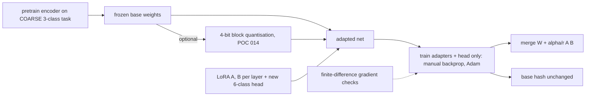

# POC 015: Local variant: QLoRA mechanics for ticket classification on CPU - NumPy LoRA with a 4-bit frozen base (no transformer, PEFT, bitsandbytes or GPU)

**Category:** SLM | **Stack:** NumPy (hand-written backprop), POC 014 block quantisation, scikit-learn baseline; transformers, PEFT, bitsandbytes, GPU and Hugging Face models NOT used

## Problem
Fine-tuning a large model for a narrow task is dominated by memory: optimiser state and gradients for every weight. QLoRA freezes the pretrained weights in 4-bit blocks and trains only small low-rank adapters. Whether that is a good trade, how adapter rank matters, whether adapters can be merged, and whether the base stays untouched are engineering questions that can be answered without a GPU. This POC implements the recipe from scratch on a small MLP encoder for support-ticket classification, with gradient checks, and compares it with a frozen-encoder probe, full fine-tuning and a from-scratch TF-IDF baseline across label budgets.

## Original brief and what this local variant covers
- **Original brief:** QLoRA fine-tune of a small model for support-ticket classification (PEFT, transformers, MLflow).
- **Original engineering objective:** Fine-tune a pretrained transformer cheaply: freeze and 4-bit-quantise the base, train low-rank adapters, compare with full fine-tuning, merge adapters for deployment, track runs.
- **Covered here (real, tested):** The QLoRA mechanics (frozen quantised base, adapters, merging, memory arithmetic, gradient correctness) on a small NumPy MLP.
- **Not covered / not verified:** Any transformer, PEFT, bitsandbytes NF4, GPU training or MLflow tracking. No claim about real language models is made.
- **Status:** local, educational variant; mocks and stand-ins are labelled in the Evidence status table below.

## Approach

- Layers compute `h W + b + (alpha/r) (h A) B`; B starts at zero so the adapter is an exact no-op (tested). In QLoRA mode W is stored packed (Q4_0, 4.5 bits per weight) and dequantised on the fly; gradients flow through it to earlier adapters but never update it.
- All gradients are hand-derived and verified against central finite differences in float64 for full, LoRA, QLoRA and linear-probe modes.
- The experiment grid varies labelled tickets (30-240), five seeds, and adapter rank; the baseline is TF-IDF + logistic regression trained from scratch on the same labels.
- Findings are in Results. In short: QLoRA matches LoRA within noise at 7x less base memory; merging is lossless; but on this easy task adapters do not beat the from-scratch TF-IDF baseline or full fine-tuning, because the coarse pretraining gives little useful structure.
- An optional Hugging Face recipe (`optional_peft.py`) maps the same rank/alpha onto PEFT + bitsandbytes NF4; it is not run here and fails closed when its dependencies are missing.

## Run it
```bash
make test PY=python
make demo PY=python   # several minutes; DEMO_QUICK=1 shortens it
```

## Evidence status
| Claim | Status |
|---|---|
| LoRA/QLoRA training, merging, 4-bit packed base, gradient correctness | real, NumPy on CPU |
| Accuracy numbers | measured on synthetic tickets (phrase templates with confusable phrases): they say nothing about real tickets or transformers |
| Comparison with transformers/PEFT/bitsandbytes NF4 and GPU memory | NOT RUN - unverified |
| optional_peft.py recipe | NOT RUN (dependencies absent); only its configuration and fail-closed behaviour are tested |

## Results
<!-- RESULTS:START -->

**Results (POC 015: REAL NumPy LoRA/QLoRA training on CPU; synthetic tickets; no transformer, PEFT, bitsandbytes or GPU)**
Encoder pretrained on a 3-way COARSE task (train accuracy 0.9663), then adapted to the 6-way FINE ticket task with few labels. Test: 2,000 unseen synthetic tickets. The generator has confusable phrases, so about 0.75 is the ceiling.

#### Accuracy by number of labelled tickets (mean +/- std over seeds)

| labels | tfidf+LR (no pretraining) | linear_probe | lora | qlora | full |
|---|---|---|---|---|---|
| 30 | 0.509 +/- 0.051 | 0.412 +/- 0.021 | 0.527 +/- 0.030 | 0.528 +/- 0.031 | 0.545 +/- 0.048 |
| 60 | 0.652 +/- 0.026 | 0.441 +/- 0.029 | 0.608 +/- 0.033 | 0.608 +/- 0.033 | 0.657 +/- 0.021 |
| 120 | 0.747 +/- 0.014 | 0.499 +/- 0.017 | 0.688 +/- 0.017 | 0.685 +/- 0.018 | 0.733 +/- 0.011 |
| 240 | 0.761 +/- 0.007 | 0.540 +/- 0.027 | 0.722 +/- 0.007 | 0.722 +/- 0.007 | 0.747 +/- 0.003 |

Trainable parameters: linear_probe: 774, lora: 14,086, qlora: 14,086, full: 296,070.

#### LoRA rank sweep (120 labels)

| rank | 1 | 2 | 4 | 8 | 16 |
|---|---|---|---|---|---|
| accuracy | 0.627 | 0.644 | 0.670 | 0.688 | 0.678 |

#### Memory of the frozen base (bytes)

| fp32 base | Q4_0 packed base | ratio | LoRA adapters (fp32) | head (fp32) |
|---|---|---|---|---|
| 1181184 | 167424 | 7.1x | 53248 | 3096 |

#### Merging and immutability

| check | value |
|---|---|
| acc_lora | 0.687 |
| acc_merged | 0.687 |
| acc_qlora_adapter | 0.684 |
| acc_qlora_merged_dense | 0.684 |
| acc_qlora_merged_requantised_q4 | 0.684 |
| max_abs_logit_diff_lora_vs_merged | 5.72e-06 |
| pretrained base byte-identical after adapter training | True |

<!-- RESULTS:END -->

## Limitations
- A bag-of-hashed-ngrams MLP is not a transformer: LoRA on attention projections, NF4 quantisation and double quantisation, paged optimisers and gradient checkpointing are not exercised.
- The quantiser is POC 014's Q4_0 (llama.cpp-style), not bitsandbytes NF4.
- The pretraining task is deliberately coarse; the finding that adapters do not beat a from-scratch linear model is specific to this easy synthetic task.
- Synthetic data with a known ceiling of about 0.75; no real support tickets.
- MLflow tracking from the original brief is not included.

## Data and security
Synthetic tickets only (POC 016 generator); no downloads, no network, no credentials.
