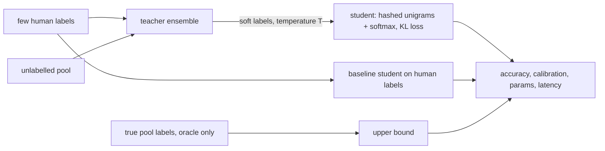

# POC 016: Distilling a heavy teacher's labels into a tiny task model (scikit-learn ensemble teacher; no transformers)

**Category:** SLM | **Stack:** scikit-learn ensemble teacher, NumPy softmax-regression student with a hand-written soft-label loss; transformers, LLMs and GPUs NOT used

## Problem
Labelling thousands of support tickets by hand is expensive, and serving a heavy classifier on every ticket is slow. Distillation trains a small, fast model on a stronger model's predictions over unlabelled data. This POC compares a soft-voting teacher (word 1-3-gram TF-IDF logistic regression, naive Bayes, SVD plus gradient boosting; trained on a few hundred human labels) with a 12k-parameter hashed-unigram softmax student trained (a) on the human labels, (b) on the teacher's hard labels, (c) on its temperature-softened probabilities with a KL loss, and (d) on the true labels of the pool as an oracle bound, on synthetic tickets whose categories share confusable phrases.

## Approach

- The student's loss is implemented from scratch (softmax cross-entropy against a target distribution, Adam, L2) and its gradient is checked against finite differences; one-hot targets reproduce ordinary training.
- A leakage test corrupts the pool's true labels and verifies that every distilled student is unchanged while only the oracle changes.
- Results over 3 seeds with 250 human labels: teacher 0.738, student on human labels 0.740, distilled students 0.750-0.753, oracle 0.770 (the ceiling is set by the deliberately confusable phrases). The student is ~9x faster per ticket than the ensemble and much smaller.
- The benefit grows as human labels shrink: with 80 labels the distilled student reaches 0.669 vs 0.621 for the student on human labels and 0.652 for the teacher.
- Temperature softening (T=2, 4) did not improve accuracy and badly hurt calibration (ECE 0.16 and 0.37 vs 0.04 at T=1) because the student is trained on softened targets but evaluated at T=1: use T=1 here or re-scale logits.

## Run it
```bash
make demo PY=python   # about 3 minutes (the label-budget sweep trains many students)
make test
```

## Evidence status
| Claim | Status |
|---|---|
| Distillation loss correctness, leakage guard, determinism, teacher/student comparison, label-budget sweep | Tested (9 tests) and measured on synthetic data |
| Distilling a real LLM or transformer into a small language model | NOT done: the 'large model' is a scikit-learn ensemble and the task is template-generated tickets |
| Real support tickets, multilingual text, class imbalance, free-text noise | Not covered |
| The student exceeding the teacher | Observed on this data (about +1 point); it can happen with a smoother model and more unlabelled data, and should not be assumed in general |

## Results
<!-- RESULTS:START -->

**Results (measured by `python -m llm_to_slm_distillation.main`; synthetic tickets, scikit-learn ensemble teacher, NumPy student; 3 seeds)**
250 human-labelled tickets, 6000 unlabelled pool tickets, 2000 test tickets, 6 categories.

| model | test accuracy (mean +/- std) | ECE | student parameters | ms / ticket |
|---|---|---|---|---|
| teacher | 0.738 +/- 0.004 | 0.078 | ensemble | 0.088 |
| student on human labels only | 0.740 +/- 0.012 | 0.057 | 12294.000 | 0.010 |
| student on teacher HARD labels (pool) | 0.753 +/- 0.002 | 0.104 | 12294.000 | 0.010 |
| student on teacher SOFT labels, T=1 (pool) | 0.752 +/- 0.003 | 0.037 | 12294.000 | 0.012 |
| student on teacher SOFT labels, T=2 (pool) | 0.750 +/- 0.003 | 0.162 | 12294.000 | 0.010 |
| student on teacher SOFT labels, T=4 (pool) | 0.750 +/- 0.003 | 0.372 | 12294.000 | 0.010 |
| student on human labels + soft pool | 0.747 +/- 0.004 | 0.150 | 12294.000 | 0.010 |
| oracle: student on true labels of the pool | 0.770 +/- 0.010 | 0.031 | 12294.000 | 0.010 |

#### Effect of the human-label budget (2 seeds; accuracy)

| human labels | teacher | student, human labels only | student, distilled (soft, T=1) | oracle student |
|---|---|---|---|---|
| 40 | 0.559 | 0.551 | 0.566 | 0.768 |
| 80 | 0.652 | 0.621 | 0.669 | 0.768 |
| 160 | 0.712 | 0.711 | 0.725 | 0.768 |
| 320 | 0.744 | 0.752 | 0.757 | 0.768 |

<!-- RESULTS:END -->

## Limitations
- The accuracy ceiling (0.77) comes from synthetic confusable phrases, so the gaps between methods are small (a few points); real data would need a larger study with confidence intervals per class.
- Three seeds give a rough spread only; the budget sweep uses two seeds.
- Teacher and student see the same bag-of-words information, so distillation here transfers decision-boundary smoothness, not new knowledge; with an LLM teacher the transferred knowledge could be far larger.
- Latency numbers are single-process scikit-learn/NumPy timings on a shared machine.

## Data and security
Synthetic tickets from template phrases and a seeded RNG; no external data.
