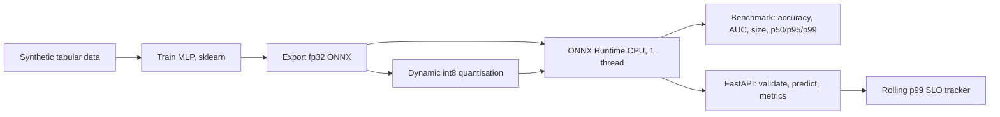

# POC 017: Quantised ONNX model served on CPU with latency SLOs

**Category:** SLM | **Stack:** Python, scikit-learn, ONNX Runtime (CPU), skl2onnx, FastAPI

## Problem
An edge or low-cost deployment has no GPU and a latency budget. This POC takes a trained model through ONNX export and int8 dynamic quantisation, checks that accuracy survives, measures CPU latency honestly, and serves it behind a validated API that tracks a rolling p99 SLO.

## Approach

- A 256-128 MLP is trained on a synthetic 20-feature task with interactions, exported with skl2onnx and quantised with ONNX Runtime's dynamic int8 quantiser.
- Equivalence checks: the fp32 ONNX probabilities match scikit-learn to within 1e-4; the int8 model is compared on accuracy, AUC and decision agreement.
- Latency is measured warm, single thread, at batch 1 and 32, as p50/p95/p99; the HTTP layer is measured in-process.
- The service validates shape, finiteness, magnitude and batch size, returns 422 for bad input and a generic 500 for internal errors, and exposes `/metrics` with the rolling p99 versus its budget.

## Run it
```bash
make install   # also: pip install -r ../../requirements-edge.txt
make test
make demo
```

## Evidence status
| Claim | Status |
|---|---|
| ONNX export, int8 quantisation, accuracy/size/latency comparison | Real: ONNX Runtime executes on this CPU |
| HTTP service behaviour and SLO tracker | Real, tested in-process with FastAPI TestClient |
| Network latency, real edge hardware (ARM, Raspberry Pi), concurrency under load | Not measured |
| Large models, transformers, per-channel or static quantisation | Not covered |

## Results
<!-- RESULTS:START -->

**Results: MLP served on CPU through ONNX Runtime (one thread)**
Synthetic 20-feature binary task, 1500 held-out rows; latencies are wall-clock on this machine and vary run to run.

| variant | accuracy | AUC | max abs diff vs sklearn | size KB | batch=1 p50 ms | batch=1 p99 ms | batch=32 p50 ms |
|---|---|---|---|---|---|---|---|
| sklearn fp32 | 0.836 | 0.914 | 0.000 | - | 0.238 | 0.469 | 0.343 |
| onnx fp32 | 0.836 | 0.914 | 0.000 | 151.400 | 0.029 | 0.113 | 0.081 |
| onnx int8 (dynamic) | 0.837 | 0.914 | 0.032 | 42.500 | 0.040 | 0.224 | 0.061 |

HTTP service (in-process TestClient, int8 model, 400 single-row requests): p50 0.426 ms, p95 0.601 ms, p99 0.738 ms against a 50.0 ms p99 budget: SLO met = True. This excludes network and process-boundary cost.

<!-- RESULTS:END -->

## Limitations
- The model is tiny, so int8 reduces size (about 3.5x) but is not faster than fp32 here; quantisation speed-ups need larger layers or hardware with int8 support.
- Latencies depend on the machine and vary run to run; the table is a snapshot, and tests only assert ordering and loose bounds.
- The SLO tracker measures model time inside the request handler, not queueing, serialisation or network.
- Single process, single thread: no worker pool, batching across requests or autoscaling.
- Synthetic data: accuracy numbers say nothing about a real task.

## Data and security
Data is synthetic and seeded. Model artefacts are written to a temporary directory and not committed. The API caps batch size, rejects non-finite values and does not expose stack traces.
