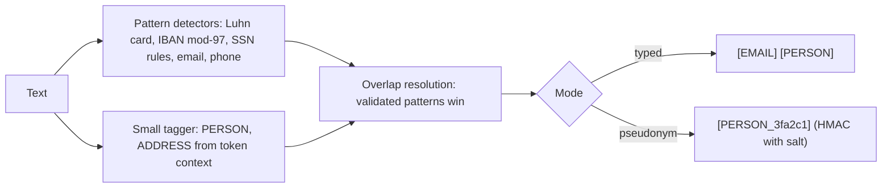

# POC 018: PII detection and redaction for free text

**Category:** SLM | **Stack:** Python, scikit-learn tagger (small trained model), validated pattern detectors from POC 034; Presidio and spaCy not used

## Problem
Support tickets, chat logs and notes contain names, addresses, emails, phone numbers, card and ID numbers. Before text goes to an LLM, an analytics store or a vendor it must be redacted, locally and cheaply. This POC combines checksum-validated pattern detectors with a tiny trained tagger and measures where each works and where it does not.

## Approach

- Structured PII is found by detectors with validation (Luhn, mod-97, SSN rules), which removes false positives on look-alike numbers.
- Names and street addresses come from a logistic-regression tagger on context features (capitalisation, neighbouring words, street words). Token identity features are deliberately left out of the final model because they memorise training names.
- Overlaps are resolved by priority (a name-like email local part stays one EMAIL span). Redaction is either typed placeholders or salted-HMAC pseudonyms that stay consistent within and across texts for the same salt.
- Evaluation separates three conditions: seen names, unseen names with familiar sentence structures, and unseen names with unseen structures.

## Run it
```bash
make install
make test
make demo
```

## Evidence status
| Claim | Status |
|---|---|
| Structured PII detection and redaction (card, IBAN, SSN, email, phone) | Real, exact on synthetic text including held-out sentence structures |
| Street addresses | Real: high on the synthetic formats used; real addresses vary far more |
| Person names | Weak outside familiar sentence structures: see Results (F1 well below 0.6 on new templates); a real NER model is needed and was not available |
| Presidio, spaCy, transformer NER, on-device latency on edge hardware | Not run |

## Results
<!-- RESULTS:START -->

**Results: hybrid PII redaction on synthetic text (names in the test set were never seen in training)**
Hybrid = validated pattern detectors (Luhn, IBAN mod-97, SSN rules, email, phone) from POC 034 plus a small logistic-regression tagger for person names and street addresses. 'Patterns only' is the same pipeline without the tagger. No Presidio, spaCy or neural NER was used.

| type | unseen names: P | R | unseen names + new templates: P | R | patterns-only P | R | support |
|---|---|---|---|---|---|---|---|
| PERSON | 1.000 | 1.000 | 0.342 | 0.243 | 0.000 | 0.000 | 719 |
| ADDRESS | 1.000 | 1.000 | 0.962 | 0.962 | 0.000 | 0.000 | 151 |
| EMAIL | 1.000 | 1.000 | 1.000 | 1.000 | 1.000 | 1.000 | 176 |
| PHONE | 1.000 | 1.000 | 1.000 | 1.000 | 1.000 | 1.000 | 151 |
| CREDIT_CARD | 1.000 | 1.000 | 1.000 | 1.000 | 1.000 | 1.000 | 90 |
| IBAN | 1.000 | 1.000 | 1.000 | 1.000 | 1.000 | 1.000 | 90 |
| US_SSN | 1.000 | 1.000 | 1.000 | 1.000 | 1.000 | 1.000 | 69 |

Character-level PII leak rate: unseen names 0.0, unseen names AND unseen sentence templates 0.2396, patterns only 0.4818. The near-perfect 'unseen names' column reflects test sentences that reuse the training templates; the held-out-template column is the fairer estimate. A variant that also uses token identity and suffix features (identity features) scores PERSON recall 0.812 on unseen names but 1.0 on names seen in training: it memorises names. Over-redaction of non-PII characters: 0.0. Seen-name leak rate: 0.0. Throughput on one CPU core: about 830.2 texts per second.

Hard cases (obfuscation, lowercase names) the system is expected to miss:

| input | redacted |
|---|---|
| reach me at john [at] example [dot] com tonight | reach me at john [at] example [dot] com tonight |
| call five five five 123 4567 after noon | call five five five [PHONE]after noon |
| mail JOHN.SMITH@EXAMPLE.COM now | mail [EMAIL] now |
| my friend maria gonzalez lives at 12 baker street | my friend maria gonzalez lives at 12 baker street |
| Contact: Ana Ng (ana.ng@example.com), 555-123-4567 | Contact: [PERSON] ([EMAIL]), [PHONE] |

<!-- RESULTS:END -->

## Limitations
- The tagger trains on templated synthetic sentences, so it learns the templates. On unseen names in familiar sentences it is near-perfect; on unseen sentence structures it misses most names. Do not use it as the name detector for real data.
- Names at the start of a sentence are the hardest case for the context-only model and can be left half-redacted.
- Obfuscated PII ("john [at] example [dot] com", spelled-out digits), lowercase names, non-Latin scripts and non-US formats are not handled; tests pin these misses.
- Pseudonyms are consistent within a salt but are not a privacy guarantee: short, guessable values can be recovered by someone who holds the salt.
- All numbers come from synthetic text with reserved example domains and 555 phone numbers.

## Data and security
No real personal data is used or stored. Redaction returns spans and offsets only; the pseudonym salt must be supplied by the caller (minimum 8 bytes) and is never logged.
