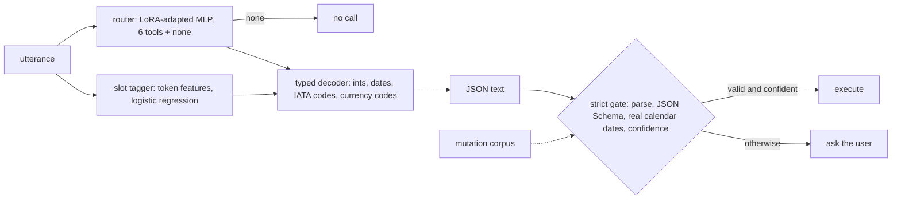

# POC 019: Local variant: reliable tool calling on CPU - LoRA router, slot tagger and strict JSON-Schema gate (no language model generates the calls)

**Category:** SLM | **Stack:** NumPy LoRA router (POC 015 code), scikit-learn tagger, jsonschema; language models, PEFT and GPU NOT used

## Problem
An agent that calls tools must emit calls that parse, satisfy the tool schema and mean what the user asked. Failures are of three kinds with different costs: malformed or schema-invalid calls (cheap to catch), valid but wrong calls (dangerous), and calls where the right answer was none. This POC builds a small tool-calling system on CPU (router, slot tagger, typed decoder) and a strict gate in front of the executor, then measures all three failure kinds on paraphrases the system was never trained on, with and without the gate, against a keyword/regex baseline.

## Original brief and what this local variant covers
- **Original brief:** Fine-tune a small model for reliable tool/function calling (PEFT, JSON-schema evaluation).
- **Original engineering objective:** Make an SLM emit tool calls that parse, satisfy the schema and match intent, and measure that reliability on unseen phrasing.
- **Covered here (real, tested):** The reliability engineering around tool calls: schema catalogue, strict gate, mutation tests, failure taxonomy (invalid / wrong-but-valid / hallucinated), seen-vs-unseen evaluation, with a LoRA-adapted router and slot tagger as the learned component.
- **Not covered / not verified:** Fine-tuning a language model, free-form JSON generation, constrained decoding inside a model. No language model is involved.
- **Status:** local, educational variant; mocks and stand-ins are labelled in the Evidence status table below.

## Approach

- Six tools with JSON Schemas (enums, integer ranges, email and date formats, IATA and currency patterns, `additionalProperties: false`) and an abstention class.
- Training and test utterances come from DISJOINT template families; a third family is available as augmentation, so the effect of wording diversity is measured separately from model choice.
- The gate never repairs: it parses, validates against the schema, checks that dates exist on the calendar, and (for the tuned system) requires router confidence; anything else becomes a clarification.
- A mutation corpus (dropped required keys, extra keys, wrong types, bad tool names, out-of-range values, impossible dates, malformed raw text) must be rejected 100%.
- Findings are in Results: the gate removes invalid calls entirely at the price of many clarifications on unseen phrasing; schema validity does not catch valid-but-wrong calls; adding one more wording family is worth more than the choice between LoRA and a from-scratch router.

## Run it
```bash
make test PY=python
make demo PY=python   # several minutes; DEMO_QUICK=1 shortens it
```

## Evidence status
| Claim | Status |
|---|---|
| Router/tagger training, decoding, gate, mutation tests | real, CPU |
| Accuracy and failure-mode rates | measured on synthetic template-generated utterances: they say nothing about real users or language models |
| "baseline" | a keyword/regex matcher written for this POC, NOT a prompted language model |
| Fine-tuning a language model, free-form JSON generation, constrained decoding inside a model, PEFT, GPU | NOT RUN - unverified |

## Results
<!-- RESULTS:START -->

**Results (POC 019: REAL CPU training of a LoRA router + slot tagger + strict schema gate on synthetic utterances; no language model)**
6 tools with JSON Schemas plus abstention; templates for training and testing are DISJOINT families ('unseen templates' = paraphrases never trained on). Averaged over seeds; 200 labelled utterances unless stated.

#### Keyword/regex baseline (stands in for an untuned, prompted model)

| test | tool_accuracy | exact_call_rate | invalid_call_rate | wrong_but_valid_rate | hallucinated_calls | clarify_rate |
|---|---|---|---|---|---|---|
| seen templates | 0.992 | 0.240 | 0.673 | 0.079 | 5 | 0.000 |
| unseen templates | 0.840 | 0.164 | 0.771 | 0.020 | 7 | 0.000 |

#### Tuned router + tagger, 200 labelled utterances


**router: lora**

| train templates | policy | test | tool_accuracy | exact_call_rate | invalid_call_rate | wrong_but_valid_rate | hallucinated_calls | clarify_rate |
|---|---|---|---|---|---|---|---|---|
| train | tuned | seen templates | 0.986 | 0.976 | 0.024 | 0.000 | 1.667 | 0.000 |
| train | tuned | unseen templates | 0.663 | 0.125 | 0.711 | 0.157 | 2.333 | 0.000 |
| train | gated | seen templates | 0.974 | 0.975 | 0.000 | 0.000 | 0.000 | 0.026 |
| train | gated | unseen templates | 0.345 | 0.119 | 0.000 | 0.555 | 0.000 | 0.633 |
| train+aug | tuned | seen templates | 0.970 | 0.944 | 0.041 | 0.015 | 2.000 | 0.000 |
| train+aug | tuned | unseen templates | 0.622 | 0.334 | 0.576 | 0.071 | 3.000 | 0.000 |
| train+aug | gated | seen templates | 0.958 | 0.942 | 0.000 | 0.016 | 0.000 | 0.042 |
| train+aug | gated | unseen templates | 0.445 | 0.320 | 0.000 | 0.173 | 0.000 | 0.509 |

**router: scratch**

| train templates | policy | test | tool_accuracy | exact_call_rate | invalid_call_rate | wrong_but_valid_rate | hallucinated_calls | clarify_rate |
|---|---|---|---|---|---|---|---|---|
| train | tuned | seen templates | 0.997 | 0.986 | 0.014 | 0.000 | 1.667 | 0.000 |
| train | tuned | unseen templates | 0.803 | 0.137 | 0.605 | 0.229 | 2.333 | 0.000 |
| train | gated | seen templates | 0.985 | 0.986 | 0.000 | 0.000 | 0.000 | 0.015 |
| train | gated | unseen templates | 0.316 | 0.066 | 0.000 | 0.711 | 0.000 | 0.548 |
| train+aug | tuned | seen templates | 0.996 | 0.973 | 0.011 | 0.015 | 2.000 | 0.000 |
| train+aug | tuned | unseen templates | 0.829 | 0.456 | 0.360 | 0.119 | 3.000 | 0.000 |
| train+aug | gated | seen templates | 0.986 | 0.973 | 0.000 | 0.016 | 0.000 | 0.014 |
| train+aug | gated | unseen templates | 0.532 | 0.379 | 0.000 | 0.206 | 0.000 | 0.362 |

#### Schema gate audit

527/527 valid gold calls accepted; 446/446 guaranteed-invalid mutations rejected ({'bad_tool': '90/90', 'drop_required': '101/101', 'wrong_type': '79/79', 'extra_key': '90/90', 'out_of_range': '27/27', 'bad_format': '59/59'}); 13/13 malformed raw outputs rejected (truncated, single-quoted, trailing comma, chatty prefix, markdown fence, wrong types, oversize).

<!-- RESULTS:END -->

## Limitations
- No language model is involved, so JSON validity cannot fail "naturally": raw-output corruption is only tested through the mutation corpus.
- Templates are synthetic and small; "unseen templates" are still from the same generator and vocabulary.
- LoRA did not beat a from-scratch router here; the pretraining signal is weak by construction.
- Dates use a fixed year and a small month/day grammar; relative dates ("next Friday") are not handled.
- Valid-but-wrong calls are not caught by schema validation and remain the main residual risk.

## Data and security
Synthetic utterances only; no network, no real tool execution, no credentials.
