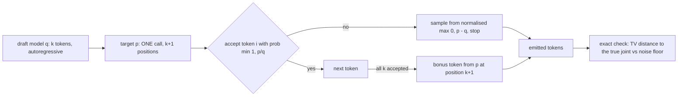

# POC 020: Speculative decoding on toy language models: losslessness and speed-up (NumPy; llama.cpp/transformers not used)

**Category:** SLM | **Stack:** NumPy toy trigram target and drafts; no real LLM, llama.cpp or transformers

## Problem
Speculative decoding promises faster generation with identical output distribution, but implementations often get the acceptance rule or the residual sampling wrong, and speed-up claims ignore that a weak draft makes things slower. This POC implements the algorithm (draft k tokens, verify all positions in one target call, accept with probability min(1, p/q), resample from the normalised residual on rejection, bonus token when everything is accepted) on a toy trigram target whose exact distributions are known, so losslessness can be checked exactly, and measures acceptance, tokens per target call and modelled speed-up against draft quality and lookahead k.

## Approach

- Greedy mode accepts a draft token only if it equals the target's argmax, and the output is identical to greedy target decoding for every draft (tested for five drafts and k in {1,3,7}).
- Sampling mode is lossless: the total-variation distance between the empirical first-two-token distribution and the exact target joint sits at the sampling-noise floor for every draft, including a near-uniform one; a single-step test with arbitrary p and q checks the residual rule directly.
- Measured tokens per target call equal the geometric-series theory (1 - alpha^(k+1)) / (1 - alpha) to within sampling error once alpha is estimated per examined token.
- Modelled speed-up divides tokens per call by (1 + k * c) with an assumed draft/target cost ratio c = 0.08: a close draft (alpha 0.93) gives about 3.3x at k=4, a mediocre one 2.5x, and a poor bigram draft is slower than no speculation (0.9x) at k=8.

## Run it
```bash
make demo PY=python
make test
```

## Evidence status
| Claim | Status |
|---|---|
| Algorithm correctness: greedy equivalence, distributional losslessness, residual sampling, zero-probability proposals, k=0 | Tested (17 tests; exact distributions on a toy model) |
| Acceptance and tokens per call vs theory | Measured |
| Wall-clock speed-up | MODELLED from call counts with an assumed draft cost ratio; no real model was timed |
| Real LLM draft/target pairs, KV-cache effects, batching, llama.cpp or transformers implementations, GPU timings | NOT verified |

## Results
<!-- RESULTS:START -->

**Results (measured by `python -m speculative_decoding_demo.main`; toy trigram target and bigram drafts in NumPy; speed-up is MODELLED from call counts)**
Vocabulary 30; draft pass cost assumed 0.08 of a target pass (modelled).

#### Losslessness: TV distance of the first-2-token distribution from the exact target (k=4)

| draft | TV distance |
|---|---|
| exact copy | 0.025 |
| noisy copy (sigma 0.2) | 0.023 |
| noisy copy (sigma 0.6) | 0.021 |
| bigram summary | 0.021 |
| near-uniform bigram | 0.021 |

Sampling noise floor for the same number of samples: 0.0214 (a lossless sampler should sit at about this level).

Greedy speculative decoding identical to greedy target decoding for every draft: **True**

#### Acceptance, tokens per target call and modelled speed-up

| draft | k | acceptance | tokens / target call | theory | modelled speed-up |
|---|---|---|---|---|---|
| exact copy | 1 | 1.000 | 2.000 | 2.000 | 1.850 |
| exact copy | 2 | 1.000 | 3.000 | 3.000 | 2.590 |
| exact copy | 4 | 1.000 | 5.000 | 5.000 | 3.790 |
| exact copy | 8 | 1.000 | 9.000 | 9.000 | 5.490 |
| noisy copy (sigma 0.2) | 1 | 0.931 | 1.930 | 1.930 | 1.790 |
| noisy copy (sigma 0.2) | 2 | 0.927 | 2.790 | 2.790 | 2.400 |
| noisy copy (sigma 0.2) | 4 | 0.931 | 4.350 | 4.350 | 3.300 |
| noisy copy (sigma 0.2) | 8 | 0.931 | 6.910 | 6.860 | 4.190 |
| noisy copy (sigma 0.6) | 1 | 0.801 | 1.800 | 1.800 | 1.670 |
| noisy copy (sigma 0.6) | 2 | 0.797 | 2.430 | 2.430 | 2.100 |
| noisy copy (sigma 0.6) | 4 | 0.788 | 3.280 | 3.280 | 2.490 |
| noisy copy (sigma 0.6) | 8 | 0.793 | 4.250 | 4.230 | 2.580 |
| bigram summary | 1 | 0.333 | 1.330 | 1.330 | 1.230 |
| bigram summary | 2 | 0.338 | 1.450 | 1.450 | 1.250 |
| bigram summary | 4 | 0.330 | 1.490 | 1.490 | 1.130 |
| bigram summary | 8 | 0.332 | 1.500 | 1.500 | 0.910 |
| near-uniform bigram | 1 | 0.308 | 1.310 | 1.310 | 1.210 |
| near-uniform bigram | 2 | 0.304 | 1.400 | 1.400 | 1.200 |
| near-uniform bigram | 4 | 0.310 | 1.450 | 1.450 | 1.100 |
| near-uniform bigram | 8 | 0.316 | 1.460 | 1.460 | 0.890 |

<!-- RESULTS:END -->

## Limitations
- Toy trigram models stand in for real LLMs: acceptance rates of real draft/target pairs depend on text and model families and are not predicted by this POC.
- The speed-up model ignores verification cost growth with k, memory-bandwidth effects and batching, which dominate real deployments.
- Losslessness is verified on the first two tokens (exact enumeration is only feasible for short prefixes), and by construction for the rest.
- Only a trigram target with a seeded random table is used; no tokenizer, no sampling truncation (top-k/top-p) or temperature handling beyond argmax/ancestral sampling.

## Data and security
Synthetic seeded probability tables; no data files.
