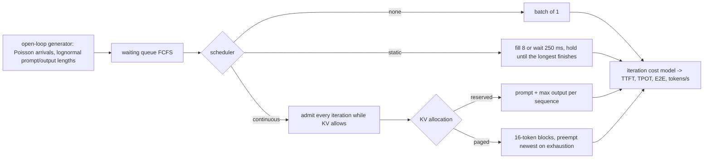

# POC 021: LLM serving scheduling study: static vs continuous batching and paged KV cache in a discrete-event model (vLLM, Locust and GPUs not used)

**Category:** SLM | **Stack:** Python discrete-event model with an assumed GPU cost model; vLLM, Locust, GPUs and real models NOT used

## Problem
The headline claims for LLM serving engines (continuous batching, PagedAttention) are about scheduling and memory, not about any one kernel. This POC models an engine as prefill plus decode iterations with an assumed cost model (decode iteration time = a + b x batch size, prefill time proportional to prompt tokens) and a token-counted KV cache, and compares four configurations under an open-loop Poisson load: no batching, static batching, continuous batching with up-front KV reservation and continuous batching with paged (16-token block) allocation and preemption. It reports throughput, time-to-first-token, time-per-output-token, end-to-end latency, concurrency and KV usage across load levels.

## Approach

- Cost model (assumed, not measured): 18 ms + 0.4 ms per sequence per decode iteration, 0.25 ms per prompt token of prefill, a 40,000-token KV cache, at most 64 sequences per batch. Prompts have a median of 300 tokens, outputs 120.
- Findings at saturation (6 requests/s): no batching sustains ~53 tokens/s, static batching ~164, continuous batching with reserved KV ~728, with paged KV ~790 (+8.5%) and 38% lower median time-to-first-token, because reservation caps concurrency at 50 sequences while paging reaches the batch limit of 64. The two continuous variants are identical until KV memory binds, and a lone request is served identically by every policy (tested); note that even 0.5 requests/s already overloads the unbatched engine here (mean service time ~3 s).
- Static batching holds the GPU until its longest sequence finishes and delays new arrivals, so TTFT is orders of magnitude worse than continuous batching at moderate load (p95 168 s vs 0.3 s at 2 requests/s).
- Correctness checks: isolated-request latency equals the cost model exactly, every generated token is accounted for, preemption under a tiny cache recomputes and still completes every request, oversize requests are rejected rather than hanging.

## Run it
```bash
make demo PY=python
make test
```

## Evidence status
| Claim | Status |
|---|---|
| Scheduler and allocator logic, accounting, preemption, rejection, determinism | Tested (15 tests) |
| Throughput/latency comparisons | MODELLED with assumed cost parameters; relative ordering is the result, absolute numbers are not |
| vLLM, TGI, TensorRT-LLM or any real engine; GPU kernels, prefix caching, chunked prefill, speculative decoding, quantisation, multi-GPU | NOT measured or modelled |
| A real load test (Locust) against a running server | Not done |

## Results
<!-- RESULTS:START -->

**Results (measured by `python -m llm_serving_study.main`; discrete-event MODEL with assumed GPU cost parameters; no GPU, vLLM or real model)**
Assumed cost model: decode iteration 18 ms + 0.4 ms per sequence, prefill 0.25 ms per prompt token, KV cache 40,000 tokens, max batch 64. Prompt median 300 tokens, output median 120 tokens, Poisson arrivals, 240 s.

#### 0.5 requests/s (102 requests)

| configuration | tokens/s | TTFT p50 s | TTFT p95 s | TPOT p50 ms | E2E p95 s | max concurrent | KV peak % | preemptions |
|---|---|---|---|---|---|---|---|---|
| no batching | 51.000 | 81.507 | 99.648 | 18.400 | 103.770 | 1 | 5.800 | 0 |
| static batching (8, 250 ms fill) | 70.500 | 2.292 | 8.730 | 18.800 | 12.560 | 7 | 17.700 | 0 |
| continuous, reserved KV | 71.400 | 0.093 | 0.241 | 19.400 | 9.780 | 6 | 12.900 | 0 |
| continuous, paged KV | 71.400 | 0.093 | 0.241 | 19.400 | 9.780 | 6 | 9.200 | 0 |

#### 2.0 requests/s (449 requests)

| configuration | tokens/s | TTFT p50 s | TTFT p95 s | TPOT p50 ms | E2E p95 s | max concurrent | KV peak % | preemptions |
|---|---|---|---|---|---|---|---|---|
| no batching | 52.700 | 610.437 | 1034.189 | 18.400 | 1037.230 | 1 | 5.800 | 0 |
| static batching (8, 250 ms fill) | 164.000 | 105.436 | 168.599 | 20.600 | 174.590 | 8 | 22.200 | 0 |
| continuous, reserved KV | 288.500 | 0.119 | 0.292 | 25.600 | 12.390 | 18 | 42.400 | 0 |
| continuous, paged KV | 288.500 | 0.119 | 0.292 | 25.600 | 12.390 | 18 | 25.200 | 0 |

#### 6.0 requests/s (1411 requests)

| configuration | tokens/s | TTFT p50 s | TTFT p95 s | TPOT p50 ms | E2E p95 s | max concurrent | KV peak % | preemptions |
|---|---|---|---|---|---|---|---|---|
| no batching | 52.800 | 2047.877 | 3997.078 | 18.400 | 3997.780 | 1 | 5.800 | 0 |
| static batching (8, 250 ms fill) | 164.000 | 579.164 | 1137.801 | 20.600 | 1139.590 | 8 | 25.200 | 0 |
| continuous, reserved KV | 727.900 | 33.753 | 67.837 | 60.000 | 79.860 | 50 | 100.000 | 0 |
| continuous, paged KV | 789.900 | 21.094 | 42.108 | 77.000 | 62.260 | 64 | 91.200 | 0 |

#### 12.0 requests/s (2881 requests)

| configuration | tokens/s | TTFT p50 s | TTFT p95 s | TPOT p50 ms | E2E p95 s | max concurrent | KV peak % | preemptions |
|---|---|---|---|---|---|---|---|---|
| no batching | 52.700 | 4432.786 | 8264.756 | 18.400 | 8265.400 | 1 | 5.800 | 0 |
| static batching (8, 250 ms fill) | 162.500 | 1335.376 | 2520.756 | 20.600 | 2523.470 | 8 | 25.300 | 0 |
| continuous, reserved KV | 715.200 | 196.252 | 387.269 | 60.800 | 395.640 | 50 | 100.000 | 0 |
| continuous, paged KV | 783.700 | 167.508 | 331.073 | 80.100 | 343.320 | 64 | 99.800 | 2 |

<!-- RESULTS:END -->

## Limitations
- The iteration-time model is linear in batch size and ignores attention cost growth with context length, memory-bandwidth saturation and kernel launch overheads.
- Prefill is added to the iteration in which a request is admitted (no chunked prefill), which makes continuous batching's TPOT worse than a real engine's at high load.
- A single queue, FCFS, one GPU; no priorities, no admission control, no streaming back-pressure.
- One seed and one workload shape; absolute saturation points depend entirely on the assumed constants.

## Data and security
Synthetic request streams from a seeded RNG; no data files.
