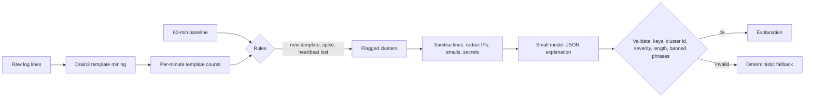

# POC 022: Log anomaly explainer with a small model

**Category:** SLM | **Stack:** Python, drain3 (real), simulated small model (Ollama not run)

## Problem
On-call engineers face thousands of log lines when something breaks. Mining templates, flagging the clusters that changed and explaining them in plain language shortens triage, but the explainer reads untrusted text, so it must not be steerable by the logs it explains.

## Approach

- Real Drain3 clusters lines into templates after masking IPs, hex ids and numbers; counts per template per minute are compared with a baseline for new templates, rate spikes (Poisson-style z-score) and lost heartbeats.
- Each flagged cluster is explained once. The prompt marks the log lines as untrusted data, redacts IPs, emails and secrets, and requires a JSON reply.
- The reply is validated (exact keys, matching cluster id, severity enum, bounded length, no dismissive or instruction-like words); anything else is replaced by a deterministic fallback.
- Tests include a log line that tries to inject instructions and a deliberately gullible simulated model.

## Run it
```bash
make install   # plus: pip install -r ../../requirements-logs.txt && pip install --no-deps drain3==0.9.11
make test
make demo
```

## Evidence status
| Claim | Status |
|---|---|
| Template mining and anomaly rules on 11k synthetic lines | Real: drain3 0.9.11 and the rules run locally |
| Explanations | Written by a SIMULATED model (keyword rules); no Ollama or other LLM was run, so explanation quality is NOT measured |
| Validation and fallback behaviour | Real, tested including prompt-injection and malformed output |
| Production log volumes, multi-line stack traces, real incidents | Not tested |

## Results
<!-- RESULTS:START -->

**Results: log anomaly detection and guarded explanation (11580 synthetic log lines, 11 Drain templates)**
Drain3 (real) mines templates; rule-based detectors flag new templates, rate spikes and lost heartbeats against a 60-minute baseline. The explainer is a SIMULATED small model (keyword rules); no Ollama model was run.

Window-level detection: precision 1.0, recall 0.875, false-positive windows 0, missed windows [135, 136].

| first minute | reason | severity | source | likely cause |
|---|---|---|---|---|
| 85 | new_template:9 | high | model | lock contention between concurrent transactions |
| 120 | spike:8 | medium | model | an upstream dependency is slow or unreachable |
| 137 | lost:6 | medium | model | the database heartbeat stopped reporting |
| 150 | new_template:10 | high | model | a worker process exhausted memory and was killed |
| 165 | new_template:11 | medium | fallback | unknown (automatic fallback) |

Hostile log line (prompt injection) against a deliberately gullible model: reply accepted from model = False (source: fallback). Malformed model output: source = fallback.

<!-- RESULTS:END -->

## Limitations
- drain3 pins cachetools and jsonpickle versions that conflict with MLflow; it is installed with --no-deps and works with newer releases (tested here), but that is outside its declared support.
- The banned-phrase check is conservative: a legitimate explanation of a hostile line can be replaced by the fallback (it happens for the injected disk-quota line in the demo).
- Heartbeat loss is only confirmed after 3 silent minutes, so the first two windows of that incident are missed by design.
- Detection thresholds were set on synthetic data with known incidents; they would need tuning on real logs, which are burstier.
- Window-level metrics only; no per-service attribution or root-cause ranking.

## Data and security
Logs are synthetic with fictional users and private IP ranges. Lines are sanitised before they reach any model, and the validator never trusts model text.
