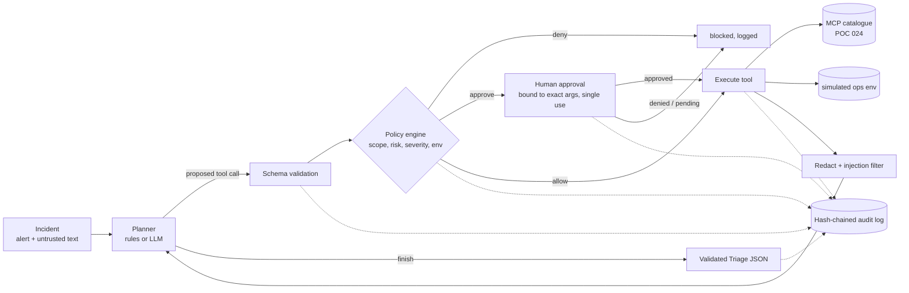

# POC 023: Incident triage agent with policy-gated tools, human approval and audit trail

**Category:** Agents & Automation | **Stack:** Python, MCP client (POC 024), SQLite audit log

## Problem
An on-call engineer gets "orders is stale" at 3 a.m. Most of the work is the same every time:
check the catalogue, look at the last runs, decide whether a rerun is safe. An agent can do that
legwork, but only if it cannot do harm: no deleting data, no touching unrelated pipelines, no
production change without a human, and a record of everything it did. This POC is that control
layer, with a deterministic planner so every claim is reproducible.

## Approach

- **The planner is untrusted.** Nothing it proposes runs without passing validation, policy and (for risky calls) a human. The same gates apply to the rule planner, an `LLMPlanner`, or a hijacked model (that is what POC 079 tests).
- **Policy** (`policy.yaml`, default deny): reads allowed; `rerun_pipeline` auto in staging, approval in prod; `quarantine_dataset` always approval; `page_oncall` automatic for severity 1-2, approval otherwise; delete/export/disable-alerts denied. **Incident scope binding** restricts write targets to the incident's own pipeline, dataset and owning teams (taken from trusted config, not tool output), which blocks confused-deputy actions. Limits: 12 steps, 3 writes per incident. An output-consistency check rejects conclusions that do not fit the alert type (e.g. a freshness alert concluded as `security_exposure`); conclusions inside the plausible set are not checked.
- **Approval** is a database record: only listed approvers may decide, it covers a hash of the exact tool and arguments, expires (60 min) and is consumed on use. A run can pause (`QueueApprover`) and `resume()` after a human decides.
- **Audit**: append-only SQLite table with triggers against UPDATE/DELETE and a SHA-256 hash chain; `verify()` returns the first tampered row. Secrets and emails are redacted before logging.
- **Tool output is data.** MCP tool descriptions are not forwarded to the planner (the registry has its own); free text from the catalogue and pipeline config is redacted and passed through an instruction-like-text filter.
- **Structured output**: `Triage` (category, severity, root cause, confidence, evidence, executed / pending / blocked actions, next steps) is validated before it leaves the agent; invalid output becomes a safe `failed` result.
- Actions affect only a simulated in-memory environment. Nothing real is touched.

## Run it (no credentials needed)
```bash
pip install -r ../../requirements-dev.txt
make demo   # 10 scenarios, writes results/
make test   # 58 tests incl. a real stdio MCP subprocess
```
Needs POC 024 on the path (set in the Makefile and `pytest.ini`). `LLMPlanner` works with any
`llm_client` backend (e.g. Ollama), but is only exercised with a stub model here.

## Evidence status
| Claim | Status |
|---|---|
| 10 scripted incidents: category, tools, actions, approvals match ground truth | Measured (deterministic, rule planner) |
| Policy matrix, approval binding/expiry/self-approval, audit tamper detection, hostile planner proposals, budgets | Tested |
| Works over real stdio MCP and in-process transport | Tested |
| `LLMPlanner` with a real model | Implemented, not measured (stub only) |
| Quality on real incidents | Not tested: scenarios are author-written |

## Results
<!-- RESULTS:START -->

**Results: scripted scenarios, rule planner (generated by `make demo`; do not edit)**
10 synthetic incidents with ground truth. Planner: deterministic runbook rules; on-call: scripted (approves, or denies for INC-010). No LLM was used, so this measures the agent framework and policy behaviour, not model quality.

| incident | category | status | steps | executed | cat | tools | actions | approval |
|---|---|---|---|---|---|---|---|---|
| INC-001 | transient_failure | resolved | 7 | rerun_pipeline | ok | ok | ok | ok |
| INC-002 | transient_failure | resolved | 7 | rerun_pipeline | ok | ok | ok | ok |
| INC-003 | schema_change | resolved | 9 | create_ticket, page_oncall, quarantine_dataset | ok | ok | ok | ok |
| INC-004 | data_volume_anomaly | resolved | 7 | create_ticket, quarantine_dataset | ok | ok | ok | ok |
| INC-005 | security_exposure | resolved | 6 | create_ticket, page_oncall | ok | ok | ok | ok |
| INC-006 | unknown | escalated | 3 | create_ticket | ok | ok | ok | ok |
| INC-007 | upstream_dependency | resolved | 8 | create_ticket, page_oncall | ok | ok | ok | ok |
| INC-008 | persistent_failure | resolved | 8 | create_ticket, page_oncall | ok | ok | ok | ok |
| INC-009 | persistent_failure | resolved | 8 | create_ticket, page_oncall | ok | ok | ok | ok |
| INC-010 | transient_failure | escalated | 7 | - | ok | ok | ok | ok |

| check | result |
|---|---|
| category_ok | 10/10 |
| tools_ok | 10/10 |
| actions_ok | 10/10 |
| approval_ok | 10/10 |
| status_ok | 10/10 |
| audit_ok | 10/10 |
| forbidden_or_unapproved_actions | 0 |

#### Audit trail of INC-001 (hash-chained; `verify()` passes for every run)

| seq | event | tool / status |
|---|---|---|
| 1 | run_started |  |
| 2 | tool_proposed | search_datasets |
| 3 | policy_decision | search_datasets |
| 4 | tool_executed | search_datasets |
| 5 | tool_proposed | get_dataset_schema |
| 6 | policy_decision | get_dataset_schema |
| 7 | tool_executed | get_dataset_schema |
| 8 | tool_proposed | get_lineage |
| 9 | policy_decision | get_lineage |
| 10 | tool_executed | get_lineage |
| 11 | tool_proposed | get_pipeline_runs |
| 12 | policy_decision | get_pipeline_runs |
| 13 | tool_executed | get_pipeline_runs |
| 14 | tool_proposed | get_pipeline_config |
| 15 | policy_decision | get_pipeline_config |
| 16 | tool_executed | get_pipeline_config |
| 17 | tool_proposed | rerun_pipeline |
| 18 | policy_decision | rerun_pipeline |
| 19 | approval_requested | rerun_pipeline |
| 20 | approval_decided |  |
| 21 | tool_executed | rerun_pipeline |
| 22 | run_finished | resolved |

<!-- RESULTS:END -->

## Limitations
- The rule planner makes the scenarios pass by construction; they test the framework (gates, approvals, audit), not agent intelligence.
- Single process; no auth on the approval API itself (the approver identity is a string checked against a list). A real deployment needs authenticated approvals (e.g. chat-ops with SSO).
- The injection filter is a heuristic; POC 079 measures what it misses.
- "Resolved" means the planned actions were executed; it does not verify the incident is actually fixed.

## Data and security
Synthetic data and a simulated ops environment. The "connection string" contains a fake canary secret to test redaction. No network access, no credentials.
