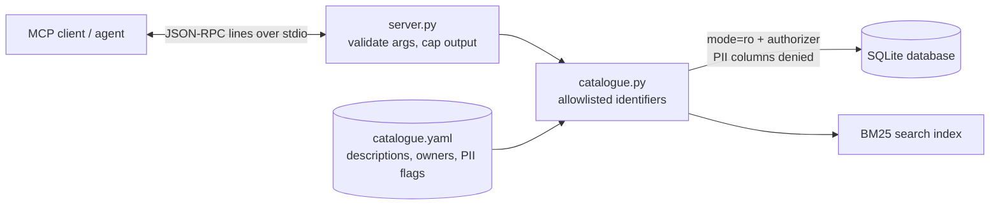

# POC 024: MCP data-catalogue server (read-only, PII-safe)

**Category:** Agents & Automation | **Stack:** Python, MCP over stdio, SQLite, YAML metadata, sqlglot

## Problem
Agents that browse a warehouse need metadata (what exists, what it means, who owns it, where it
comes from) without being handed a SQL console. This server exposes a catalogue as six read-only
MCP tools with typed arguments, so an agent can discover and inspect datasets but cannot run
arbitrary queries or read personal data.

## Evidence status
| Item | Status |
|---|---|
| Tools, protocol handling, security checks | **Measured** by 44 tests, including a real server subprocess over stdio |
| Interoperability with the **official MCP Python client** (initialize, list tools, call tools) | **Tested** (`mcp==2.3.0`; runs in CI, skipped locally unless `requirements-interop.txt` is installed) |
| Claude Desktop, Claude Code, IDE hosts, other MCP clients | **Not tested** |
| Behaviour under a real model, load, many clients | **Not tested** |

## Architecture


## Tools (all read-only; no free-form SQL, path or URL parameters)
| Tool | Purpose |
|---|---|
| `list_datasets` | Browse by domain or tag |
| `search_datasets` | BM25 keyword search over names, descriptions, tags and column text |
| `get_dataset_schema` | Columns, types, descriptions, PII flags, owner, freshness SLA, row count |
| `sample_rows` | 1-10 example rows; PII columns returned as `[REDACTED]` |
| `profile_column` | Null rate, distinct count, min/max, top values (low-cardinality, non-PII only) |
| `get_lineage` | Upstream sources (parsed from view SQL with sqlglot) and downstream dependants |

## Threat model
| Threat | Mitigation | Test |
|---|---|---|
| Agent writes or alters data | Read-only DB connection (`mode=ro`, `query_only`), no write tool | `test_database_is_never_modified` |
| Arbitrary SQL / identifier injection | No SQL parameter; dataset and column names must exist in the catalogue and are quoted | `test_identifiers_are_looked_up_never_interpolated` |
| PII exposure (samples, profiles, other tables) | PII columns redacted or refused; SQLite authorizer denies PII reads and tables outside the dataset | `test_pii_is_redacted...`, `test_guarded_connection_denies...` |
| Undocumented dataset leaks columns | Fail closed: undocumented datasets treat every column as PII | `test_undocumented_datasets_fail_closed` |
| Malformed or oversized input | Strict argument validation (types, bounds, enums, no extra keys); 100 KB line cap; 20 KB result cap | `test_invalid_arguments...`, `test_oversized_results...` |
| Server crash / info leak on bugs | Errors become safe messages; details go to stderr only | `test_internal_errors_do_not_leak_details` |
| Prompt injection via catalogue text | **Not preventable server-side.** Descriptions are returned verbatim as data; the client must treat tool output as untrusted | `test_prompt_injection_text...` documents the behaviour |

## Run it
```bash
pip install -r ../../requirements-dev.txt
make demo      # scripted MCP session against a real server subprocess -> results/
make test
# run the server (stdio); builds a synthetic database on first start:
PYTHONPATH=.:../../libs python3 -m mcp_server_data_catalog.server
```
Typical MCP client entry (adapt paths; **not tested with any host application**):
```json
{"mcpServers": {"data-catalogue": {"command": "python3",
  "args": ["-m", "mcp_server_data_catalog.server"],
  "env": {"PYTHONPATH": "/abs/path/pocs/024-mcp-server-data-catalog:/abs/path/libs"}}}}
```
Optional interop test: `pip install -r ../../requirements-interop.txt && make test`.

## Results
<!-- RESULTS:START -->

**Results: scripted MCP session over stdio (generated by `make demo`; do not edit)**
- A real server subprocess, driven by a minimal JSON-RPC client; synthetic data only.
- Negotiated protocol `2025-06-18`; tools: `list_datasets`, `search_datasets`, `get_dataset_schema`, `sample_rows`, `profile_column`, `get_lineage`

**Discover what exists** — `search_datasets({"query": "revenue per order", "limit": 3})`

```
[{"name": "order_revenue", "score": 2.574, "kind": "view", "domain": "sales", "description": "Revenue per order (quantity x unit price summed over lines)."}, {"name": "order_items", "score": 1.663, "kind": "table", "domain": "sales", "description": "Order line ...
```

**Inspect a schema** — `get_dataset_schema({"dataset": "order_revenue"})`

```
{"name": "order_revenue", "kind": "view", "description": "Revenue per order (quantity x unit price summed over lines).", "domain": "sales", "owner": "finance-analytics", "tags": ["derived", "revenue", "orders"], "classification": "internal", "freshness_hours": ...
```

**Trace lineage** — `get_lineage({"dataset": "orders"})`

```
{"dataset": "orders", "kind": "table", "upstream": [], "downstream": ["daily_orders", "order_revenue"]}
```

**Profile a column** — `profile_column({"dataset": "orders", "column": "status"})`

```
{"dataset": "orders", "column": "status", "type": "TEXT", "rows": 1500, "null_count": 0, "null_rate": 0.0, "distinct": 4, "min": "cancelled", "max": "shipped", "top_values": [{"value": "completed", "count": 1192}, {"value": "shipped", "count": 141}, {"value":  ...
```

**Sample rows (PII is redacted)** — `sample_rows({"dataset": "customers", "rows": 2})`

```
{"dataset": "customers", "rows": [{"customer_id": 1, "name": "[REDACTED]", "email": "[REDACTED]", "country": "India", "segment": "consumer", "signup_date": "2024-09-10"}, {"customer_id": 2, "name": "[REDACTED]", "email": "[REDACTED]", "country": "Germany", "se ...
```

**Refused: profile a PII column** — `profile_column({"dataset": "customers", "column": "email"})`

```
tool error: column 'email' is PII and cannot be profiled
```

**Refused: identifier injection** — `profile_column({"dataset": "orders", "column": "status\" FROM customers --"})`

```
tool error: unknown column 'status" FROM customers --' in dataset 'orders'
```

**Refused: unknown dataset** — `get_dataset_schema({"dataset": "sqlite_master"})`

```
JSON-RPC error -32602: dataset must be one of ['customers', 'daily_orders', 'order_items', 'order_revenue', 'orders', 'product_margin', 'products']
```

**Rejected: extra argument** — `sample_rows({"dataset": "orders", "sql": "DROP TABLE orders"})`

```
JSON-RPC error -32602: unexpected argument(s): ['sql']
```

**Rejected: out-of-range bound** — `sample_rows({"dataset": "orders", "rows": 1000})`

```
JSON-RPC error -32602: rows out of range
```

<!-- RESULTS:END -->

## Limitations
- The protocol layer is hand-written for the subset needed (initialize, ping, tools). Resources,
  prompts, sampling, HTTP transports, pagination, cancellation and progress are not implemented. It
  was checked against one official client only.
- No authentication or per-user authorization: whoever can start the process sees everything the
  catalogue allows. No rate limiting.
- PII protection is only as good as the YAML flags. Row counts are read once at start-up.
- SQLite only; the catalogue is rebuilt on restart, not live.

## Data and security
Synthetic data and fictional teams only; no credentials, network or paid services.
