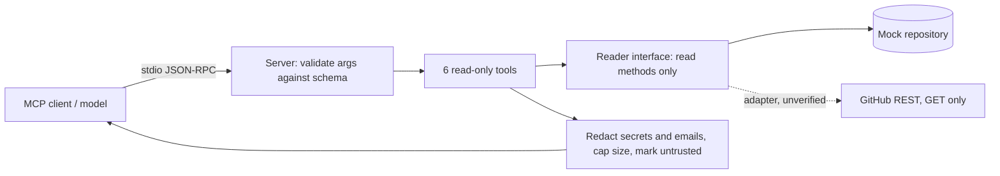

# POC 025: Read-only MCP server for repository and CI insight

**Category:** Agents & Automation | **Stack:** Python, hand-written MCP over stdio (reuses POC 024 core), mock GitHub data

## Problem
Engineers want an assistant to answer "why is CI red?" or "which PRs need review?" without handing it write access to the repository. A read-only MCP server with a narrow tool surface, argument validation and output redaction gives that, and makes the remaining risk (untrusted text in PRs and logs) explicit.

## Approach

- Six tools: list and get pull requests, list CI runs, get a failed run's redacted log tail, CI health summary (failure rate, top failing and suspected flaky tests), commit search. All are annotated read-only; no tool takes a repository, URL or path argument, and extra arguments are rejected.
- Output passes through redaction (token patterns, key=value secrets, emails), length caps and an untrusted-content note, because PR bodies and logs can carry instructions aimed at the client model; the server returns them as data and cannot stop a client from obeying them.
- The data access layer exposes only read methods; the optional GitHub adapter issues GET requests to three allow-listed paths for one pinned repository.
- Protocol handling reuses the hand-written core from POC 024 (initialize, tools/list, tools/call, error codes). It was also exercised with the official MCP Python client in the interoperability test.

## Run it
```bash
make install
make test
make demo      # drives the server over real stdio
```

## Evidence status
| Claim | Status |
|---|---|
| MCP protocol over stdio, validation, redaction, read-only surface | Real: tested via subprocess stdio and the official MCP client (when installed) |
| Repository data | MOCK: synthetic in-memory repository; no GitHub API call was made |
| HttpGitHubReader against api.github.com | UNVERIFIED: only its GET-only, allow-listed behaviour is tested with a fake opener |
| Prompt-injection resistance of a client model | Not measured: the server flags and isolates untrusted text but cannot control the client |

## Results
<!-- RESULTS:START -->

**Results: read-only MCP server over stdio against a MOCK repository**
Server `repo-ops-readonly` exposes 6 tools (list_pull_requests, get_pull_request, list_workflow_runs, get_run_failure, ci_health_summary, search_commits); all annotated read-only: True. Data comes from a synthetic in-memory repository; no GitHub API was called.

| tool | arguments | error | reply chars |
|---|---|---|---|
| ci_health_summary | {'days': 7} | False | 259 |
| list_workflow_runs | {'conclusion': 'failure', 'branch': 'main', 'limit': 3} | False | 515 |
| get_run_failure | {'run_id': 1150} | False | 425 |
| get_pull_request | {'number': 17} | False | 521 |
| list_pull_requests | {'state': 'open', 'limit': 3} | False | 610 |
| search_commits | {'query': 'cdc', 'limit': 3} | False | 436 |

Refused or rejected requests:

| tool | arguments | rejected |
|---|---|---|
| get_run_failure | {'run_id': 1000, 'repo': 'other/private'} | True |
| create_issue | {'title': 'x'} | True |
| list_workflow_runs | {'branch': 'main; rm -rf /'} | True |
| list_pull_requests | {'limit': 10000} | True |
| get_pull_request | {'number': '17 OR 1=1'} | True |
| search_commits | {'query': 'xxxxxxxxxxxxxxxxxxxxxxxxxxxxxxxxxxxxxxxxxxxxxxxxx | True |

Fake token leaked into any reply: False; email leaked: False.

<!-- RESULTS:END -->

## Limitations
- Mock data only: real GitHub payloads are larger and differ in shape; the adapter returns raw GitHub JSON and has no mapper.
- Redaction is pattern-based; unusual secret formats would pass through.
- No authentication, rate limiting or per-client authorisation: stdio assumes a trusted local launcher.
- No resources, prompts, pagination cursors or HTTP transport.
- Reuses POC 024's server module through the Python path, so the two POCs are coupled.

## Data and security
Repository, authors, logs and the token-shaped string are synthetic and assembled at runtime. The server holds no credentials and has no code path that writes.
