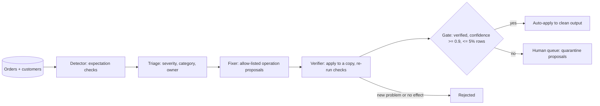

# POC 026: Multi-agent data-quality triage and proposed fixes

**Category:** Agents & Automation | **Stack:** Python, pandas; own agent graph and expectation checks (LangGraph and Great Expectations not used)

## Problem
Data-quality alerts pile up because someone has to decide which are urgent, who owns them and which can be fixed safely. This POC splits that into roles (detect, triage, propose, verify, gate) so that safe repairs are applied automatically and everything that would require guessing data goes to a person with an owner and a severity.

## Approach

- Six checks run over synthetic orders with six injected, labelled defect types (null and orphan customer ids, status typos, negative amounts, future dates, duplicate ids).
- Fixer proposals are limited to three allow-listed operations: map near-miss status spellings, drop exact duplicate ids, or quarantine rows. It never invents a customer, an amount or a date.
- The verifier applies each proposal to a copy and requires the target issue to disappear, no new issue to appear and only the intended column to change; the gate adds confidence and size limits.
- Hostile text stored in a data field (SQL and instruction-like) cannot influence anything because no operation takes free-form code and the trace holds only counts.

## Run it
```bash
make install
make test
make demo
```

## Evidence status
| Claim | Status |
|---|---|
| Detection, verification, gating and idempotence on synthetic orders | Real: runs locally, deterministic |
| Agents | Rule-based roles, NOT LLMs; an LLM could replace the triage rationale or proposal step behind the same schema and verifier, but that is not built or tested |
| LangGraph, Great Expectations | Not used; a small explicit pipeline and checks were written instead |
| Real warehouse data | Not tested |

## Results
<!-- RESULTS:START -->

**Results: multi-agent data-quality triage on synthetic orders (rule-based agents, no LLM)**
| defect | injected | found | extra flags |
|---|---|---|---|
| null_customer_id | 30 | 30 | 0 |
| status_typo | 40 | 40 | 0 |
| negative_amount | 15 | 15 | 0 |
| future_date | 25 | 25 | 0 |
| orphan_customer | 20 | 20 | 0 |
| duplicate_order_id | 20 | 20 | 0 |

| issue | severity | category | owner | rows |
|---|---|---|---|---|
| not_null:customer_id | medium | needs_human | source-system-owner | 30 |
| unique:order_id | high | auto_fixable | ingestion-team | 20 |
| in_set:status | medium | auto_fixable | data-steward | 40 |
| range_min:amount | medium | needs_human | source-system-owner | 15 |
| not_future:order_date | medium | needs_human | source-system-owner | 25 |
| fk_exists:customer_id | high | needs_human | ingestion-team | 20 |

Auto-applied (verified, confidence >= 0.9, <= 5% rows): [('drop_duplicates', ('unique', 'order_id'), 20), ('map_values', ('in_set', 'status'), 40)]. Queued for a human: 4 proposals (null/orphan customers, negative amounts, future dates are quarantine proposals, never guessed). Status typos repaired correctly: 40/40. Remaining issues after the auto fixes: 4; a second run auto-applies 0 further fixes (idempotent).

<!-- RESULTS:END -->

## Limitations
- Defects are crisp (a typo is always a near-miss of an allowed value), so 100% detection and repair here is optimistic compared with messy production data.
- Only status spellings and exact duplicates are auto-repairable; other fixes need a human by design, so the automatic share of fixed rows is about 40% on this data.
- Quarantine proposals are queued, not executed: a real deployment needs an approval workflow (see POC 029) and an audit trail (POC 084).
- Checks are single-table plus one foreign key; no distribution or cross-table consistency checks.
- Severity thresholds and owners are fixed rules, not learned or configurable.

## Data and security
Data is synthetic with example.com emails. The pipeline never writes to a source table; it returns a cleaned copy and a review queue.
