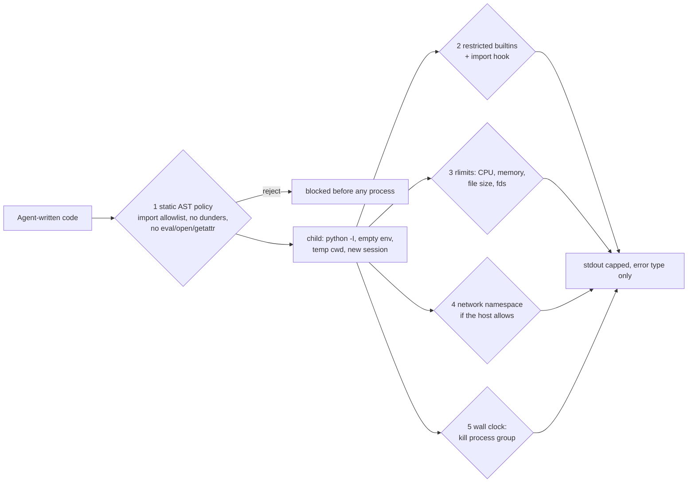

# POC 027: Agent code sandbox: layered defences for running untrusted Python, with attacks that prove each layer

**Category:** Agents & Automation | **Stack:** Python subprocess, AST policy, resource limits, unshare

## Problem
Agents that write analysis code need somewhere to run it. Running it in-process hands over the host; a bare subprocess still reads files, spawns commands and burns CPU. This POC builds the cheap layers (and no more), then attacks them: each layer is removed in turn to show which attack it was stopping.

## Approach

- Eighteen hostile snippets in six categories (file read, file write, command execution, network, object-graph escape, denial of service). Oracles are judge-free: a canary file's content, a marker file, a local listener's connection count, output size, elapsed time.
- Four configurations (all layers; no static policy; additionally no restricted builtins; wall-clock only) give a success table per category. Control-group tests assert the attacks do work when a layer is missing.
- Notable measured result: without the static policy, the restricted-builtins table does not stop a `__subclasses__()` walk of the object graph. The AST check, not the builtins table, covers that.
- Legitimate analysis snippets (primes, statistics, JSON/regex, Counter) keep working.
- **This is defence in depth, not isolation.** Python sandboxes are escapable and rlimits are coarse; for untrusted code from the internet use a container or microVM.

## Run it
```bash
make demo && make test   # 43 tests, ~10 s
```

## Evidence status
| Claim | Status |
|---|---|
| Per-layer attack outcomes, DoS containment, output cap, env scrubbing, legitimate code still runs | Tested on this Linux host |
| Network namespace layer | Used and tested only where `unshare -n` works (it does on the dev machine, as root); on unprivileged CI the test is skipped and the demo reports it unavailable |
| Kernel exploits, ptrace/seccomp-level attacks, real container isolation | **Not tested** |

## Results
<!-- RESULTS:START -->

**Results: attack success per defence configuration (generated by `make demo`)**
18 hostile snippets in 6 categories (file read, file write, command execution, network, object-graph escape, denial of service), judged by canary/marker files and a local listener. Limits for the demo: 1 s CPU, 200 MB address space, 2.5 s wall clock. Network namespace (`unshare -n`) available here: **True**.

| configuration | fs_read | fs_write | exec | net | escape | dos | total successful |
|---|---|---|---|---|---|---|---|
| all layers (+ network namespace if available) | 0/3 | 0/1 | 0/4 | 0/2 | 0/3 | 0/5 | 0 |
| no static policy | 0/3 | 0/1 | 0/4 | 0/2 | 1/3 | 0/5 | 1 |
| no static policy, no restricted builtins | 3/3 | 1/1 | 4/4 | 0/2 | 2/3 | 0/5 | 10 |
| wall clock only | 3/3 | 1/1 | 4/4 | 2/2 | 2/3 | 0/5 | 12 |

Which layer ended each attack run (all-layers configuration): {'static_policy': 13, 'rlimit': 2, 'runtime_restriction': 3}. Legitimate analysis snippets still work: **4/4**.

Read down the table: each removed layer lets a different category through. Even with every layer on, this is defence in depth, not isolation: see Limitations.

<!-- RESULTS:END -->

## Limitations
- RLIMIT_NPROC is not enforced for root, so fork bombs are stopped by the static policy and the process-group kill, not by the rlimit, in the dev environment.
- The allowlist is deliberately tiny (no pandas/numpy); extending it widens the attack surface.
- Python-level layers can be bypassed by interpreter bugs or C-extension behaviour; the corpus is small and written by the author.
- No filesystem isolation beyond file-size and fd limits; the child can still read world-readable files if it gets past the static and builtins layers.

## Data and security
Hostile snippets only touch a temp directory and a loopback listener created by the test harness; the 'secret' is a fake canary string.
