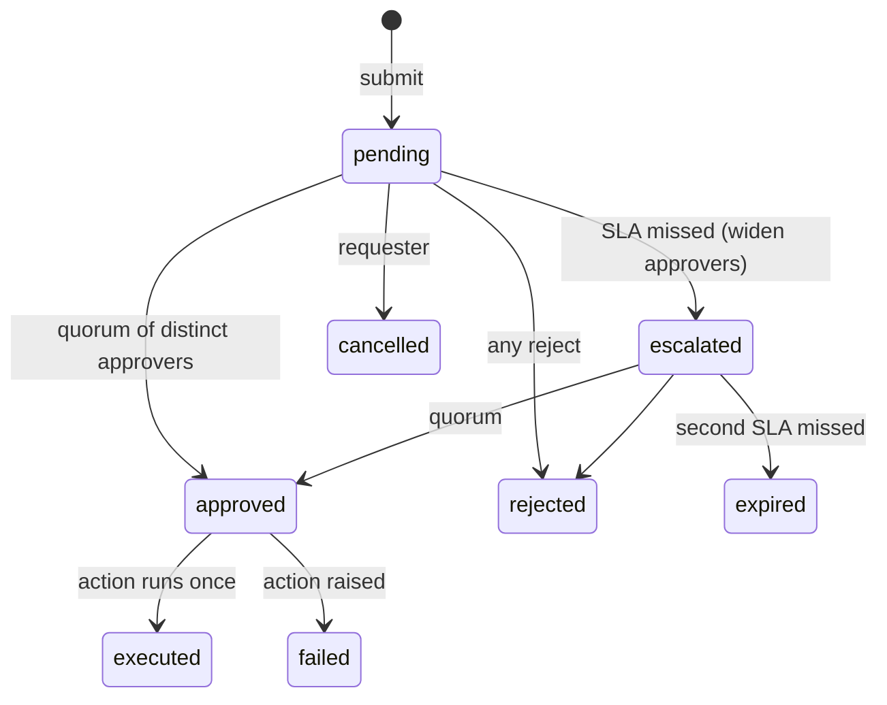

# POC 029: Human-in-the-loop approval workflow: quorum, separation of duties, SLA escalation, signed tokens

**Category:** Agents & Automation | **Stack:** Python, SQLite, stdlib HTTP server, HMAC tokens

## Problem
Sensitive agent actions (delete a dataset, restart production) need a person's sign-off, but a chat message saying "approved" is not a control. Approvals must be attributable, single-use, time-limited, resistant to the requester approving their own work, and safe when two people click at once. POC 023 embeds a basic approval step; this POC is the standalone, durable service.

## Approach

- Every transition is a compare-and-swap in SQLite against an explicit transition table, so illegal moves and lost races are refused; a threaded test fires simultaneous approvals and requires exactly one execution.
- Approval links are HMAC-signed, expire, are bound to (request, person) and single use; forged, expired, malformed and replayed tokens are rejected.
- Separation of duties: the requester is never asked and cannot decide. Quorum counts distinct approvers; escalation adds a second approver group after the SLA.
- Hash-chained audit log reused from POC 023 (`AuditLog`); a stdlib HTTP API exposes submit, decide and status.
- Notifications are recorded in an outbox (what a chat bot/email would send); nothing is sent anywhere.

## Run it
```bash
make demo && make test   # 15 tests
```

## Evidence status
| Claim | Status |
|---|---|
| State machine, quorum, SoD, token security, SLA escalation, races, audit chain, HTTP API | Tested (deterministic fake clock; real threads and a real local HTTP server) |
| Real identity provider / SSO, chat integrations, durable job runner for the executor | **Not tested** (identity is a string in a signed token) |

## Results
<!-- RESULTS:START -->

**Results: deterministic, fake clock (generated by `make demo`)**
| scenario | final state | total executions so far | note |
|---|---|---|---|
| 1 happy path: one approver | executed | 1 | executed once |
| 2 quorum: 2 of 3 approvers | executed | 2 | state after first approval: pending |
| 3 reject | rejected | 2 | nothing executed |
| 4 requester approves own request | pending | 2 | separation of duties: requester cannot decide their own request |
| 5 SLA miss escalates; escalation approver approves | executed | 3 | after SLA: escalated |
| 6 two SLA misses | expired | 3 | expired, never executed |
| 7 two simultaneous approvals | executed | 4 | executions: 1; outcomes: ['executed', 'refused: request is already executed'] |

Audit log: 27 events, hash chain intact: **True**. The simultaneous-approval race produced exactly **1** execution.

<!-- RESULTS:END -->

## Limitations
- Authentication of the approver relies on possession of the signed link; real deployments should bind it to an SSO session.
- The executor runs in-process inside the decision call; a crash between `approved` and `executed` leaves the request approved but unexecuted (needs an outbox/worker, not included).
- The audit log commits per event, so a crash can leave the decision and state change in separate commits.
- Single SQLite file and a process-wide lock: no multi-node deployment.

## Data and security
Synthetic users; the HMAC secret in the demo is a placeholder string; nothing leaves localhost.
