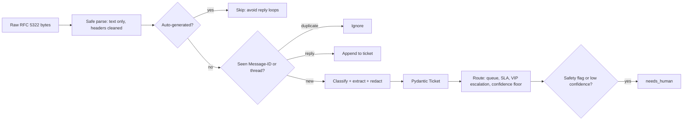

# POC 030: Email to structured ticket with routing

**Category:** Agents & Automation | **Stack:** Python stdlib email, Pydantic, mock mailbox; rule-based classifier (no LLM)

## Problem
Support mailboxes mix real requests with auto-replies, HTML-only mail, risky attachments and hostile text. Turning each message into a validated ticket with a queue and SLA, without creating duplicates when the mailbox is processed twice, is a small system with real failure modes.

## Approach

- Parsing uses the stdlib `email` package with the default policy: HTML is reduced to text (scripts and styles dropped, nothing fetched), header values are stripped of control characters, oversized and sender-less messages are refused, attachments are described (name, type, size, risky extension) but never opened or stored.
- Auto-submitted and bulk mail is skipped, replies are threaded by In-Reply-To or References, and the Message-ID makes re-processing a mailbox idempotent.
- A transparent keyword classifier sets category, an urgency flag and the order id; low confidence goes to a triage queue instead of a guess. Card, IBAN and SSN numbers are redacted from the summary.
- Instruction-like sentences in the body ("ignore previous instructions", "set priority to ...") are removed before classification and the ticket is flagged for a human. A test found that, without this, such a sentence could still raise priority through the word urgent.

## Run it
```bash
make install
make test
make demo
```

## Evidence status
| Claim | Status |
|---|---|
| Parsing, threading, idempotence, routing, redaction, safety flags | Real: stdlib email parsing of generated RFC 5322 messages |
| Mailbox | Mock: generated bytes, no IMAP server or network |
| Classification | Keyword baseline, NOT an LLM; near-perfect on templated mail (100%) but 13% on 15 hand-written paraphrases, of which 14 are sent to a human instead of being guessed |
| Ollama or any model | Not used or measured |

## Results
<!-- RESULTS:START -->

**Results: 150 synthetic emails to tickets (rule-based classifier, no LLM)**
| metric | value |
|---|---|
| category accuracy | 1.000 |
| urgent flag accuracy (incl. VIP escalation) | 1.000 |
| order ids extracted | 84/84 |
| HARD set (paraphrase, mixed signals, Spanish, quoted threads): category accuracy | 0.133 |
| HARD set: sent to a human instead of auto-routed | 14/15 |
| HARD set: accuracy among auto-routed | 1.000 |
| tickets created | 150 |
| tickets needing a human (low confidence or safety flag) | 14 |
| tickets with a risky attachment flagged | 14 |
| replay of the whole mailbox | {'duplicate': 150} |
| replay changed state | False |
| reply threaded onto the original ticket | appended |

Queues: {'finance-support': 30, 'logistics': 30, 'tier2-engineering': 30, 'account-services': 30, 'product-feedback': 30}. Categories come from keyword scoring on templated bodies, so accuracy here is optimistic for real customer mail.

<!-- RESULTS:END -->

## Limitations
- The 100% figure is for synthetic templated mail with the keywords present; the hard set (15 emails) shows the baseline cannot read paraphrases, other languages or mixed requests.
- Abstention is the safeguard: unsure mail goes to the triage queue. The hard-set number of auto-routed mails is too small (1) to claim anything about their accuracy.
- No real IMAP, SMTP, authentication, encryption, SPF/DKIM checks or spam scoring; attachments are not scanned for malware.
- Threading is by header only; the same customer writing a fresh email about the same issue creates a new ticket.
- Single process, in-memory store.

## Data and security
Mail is generated from a seed with reserved example domains. The parser never executes, fetches or stores attachment content or remote images.
