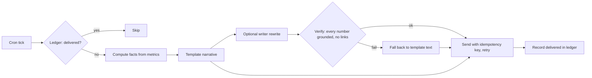

# POC 031: Scheduled insight report agent

**Category:** Agents & Automation | **Stack:** Python, Jinja2 (sandboxed), SQLite ledger, own cron matcher; writer is simulated (no LLM)

## Problem
A weekly revenue narrative has to arrive on time, exactly once, after a restart or a missed run, and every number in it has to be true. An LLM can improve the prose, but it can also invent a statistic or smuggle in a link, so its text must be verified against the computed facts before anyone sees it.

## Approach

- A 5-field cron matcher (lists, ranges, steps, Vixie day semantics) finds ticks since the last processed tick; up to five missed ticks are caught up.
- Facts come from synthetic daily metrics: period-over-period change, comparison with a four-week average, average order value, largest segment mover, and unusual days scored against the ratio to the same weekday in prior weeks with a pooled spread (a first version with a per-day 4-sample spread flagged 17% of normal days and was replaced).
- The text is rendered by a sandboxed strict Jinja2 template. A writer may rewrite it, but the result is accepted only if every number matches a computed fact within rounding and it contains no URL or markdown image; otherwise the template text is used.
- Runs are recorded in a SQLite ledger; delivery retries up to three times; the outbox file name is a hash of report and period, so even a lost ledger cannot cause a duplicate message.

## Run it
```bash
make install
make test
make demo
```

## Evidence status
| Claim | Status |
|---|---|
| Cron, catch-up, ledger, idempotent delivery, retries, number verification | Real: runs locally, deterministic |
| Metrics | Synthetic daily revenue with a planted 3-day consumer-segment drop |
| Writer | SIMULATED LLM (faithful, hallucinating, linking modes); no real model was run, so prose quality is not measured |
| Airflow or any external scheduler, SMTP/Slack delivery | Not used: a file outbox stands in |

## Results
<!-- RESULTS:START -->

**Results: scheduled, idempotent, number-verified reports (synthetic metrics; writer is SIMULATED, no LLM)**
Report for the incident week:

```
Weekly revenue report for 2025-04-07 to 2025-04-13.
Revenue was $148,619, down 4.7% from $155,883 the week before, and 3.8% below the four-week average of $154,507.
Orders were 1,635 (8.9% down), with an average order value of $90.9.
The largest segment mover was consumer, down $10,248.
Unusual days (z-score of the ratio to the same weekday in the prior four weeks, against the usual spread): 2025-04-12 (-3.9), 2025-04-13 (-4.1).
```

| writer behaviour | text used | passed verification | ungrounded numbers | links |
|---|---|---|---|---|
| faithful | writer | True | - | 0 |
| hallucinating | template_fallback | False | ['11.7%', '14%', '61'] | 0 |
| linking | template_fallback | False | - | 3 |

Schedule `0 8 * * 1`, four Mondays missed since the last tick, first sink call fails: [('2025-04-06', 'send_failed'), ('2025-04-06', 'delivered'), ('2025-04-13', 'delivered'), ('2025-04-20', 'delivered'), ('2025-04-27', 'delivered')]. Restart over the same window: [('2025-04-06', 'already_delivered'), ('2025-04-13', 'already_delivered'), ('2025-04-20', 'already_delivered'), ('2025-04-27', 'already_delivered')]. Files in outbox: 4 (distinct idempotency keys 4).

<!-- RESULTS:END -->

## Limitations
- Number verification catches invented or altered figures but not wrong words (for example saying up when the number is down); the template wording is the only fully trusted text.
- Anomaly detection flags 2 of 3 incident days and 1 other day in a 70-day scan on this data; a day after an incident is judged against references that contain the incident.
- At-least-once delivery with an idempotent sink: a crash between sending and recording is safe only because the sink deduplicates by key.
- Single process; no distributed locking if two schedulers ran at once.
- No time zones: ticks are naive datetimes.

## Data and security
All metrics are synthetic. The outbox is local files; no credentials are used or stored.
