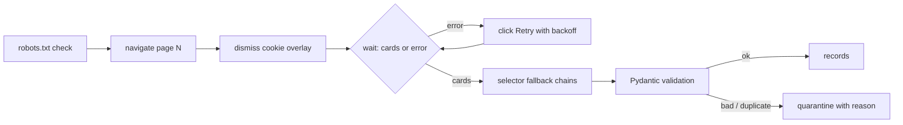

# POC 032: Resilient browser-automation data extraction

**Category:** Agents & Automation | **Stack:** Playwright 1.64 (real Chromium), Pydantic v2, stdlib test server

## Problem
Scrapers built against the happy path lose data silently when pages render late, APIs return 503, a cookie overlay blocks clicks, or markup changes mid-site. This POC extracts product records with a browser using retries with backoff, selector fallback chains, overlay dismissal, robots.txt compliance, strict Pydantic validation with a quarantine for bad rows, and duplicate suppression, and scores it against a naive single-selector baseline on a deliberately hostile local site.

## Approach

- The target is a local server on 127.0.0.1 (client-side rendering, a 503 on first call for pages 2 and 4, a full-screen cookie banner, class names renamed from page 3). Nothing touches the public internet.
- Extraction retries a failed API render by clicking Retry (bounded, exponential backoff), then records the page as failed instead of crashing; two dead pages in a row end the crawl.
- Each field has ordered selector fallbacks and fallbacks are counted, so layout drift shows up in the report.
- Records failing validation (N/A price, empty name, negative price) or repeating an id are quarantined with a reason, never dropped silently.
- robots.txt is fetched first; a disallowed path means no page requests.

## Run it
```bash
make demo PY=python   # needs Chromium: /opt/pw-browsers locally, or `playwright install chromium`
make test
```

## Evidence status
| Claim | Status |
|---|---|
| Resilient vs naive extraction on the local hostile site (36 valid records) | Measured with real Chromium |
| Retry bound, robots compliance, quarantine and dedup | Tested (real browser, local server) |
| Real websites, anti-bot systems, logins, CAPTCHAs, rate limiting beyond robots.txt | Not tested / out of scope |
| Whole POC runs in the heavy CI job (browser install) | Heavy |

## Results
<!-- RESULTS:START -->

**Results (measured by `python -m playwright_web_extractor.main`; local hostile test site, real Chromium)**
Ground truth: 36 valid records of 40 rows (3 invalid + 1 duplicate id).

| extractor | records | recall | false records | quarantined | pages ok | retries | selector fallbacks | seconds |
|---|---|---|---|---|---|---|---|---|
| naive | 9 | 0.250 | 0 | 1 | 1 | 0 | 0 | 4.510 |
| resilient | 36 | 1.000 | 0 | 4 | 4 | 2 | 42 | 3.370 |

- resilient quarantine reasons: ['Value error, empty name', 'Value error, negative price', "could not convert string to float: 'N/A'", 'duplicate id']

<!-- RESULTS:END -->

## Limitations
- The test site is written to exercise the failure modes handled here; real sites fail in more ways.
- Selector fallbacks are hand-listed: truly new markup still breaks extraction, though it is reported as failed pages rather than wrong data.
- No politeness beyond robots.txt (no crawl-delay or per-host rate limit), because the target is local.
- Chromium is launched with --no-sandbox when the preinstalled binary is used (container environment).

## Data and security
Synthetic product catalogue served by the local test site; no external data.
