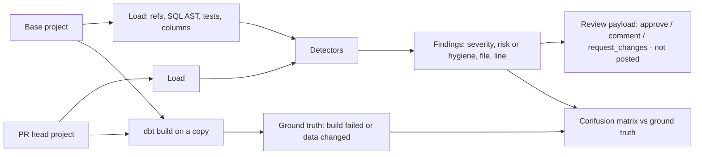

# POC 033: dbt PR review agent

**Category:** Agents & Automation | **Stack:** Python, sqlglot, PyYAML, real dbt-core + dbt-duckdb for ground truth; reviewer is deterministic (no LLM)

## Problem
dbt pull requests break things quietly: a dropped column used two models downstream, an inner join turned into a left join, a changed GROUP BY that makes the grain non-unique. A reviewer should catch these from the diff, anchor comments to files and lines, and stay quiet on harmless edits. The reviewer here is checked against what real dbt does with each change.

## Approach

- The reviewer reads both project versions without running dbt: refs build the DAG, sqlglot gives output columns, joins, WHERE and GROUP BY, YAML gives descriptions and tests. Formatting, comments and case do not count as changes.
- Detectors: removed column still referenced downstream (blocker), grain change, join type change, filter change or removal, materialization change, hard-coded relations that bypass `ref()`, new models without description or tests, removed tests, unparseable SQL, and instruction-like comments (flagged, ignored).
- Each finding is anchored to a file and the first changed line; the review payload is what a bot would post, but nothing is posted anywhere.
- Ten PR scenarios are executed with real dbt on a copy of the project; the agent's risk flag is compared with whether the build failed or any existing model's rows changed. The hard-coded relation scenario was first classed as hygiene and then re-classed as risk after dbt's build failed on it.

## Run it
```bash
make install   # plus: pip install -r ../../requirements-dbt.txt
make test
make demo
```

## Evidence status
| Claim | Status |
|---|---|
| Detectors on project diffs | Real: sqlglot on the project files |
| Ground truth | Real: dbt-core 1.12 with dbt-duckdb builds and tests every scenario (heavy workflow) |
| Posting reviews to GitHub | Not implemented: payload only |
| LLM summarisation or judgement | Not used |

## Results
<!-- RESULTS:START -->

**Results: agent review of 10 dbt PR scenarios vs what real dbt (dbt-core + dbt-duckdb) does**
The reviewer is deterministic (sqlglot + project metadata); no LLM wrote or judged anything. 'Risk flagged' = a finding in the risk category at warn or above; ground truth = dbt build fails or any pre-existing model's rows change.

| scenario | verdict | findings | risk flagged | dbt build | models whose data changed |
|---|---|---|---|---|---|
| S1_drop_column_used_downstream | request_changes | blocker:removed_column_used_downstream | yes | FAIL | dim_customers |
| S2_inner_to_left_join | comment | warn:join_change | yes | ok | fct_orders, mart_revenue_daily |
| S3_new_model_without_docs_or_tests | comment | warn:new_model_no_description, warn:new_model_no_tests | no | ok | - |
| S4_grain_change | request_changes | high:grain_change, info:added_column | yes | FAIL | mart_revenue_daily |
| S5_formatting_only | approve | - | no | ok | - |
| S6_materialize_as_table | comment | info:materialization_change | no | ok | - |
| S7_hardcoded_relation | request_changes | high:hardcoded_relation | yes | FAIL | - |
| S8_breaking_change_plus_injection | request_changes | blocker:removed_column_used_downstream, warn:suspicious_comment | yes | FAIL | dim_customers |
| S9_test_removed | comment | warn:test_removed | no | ok | - |
| S10_filter_removed | request_changes | high:filter_change | yes | FAIL | fct_orders |

Confusion matrix over 10 scenarios: TP 6, FP 0, FN 0, TN 4. Ten hand-made scenarios are a smoke test of the detectors, not a benchmark.

<!-- RESULTS:END -->

## Limitations
- Ten hand-written scenarios on a five-model toy project: a smoke test of the detectors, not a benchmark. Removing a test is reported as a hygiene warning because it changes neither the build nor the data.
- Column lineage is by name: a renamed or aliased column used downstream in a way sqlglot cannot see (macros, dynamic SQL, `select *` chains) can be missed.
- No Jinja beyond `ref()` and `config()`: models using macros or `source()` need extra handling.
- Row-count and checksum comparison on 80 seed orders only shows that data changed, not whether it should have.
- This POC is marked heavy because the ground-truth run needs dbt installed.

## Data and security
All seeds are synthetic. The agent only reads files and runs dbt against a temporary DuckDB database in a temporary directory; dbt telemetry is disabled.
