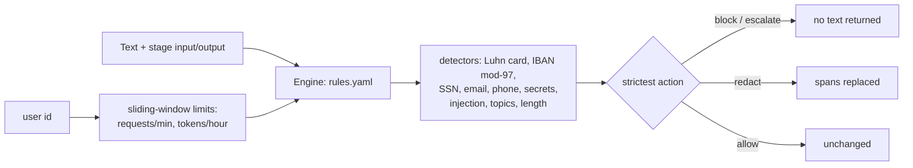

# POC 034: Agent policy guardrails: declarative input/output rules with checksums, redaction and rate limits

**Category:** Agents & Automation | **Stack:** Python, YAML policy-as-code

## Problem
Before text reaches an agent or the user it should be screened: card numbers and IBANs redacted, secrets and injection phrases blocked, self-harm escalated, and abusive callers throttled. Hard-coded checks scatter and rot; this POC keeps them as a reviewable YAML policy evaluated by one engine, with the policy itself linted and tested.

## Approach

- Rules declare `stage`, `detector`, `action`; the strictest action across matching rules wins (block > escalate > redact > allow). Findings record rule ids and labels, never the matched content.
- Checksum validation (Luhn for cards, mod-97 for IBANs) removes most false positives on number-like strings; the report states the remaining ones honestly.
- Policy loading rejects unknown detectors, actions, stages and duplicate ids; `lint` reports overlapping rules.
- Evaluated on 480 labelled synthetic texts (sensitive items plus benign look-alikes); the report gives per-kind accuracy, false positives/negatives and rough throughput.
- Complements POC 023, which gates *tool calls*; this screens *text*.

## Run it
```bash
make demo && make test   # 19 tests
```

## Evidence status
| Claim | Status |
|---|---|
| Per-kind detection on synthetic labelled texts, policy validation/lint, rate-limit windows | Measured / tested (deterministic) |
| Recall on real PII and real jailbreaks, multilingual text, obfuscation (spaced digits, leetspeak, base64) | **Not tested**; regex rules will miss them |

## Results
<!-- RESULTS:START -->

**Results: deterministic, synthetic labelled texts (generated by `make demo`)**
480 texts: sensitive items that must be caught (card with Luhn checksum, German IBAN with mod-97, SSN, email/phone on output, API key, injection phrases, self-harm, malware requests) and benign look-alikes (16-digit order numbers that fail Luhn, invoice amounts, dates, sentences containing 'ignore' or 'ransomware'). 'Correct' = the engine's action equals the expected action.

| kind | correct / total |
|---|---|
| card | 40 / 40 |
| iban | 40 / 40 |
| ssn | 40 / 40 |
| email_out | 40 / 40 |
| secret | 40 / 40 |
| injection | 40 / 40 |
| self_harm | 40 / 40 |
| malware | 40 / 40 |
| benign_order_number | 38 / 40 |
| benign_invoice | 40 / 40 |
| benign_text | 40 / 40 |
| benign_date_phone_like | 40 / 40 |

False positives (benign blocked or altered): **2**, all 16-digit order numbers that happen to pass the Luhn check (about 1 in 10 random 16-digit numbers does; the checksum cuts card false positives by ~90%, not to zero). False negatives (sensitive allowed): **0**. Throughput on one core: about 49,556 checks/s (regex rules, short texts; not a load test).

Rate limit (20/min): 20 of 30 immediate requests admitted, then admitted after the window slides; token budget 1000/h with 400-token requests admits [True, True, False].

Policy lint: no overlapping rules.

<!-- RESULTS:END -->

## Limitations
- Regex and checksum detectors are brittle against obfuscation; production systems add ML classifiers and canary tokens (see POC 079 for measured filter weaknesses).
- Phone and SSN patterns are US-style and approximate.
- Rate limits are in-process and per-instance; distributed enforcement needs a shared store.

## Data and security
Synthetic numbers only (generated to pass checksums); no real PII.
