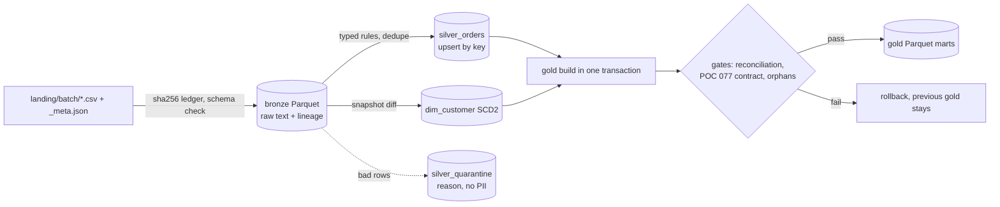

# POC 035: Bronze/silver/gold lakehouse: incremental, idempotent, SCD2, contract-gated

**Category:** Data Engineering | **Stack:** DuckDB, Parquet, data contracts (POC 077)

## Problem
Daily feeds arrive late, get re-sent, change in place and contain bad rows. A pipeline that
appends blindly double-counts on a retry, loses history when a customer changes segment, and
publishes whatever it was given. This POC loads batches incrementally, makes every step safe to
re-run, keeps customer history (SCD type 2), quarantines bad rows with a reason, and refuses to
publish gold unless reconciliation and the POC 077 data contract pass.

## Approach

Key decisions:
- **Bronze is immutable and the source of truth.** `rebuild_from_bronze()` drops silver/gold and replays; the content hash must come out identical (tested).
- **Idempotency by ledger** keyed on `(entity, batch, sha256)`: same bytes are skipped; same batch id with different bytes raises `BatchConflict`.
- **Orders upsert, latest batch wins** (`WHERE EXCLUDED._batch_id >= current`), so an out-of-order replay cannot regress a row.
- **SCD2 customers**: snapshots are diffed against current rows; a change closes the old version at the batch's effective date. A customer's first version covers all earlier time (history before first sight is unknown). Snapshots must be applied in effective-date order (`BatchOrderError`). Customers missing from a snapshot are not treated as deletes.
- **Gold is rebuilt wholesale** inside one transaction: simple and deterministic at this size; an incremental gold build would be the next step at larger scale. Gold is point-in-time: the segment shown for an order is the one valid on its order date.
- **Contract gate**: silver orders are exported and validated with the POC 077 `orders_feed` contract; any error aborts publication.
- **Security**: batch ids are validated (no path traversal), values are only ever bound parameters or typed casts (a hostile `status` string is quarantined, not executed), quarantine stores no email, gold has no PII.

## Run it (no credentials needed)
```bash
pip install -r ../../requirements-dev.txt   # duckdb is in requirements.txt
make demo   # generates data, loads 4 batches, replays, rebuilds, 1M-row scale check; writes results/
make test   # 18 tests
```
Uses POC 077 via `PYTHONPATH` (set in the Makefile and `pytest.ini`).

## Evidence status
| Claim | Status |
|---|---|
| Quarantine contains exactly the injected defects; bronze = accepted + quarantined per batch | Measured (deterministic, synthetic) |
| Replay is a no-op; incremental load equals full rebuild from bronze | Measured (content hash) |
| SCD2 history contiguous, point-in-time join correct; gate failure rolls back | Tested |
| Throughput on 1M rows | Measured locally, 3 runs, wall-clock, one machine |
| Concurrent writers, cloud object storage, very large data | Not tested |

## Results
<!-- RESULTS:START -->

**Results: deterministic correctness checks and one local timing (generated by `make demo`)**
Synthetic data, seed 11: 4 batches; 8 late order updates and 6 customer segment changes per later batch; defects injected with exact counts.

#### Idempotency and rebuild (content hash of silver + gold, timestamps excluded)

| step | batches ingested | batches skipped | content hash |
|---|---|---|---|
| first run | 8 | 0 | 82901567a4eb30a9 |
| replay same landing zone | 0 | 8 | 82901567a4eb30a9 |
| drop silver/gold, rebuild from bronze | - | - | 82901567a4eb30a9 |

Replay identical: **True**. Rebuild identical: **True**.

#### Row reconciliation per batch (bronze rows = accepted + quarantined)

| entity | batch | bronze rows | accepted | quarantined |
|---|---|---|---|---|
| customers | b001 | 112 | 112 | 0 |
| orders | b001 | 150 | 150 | 0 |
| customers | b002 | 158 | 158 | 0 |
| orders | b002 | 160 | 145 | 15 |
| customers | b003 | 180 | 180 | 0 |
| orders | b003 | 158 | 158 | 0 |
| customers | b004 | 193 | 193 | 0 |
| orders | b004 | 158 | 155 | 3 |

#### Quarantine reasons vs injected defects (exact match: **True**)

| batch | reason | quarantined | injected |
|---|---|---|---|
| b002 | enum:status | 3 | 3 |
| b002 | pattern:email | 2 | 2 |
| b002 | range:amount_max | 1 | 1 |
| b002 | range:amount_min | 2 | 2 |
| b002 | required:customer_id | 2 | 2 |
| b002 | rule:ship_before_order | 2 | 2 |
| b002 | type:amount | 1 | 1 |
| b002 | unique:order_id | 2 | 2 |
| b004 | enum:status | 2 | 2 |
| b004 | range:amount_min | 1 | 1 |

#### SCD2 customer dimension: 211 versions for 193 customers, 193 current

| segment at order time | orders | net revenue |
|---|---|---|
| consumer | 207 | 122373.66 |
| enterprise | 181 | 130382.79 |
| smb | 198 | 120578.08 |

#### Quality gates (last published build)

| gate | passed | detail |
|---|---|---|
| reconcile bronze = accepted + quarantined | True | mismatches: [] |
| quarantine table matches ledger | True | 18 vs 18 |
| gold rows = silver rows | True | 586 vs 586 |
| gold amount = silver amount | True | 438759.03 vs 438759.03 |
| daily revenue mart = silver net revenue | True | 373334.53 vs 373334.53 |
| no orders without a customer version | True | 0 orphans |
| one current version per customer | True | 0 violations |
| silver orders satisfy data contract (POC 077) | True | contract orders_feed@1.0.0, 586 rows, no errors |

#### Scale check: 1,000,000 synthetic orders, single batch, 3 runs

| stage | seconds per run |
|---|---|
| bronze ingest (CSV to Parquet) | [2.05, 1.8, 1.93] |
| silver promote (typing, rules, dedupe, upsert) | [2.56, 2.49, 2.37] |

Median end-to-end 4.3 s; accepted 990,000, quarantined 10,000. Wall-clock on 4 logical CPUs, DuckDB 1.5.6, Python 3.13.16, x86_64; timings vary by machine and are not comparable to a cluster.

<!-- RESULTS:END -->

## Limitations
- Single-process, single-writer; DuckDB file locking, no concurrent runs. Not a table format (no Iceberg/Delta time travel).
- Deletes in sources, late-arriving dimension rows (orders before a customer's first sight map to `unknown` and fail the orphan gate) and schema evolution beyond "extra columns are dropped" are not handled.
- Gold is a full rebuild; timing numbers are one laptop-class environment and say nothing about a cluster.
- Data is synthetic (derived from the shared demo warehouse); emails are fabricated on example.com.

## Data and security
Synthetic data only. No secrets; no network access. `data/generated/` is git-ignored.
