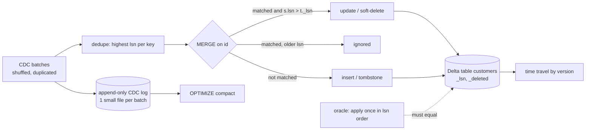

# POC 036: Delta Lake CDC ingestion with MERGE, time travel and compaction

**Category:** Data Engineering | **Stack:** delta-rs (`deltalake`), PyArrow

## Problem
Change-data-capture feeds are at-least-once and unordered: duplicates, late events, an update that
overtakes its insert, a delete followed by a re-insert. A naive upsert resurrects deleted rows or
lets old data overwrite new. This POC applies such a feed to a Delta table so the result always
equals "every change applied once, in log order", and shows what Delta adds: atomic MERGE commits,
time travel and file compaction.

## Approach

- **lsn guard** (`s.lsn > t._lsn`) makes every merge monotonic, so reordered or re-delivered events cannot move a row backwards.
- **Soft deletes**: a delete writes a tombstone (even for a key not yet seen), so an older insert arriving later cannot resurrect it. `purge_tombstones` removes tombstones below a watermark, which is only safe once no older event can still arrive.
- **Batch idempotency**: the batch id is stored in the Delta commit metadata; replaying a batch is skipped without a new version.
- **Verification by oracle**: a pure-Python implementation applies the events once in lsn order; the Delta current state must be identical for several random delivery orders.

## Run it
```bash
pip install -r ../../requirements-dev.txt
make demo && make test   # 15 tests
```

## Evidence status
| Claim | Status |
|---|---|
| Convergence to the oracle under shuffle + duplicates (5 seeds in tests, 1 in demo), idempotent replay, time travel, tombstone safety, compaction | Measured / tested (delta-rs 1.6.6, local filesystem) |
| MERGE wall-clock | Reported for context, one machine; not a benchmark |
| Spark/Databricks Delta, object stores, concurrent writers | Not tested |

## Results
<!-- RESULTS:START -->

**Results: deterministic correctness plus one local timing (generated by `make demo`)**
Synthetic CDC: 40,000 change events over 2,000 keys (insert, update, delete, re-insert), delivered in 40 batches with shuffled order and 3,971 duplicate deliveries (at-least-once).

| check | result |
|---|---|
| final Delta state equals the lsn-ordered oracle | True |
| live rows | 1746 |
| replaying every batch is skipped (idempotent) | True |
| time travel to version 11 equals the oracle on batches 0-10 | True |
| CDC log files before / after OPTIMIZE compact | 40 / 1 |
| compaction loses no log rows and leaves the merged table unchanged | True |
| tombstones before / purged (lsn below half the history) | 254 / 0 |
| total MERGE wall-clock for 40 batches (one machine, not a benchmark) | 1.83 s |

<!-- RESULTS:END -->

## Limitations
- delta-rs on a local disk; no concurrent writers, so Delta's optimistic-concurrency conflicts are not exercised.
- Merge rewrites the affected files (copy-on-write), so the merged table stays one file here; compaction is shown on the append-only log, where small files accumulate.
- Schema evolution, deletion vectors and Z-ordering are out of scope. One key column only.

## Data and security
Synthetic events (seeded). No network, no credentials.
