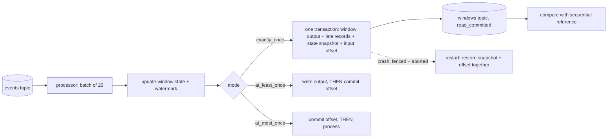

# POC 037: Streaming windowed aggregates with exactly-once effect under crashes (simulated broker; Kafka/Redpanda not used)

**Category:** Data Engineering | **Stack:** Pure Python: in-process Kafka-style broker (idempotent producer, transactions, read_committed) and a windowed processor; Redpanda/Kafka NOT used

## Problem
Stream processors are judged by what happens when they crash: output windows emitted twice, state silently lost, events skipped. This POC implements a tumbling-window aggregator with event-time watermarks and a late-data side output, in three delivery modes, on a simulated broker that offers the primitives exactly-once processing needs (producer sequence de-duplication, atomic commit of output records and consumer offsets, fencing of a crashed producer, last-stable-offset reads). It then injects random crashes and compares the results with an independent sequential reference.

## Approach

- Exactly-once mode commits the window output, late records, a state snapshot and the input offset atomically; a restart aborts any open transaction of the crashed incarnation and restores state and offset from the same commit.
- Windows close when the watermark (max event time minus 30 s) passes their end; events for closed windows are routed to a `late` topic and counted, not added to results.
- Result of 30 runs with 4 random crashes each (113 restarts): exactly-once matched the reference in 30/30; at-least-once 0/30 (replayed batches with lost in-memory state give wrong values, some windows repeat); at-most-once 6/30 (events and windows lost).
- A bug found on the way: the first broker returned references to stored values, so uncommitted processing mutated the committed state snapshot and exactly-once failed 29/30 runs; the broker now serialises on write and read like a real log, and a regression test covers it.

## Run it
```bash
make demo PY=python
make test
```

## Evidence status
| Claim | Status |
|---|---|
| Broker semantics (idempotence, atomic commit, abort, fencing, LSO) and processing guarantees under 113 injected restarts | Tested (20 tests, random crash schedules) |
| Comparison against an independent sequential reference implementation | Done (windows, values, late events) |
| Kafka/Redpanda behaviour: network partitions, zombie producers beyond fencing, rebalances, compaction, exactly-once across clusters | NOT verified: the broker is a simulation of the semantics, not of the products |
| Throughput and latency | Not measured |

## Results
<!-- RESULTS:START -->

**Results (measured by `python -m exactly_once_windows.main`; SIMULATED in-process broker, no Kafka/Redpanda; 4 random crashes per run)**
600 events in 24 batches of 25; 60 s tumbling windows, 30 s allowed lateness, ~5% late events. 30 runs per mode.

| delivery mode | runs exactly equal to reference | duplicate window records | windows with wrong values | windows missing | restarts |
|---|---|---|---|---|---|
| exactly_once | 30/30 | 0 | 0 | 0 | 113 |
| at_least_once | 0/30 | 15 | 206 | 67 | 84 |
| at_most_once | 6/30 | 0 | 91 | 69 | 37 |

No-crash exactly-once run vs the independent sequential reference: {'windows_expected': 48, 'output_records': 48, 'duplicate_records': 0, 'windows_with_wrong_values': 0, 'windows_missing': 0, 'late_events': 19, 'late_expected': 19, 'exact': True}

<!-- RESULTS:END -->

## Limitations
- Single partition and single processor: no rebalancing, no keyed partitioning, no parallelism, and state snapshots are whole-state (a real job uses incremental changelogs).
- The simulated broker commits atomically under one lock; real transaction coordinators have their own failure modes (timeouts, coordinator failover).
- Crashes are injected at three named points per batch; crashes inside a broker call or during the final flush are not modelled.
- Exactly-once here means exactly-once *effect* inside the broker; side effects outside it (calling an HTTP API) would still need idempotency keys.

## Data and security
Synthetic events from a seeded RNG (600 events, 3 keys, ~5% late); no external data.
