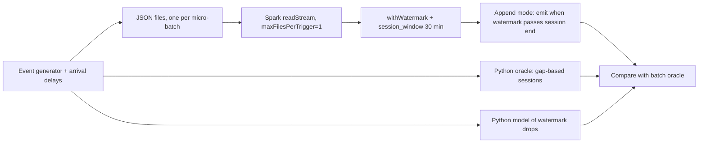

# POC 038: Sessionisation with Spark Structured Streaming and late data

**Category:** Data Engineering | **Stack:** PySpark 4.2 Structured Streaming (real, local mode), Python oracle

## Problem
User sessions defined by inactivity gaps are easy in batch and subtle in streaming: events arrive out of order, so the engine must wait before it closes a session. The watermark sets how long it waits. A short watermark emits sessions quickly but drops late events and splits sessions; a long one is complete but slow and holds more state. This POC measures that trade-off against an exact batch oracle.

## Approach

- Synthetic clickstream: 30 users with bursts of activity separated by idle gaps; arrival time = event time plus a delay (most prompt, 6% 10-50 minutes late, 1% 2-3 hours late).
- Spark Structured Streaming with `session_window` (30-minute gap) in append mode processes one file per micro-batch, in a deterministic order (explicit modification times; a first version without them gave different results between identical runs because Spark orders files by mtime). A final sentinel event advances the watermark so every real session is flushed.
- Three watermarks (5 minutes, 30 minutes, 3 hours) are compared with a plain-Python batch sessioniser: share of sessions identical to the oracle, events dropped as late, and how many micro-batches pass between the last event's arrival and the session being emitted.
- A small Python model of Spark's drop rule is compared with what Spark actually dropped.

## Run it
```bash
make install   # also: pip install -r ../../requirements-spark.txt (needs Java 17 or 21)
make test
make demo
```

## Evidence status
| Claim | Status |
|---|---|
| Sessionisation and watermark behaviour | Real: PySpark 4.2.0 Structured Streaming runs locally and is compared with an independent oracle |
| Python model of Spark's late-data rule | Approximate: it is an upper bound (it predicts more drops than Spark at the shortest watermark) and exact at 30 minutes and 3 hours; the discrepancy is not fully explained |
| Kafka, cluster execution, state store size, exactly-once sinks | Not covered: file source and foreachBatch collection only |
| Scale | About 500 events; throughput and state growth are not measured |

## Results
<!-- RESULTS:START -->

**Results: Structured Streaming sessionisation (517 events, 12 micro-batches, 30-minute gap)**
The oracle is a plain-Python batch sessionisation of all events. Events arrive out of order: about 6% 10-50 minutes late and 1% 2-3 hours late. 'Dropped events' are events inside oracle sessions that Spark discarded because they arrived behind the watermark.

| watermark | sessions emitted | oracle sessions | sessions identical to oracle | events dropped by Spark | drops predicted by Python model | median lag (micro-batches) from last event arrival to emission | share emitted only by the final flush |
|---|---|---|---|---|---|---|---|
| 5 minutes | 94 | 94 | 0.957 | 4 | 8 | 2 | 0.202 |
| 30 minutes | 94 | 94 | 0.957 | 4 | 4 | 3 | 0.287 |
| 3 hours | 94 | 94 | 1.000 | 0 | 0 | 7 | 0.691 |

<!-- RESULTS:END -->

## Limitations
- Small data and a file source: the latency numbers are in micro-batches, not seconds, and say nothing about throughput.
- Late-data semantics depend on how micro-batches are cut; here arrival order defines them, which is a modelling choice.
- The flush sentinel is an artefact of availableNow runs with a finite input; a real stream would not need it, but sessions would stay open until later events arrive.
- The Python model of drops disagrees with Spark at the 5-minute watermark (8 predicted, 4 observed) and is therefore only an upper bound.
- Marked heavy: needs Java and PySpark; runs in the heavy workflow.

## Data and security
All events are synthetic (user ids like u07). Streaming checkpoints and input files live in a temporary directory removed after the run.
