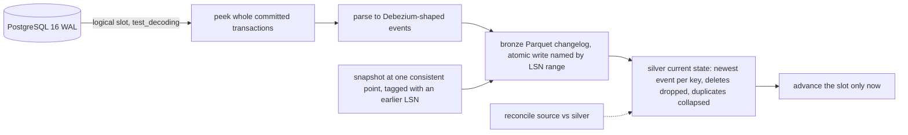

# POC 039: Postgres logical-decoding CDC to a Parquet lake: snapshot plus stream, atomic transactions, crash-safe replay (real Postgres 16; Debezium and Kafka not used)

**Category:** Data Engineering | **Stack:** PostgreSQL 16 logical decoding (test_decoding), psycopg 3, DuckDB, PyArrow; Debezium, Kafka, Kafka Connect and pgoutput NOT used

## Problem
Change data capture fails at the seams: a snapshot taken while the source is being written, transactions split across reads, rolled-back work leaking downstream, a consumer crash between writing and acknowledging, schema changes, and replication slots that silently retain WAL. This POC consumes a real PostgreSQL 16 logical replication slot (the same mechanism Debezium uses) into an append-only Parquet changelog plus a rebuilt current-state table, and tests each of those seams against a real server started locally for every run.

## Approach

- Delivery is at-least-once with idempotent effects: peek, write bronze, rebuild silver, then advance; a crash anywhere before the advance replays the same transactions.
- Events are ordered by commit LSN then position in the transaction; the snapshot is tagged with an LSN read before its consistent point, so writes during the snapshot are replayed on top and the lake converges.
- Parsing is strict: unsupported types or unchanged-TOAST values stop the consumer before the slot advances instead of guessing.
- Two schema findings are tested: a nullable ADD COLUMN flows through, but ADD COLUMN with a default changes rows that never appear in the WAL, so the lake diverges until the table is re-snapshotted (reconcile detects it).
- Slot lag in WAL bytes is measured; an idle slot retains WAL indefinitely, so the server is started with max_slot_wal_keep_size and lag must be monitored.

## Run it
```bash
pip install -r requirements-postgres.txt   # the PostgreSQL 16 server binaries must already be installed
make test PY=python
make demo PY=python
```

## Evidence status
| Claim | Status |
|---|---|
| PostgreSQL logical decoding, slot semantics, snapshot/stream handoff, transactions, rollbacks | real: a local PostgreSQL 16 server per test run, unix socket only |
| Lake (bronze changelog, silver current state) with DuckDB/Parquet | real |
| Crash between write and slot advance, overlapping replay | real, injected failure |
| Debezium, Kafka, Kafka Connect, Schema Registry, pgoutput binary protocol | not used / untested |
| Managed Postgres (RDS), network failures, very large transactions, TOAST, jsonb/arrays/enums, DDL events, multi-table foreign-key ordering, partitioned tables | not tested |

## Results
<!-- RESULTS:START -->

**Results (POC 039: REAL PostgreSQL 16 logical decoding into a Parquet lake; no Debezium, no Kafka)**
Every scenario starts its own throw-away server. Row counts are exact; timings are measured on one machine and noisy.

#### 1. First load while the source is being written

A snapshot is taken after the slot exists, while 678 concurrent background transactions ran. Source vs lake after draining: orders: 231 src / 231 lake, 0 missing, 0 extra, 0 differing; accounts: 8 src / 8 lake, 0 missing, 0 extra, 0 differing.

#### 2. Streaming with transactions and rollbacks

| check | result |
|---|---|
| committed / rolled-back transactions | 341 / 59 |
| polls interleaved with the workload | 23 |
| silver total balance != constant after any poll (atomicity violations) | 0 |
| rows from rolled-back transactions in silver / events in bronze | 0 / 0 |
| final reconcile | orders: 163 src / 163 lake, 0 missing, 0 extra, 0 differing; accounts: 8 src / 8 lake, 0 missing, 0 extra, 0 differing |

#### 3. Crash after the lake write, before the slot advance

| check | result |
|---|---|
| crash injected / slot not advanced | True / True |
| bronze changelog events vs distinct events (restart used a different batch size) | 206 vs 133 |
| final reconcile | orders: 78 src / 78 lake, 0 missing, 0 extra, 0 differing; accounts: 8 src / 8 lake, 0 missing, 0 extra, 0 differing |

#### 4. Schema evolution

| step | reconcile |
|---|---|
| ADD COLUMN channel (nullable), 15 rows updated | orders: 60 src / 60 lake, 0 missing, 0 extra, 0 differing |
| ADD COLUMN priority DEFAULT 'normal' (no WAL event per row) | orders: 66 src / 66 lake, 0 missing, 0 extra, 53 differing |
| after re-snapshot of the table (66 rows) | orders: 66 src / 66 lake, 0 missing, 0 extra, 0 differing |

#### 5. Replication-slot lag

| moment | WAL bytes the slot is behind |
|---|---|
| idle | 0 |
| after writes, consumer stopped | 66192 |
| after draining | 0 |

Drained 265 transactions in 0.56 s (measured, noisy). An idle slot retains WAL on the server indefinitely, so lag must be alerted on; the demo server also sets `max_slot_wal_keep_size`.

#### 6. Unsupported column type (jsonb)

Consumer stopped with `UnsupportedChange: unsupported column type 'jsonb' (at 0/15180B8); stopping before the slot is advanced`; slot lag after the failure 296 bytes (not advanced), bronze files written: 0.

#### Debezium-shaped event produced for an UPDATE

```json
{
 "op": "u",
 "before": {
  "id": 7,
  "status": "new",
  "amount": "10.50",
  "note": null
 },
 "after": {
  "id": 7,
  "status": "paid",
  "amount": "10.50",
  "note": null
 },
 "source": {
  "db": "postgres",
  "table": "public.orders",
  "lsn": 22000000,
  "txId": 731,
  "ordinal": 0
 },
 "ts": "2026-01-01 00:00:00+00"
}
```

<!-- RESULTS:END -->

## Limitations
- test_decoding is a text plugin meant for testing; production would use pgoutput (what Debezium uses) or wal2json. The parser covers scalar types only and fails closed on anything else.
- The silver table is rebuilt from the whole changelog on every poll: fine at demo scale, not at production scale (use incremental merge into a table format, see POCs 036/052).
- Single consumer, single slot, single process; no HA slot failover and no Kafka between source and lake.
- Needs a local PostgreSQL 16 server binary (as root the server runs as the unprivileged nobody user); the tests skip when none is found.
- Timings are measured on one machine and not asserted.

## Data and security
Synthetic rows only; the throw-away server listens on a unix socket in a temporary directory (no TCP port), uses the literal trust-auth user `cdc`, and is deleted afterwards.
