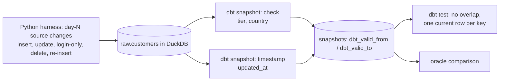

# POC 040: SCD2 history with real dbt snapshots: check vs timestamp strategies

**Category:** Data Engineering | **Stack:** dbt-core 1.12, dbt-duckdb, DuckDB

## Problem
Dimension attributes change and the warehouse must still answer "what was true on date X". dbt snapshots implement SCD type 2, but the two strategies behave differently around untracked columns, deletes and re-inserts. This POC runs the real dbt CLI through five simulated days of source changes and checks both strategies against a hand-written oracle.

## Approach

- Real `dbt snapshot` and `dbt test` subprocess runs (YAML snapshot definitions, `hard_deletes: invalidate`, `dbt_valid_to_current` set to 9999-12-31).
- Singular dbt tests assert no overlapping validity ranges and exactly one open version per key; a test corrupts the snapshot to prove the tests can fail.
- Findings recorded in the results: login-only changes create no version under `check` but do under `timestamp`; a no-change re-run writes nothing; a deleted-then-reinserted key gets a closed version, a gap, and a new version; hard-delete closure under `timestamp` uses the wall clock.
- Requires `requirements-dbt.txt`; marked heavy (each dbt call takes seconds), so it runs in the heavy workflow, not fast CI.

## Run it
```bash
pip install -r ../../requirements-dbt.txt
make demo && make test   # 8 tests, ~45 s
```

## Evidence status
| Claim | Status |
|---|---|
| Version chains vs oracle, idempotency, dbt tests pass and fail correctly | Tested with real dbt 1.12.6 + dbt-duckdb 1.11.0 on a local DuckDB file |
| Other warehouses (Snowflake, BigQuery), dbt Cloud, large-table snapshot performance | Not tested |

## Results
<!-- RESULTS:START -->

**Results: real dbt-core + dbt-duckdb snapshot runs (generated by `make demo`)**
Five simulated days: Ann changes tier then country then name; Bob only logs in (untracked column); Cy is deleted then re-inserted; Dee is inserted; the snapshot is run once more with no changes. The same source feeds a `check` snapshot (tracks tier, country) and a `timestamp` snapshot (tracks `updated_at`).

#### `check` strategy: versions per customer

| customer | version chain (tier/country) | current version open? |
|---|---|---|
| 1 | free/US -> pro/US -> pro/GB | yes |
| 2 | pro/DE | yes |
| 3 | free/IN -> free/IN | yes |
| 4 | enterprise/BR | yes |

Matches the hand-written oracle: **True**. Bob's login-only change created no version; the no-change re-run created none.

#### `timestamp` strategy: versions per customer

| customer | versions | chain |
|---|---|---|
| 1 | 4 | free/US -> pro/US -> pro/GB -> pro/GB |
| 2 | 2 | pro/DE -> pro/DE |
| 3 | 2 | free/IN -> free/IN |
| 4 | 1 | enterprise/BR |

Version counts match the oracle: **True**. Bob has 2 versions because his `updated_at` moved even though no tracked attribute changed, the practical difference between the two strategies.

`dbt test` (no overlapping validity ranges, exactly one current row per key): **passed**.

Caveat observed: for hard deletes under the timestamp strategy dbt closes the version at the wall-clock time, not the source's logical time, so mixed clocks appear in `dbt_valid_to`.

<!-- RESULTS:END -->

## Limitations
- Check-strategy timestamps are the wall clock at run time, so the simulated "days" are only ordered, not dated; the oracle compares version chains, not dates.
- Two source changes between snapshot runs collapse into one version (snapshots sample state; they are not an event log).
- Small tables only; no performance measurement.

## Data and security
Synthetic customers only; local DuckDB file; dbt telemetry disabled.
