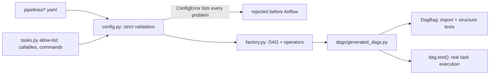

# POC 041: Config-driven Airflow DAG factory with tests

**Category:** Data Engineering | **Stack:** Apache Airflow 3.3.2 (real, in-process dag.test()), PyYAML, pytest

## Problem
Hand-written DAG files drift, copy-paste mistakes ship, and nobody reviews them like code. This POC generates Airflow DAGs from strict YAML pipeline configs: the schema is validated before Airflow ever imports it (cron, dependency cycles, unknown tasks, allow-listed callables and shell commands, parameter signatures), and the generated DAGs are verified structurally with DagBag and executed with `dag.test()` against a throw-away SQLite metadata database.

## Approach

- Config can only name callables and shell commands from an allow-list (`tasks.py`); arbitrary shell from YAML is rejected. Parameters must match the callable's signature.
- All problems in a file are reported together; duplicate `dag_id` across files is rejected.
- `dag.test()` executes the generated DAGs for real (Airflow 3.3.2 task runner, SQLite metadata DB in a temp `AIRFLOW_HOME`): the good pipeline succeeds; the dirty-data pipeline stops at the validation gate and never loads.
- Airflow's dependency pins conflict with the rest of the repo, so this POC has its own environment: marker `.own-env`, run by the `airflow` job in `heavy.yml` (`scripts/run_tests.py --own-env`).

## Run it
```bash
python -m venv .venv && .venv/bin/pip install -r ../../requirements-airflow-lock.txt   # exact lock, Airflow 3.3.2 (3.1.8 also passes the tests)
make demo PY=.venv/bin/python
make test PY=.venv/bin/python
```

## Evidence status
| Claim | Status |
|---|---|
| Config validation (23 tests incl. 14 invalid-config cases) | Tested (pure Python) |
| DagBag import, DAG structure, retries/tags/owners | Tested (real Airflow 3.3.2; also passes on 3.1.8) |
| Task execution via dag.test(), failure gate | Tested (real Airflow task runner, local SQLite) |
| Scheduler, webserver/UI, real executors (Celery/Kubernetes), providers beyond standard, production deployment | Not tested |

## Results
<!-- RESULTS:START -->

**Results (measured by `python -m airflow_dag_factory.main`; Airflow 3.3.2, dag.test() in-process, SQLite metadata DB)**
- import errors: none
- **fan_in**: 4 tasks, schedule `@hourly`, tags ['demo'], test run: **success**
- **orders_daily**: 4 tasks, schedule `0 3 * * *`, tags ['daily', 'orders'], test run: **success**
- **strict_quality**: 3 tasks, schedule `None`, tags ['quality'], test run: **failed**

<!-- RESULTS:END -->

## Limitations
- `dag.test()` runs tasks in-process; it does not exercise the scheduler, executor or workers.
- Work files go to `/tmp/poc041/...` as configured in the sample pipelines; the sample tasks are toy functions.
- The factory supports python and bash tasks and linear/fan-in dependencies only: no sensors, dynamic mapping, datasets/assets or branching.
- Airflow 3 SDK interfaces are young: `dag.test()` needs the DAG file in the configured dags folder (set by `airflow_dag_factory.env`).

## Data and security
Synthetic order rows generated by the sample tasks (seeded RNG).
