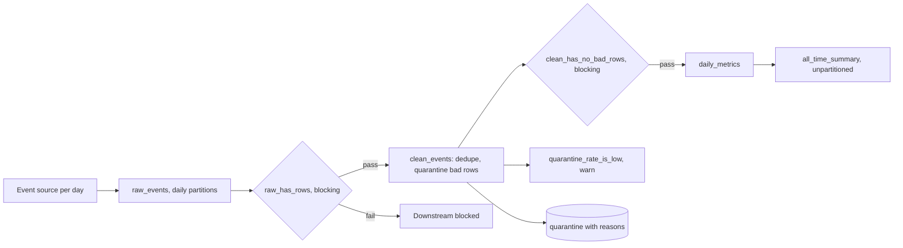

# POC 042: Dagster asset pipeline with partitions and checks

**Category:** Data Engineering | **Stack:** Dagster 1.13 (real, in-process), DuckDB, Python

## Problem
A daily event feed arrives with duplicates and bad rows, and sometimes not at all. The pipeline should reprocess one day without touching others, refuse to build downstream tables from an empty or corrupt day, and keep an auditable record of what was removed and why.

## Approach

- Four software-defined assets: raw_events, clean_events and daily_metrics are daily-partitioned; all_time_summary depends on every partition. All writes delete-then-insert the one partition, so re-materialising a day is idempotent.
- Asset checks are real Dagster checks: two are blocking (an empty raw day; bad rows surviving cleaning) and one is a non-blocking warning (more than 10% of rows quarantined).
- A scripted outage empties 2025-03-05. The blocking check stops its downstream assets; the other six days complete. After the source is repaired only that partition is re-run and the summary picks it up.
- Cleaning keeps a quarantine table with a reason per removed row; the tests reconcile raw = clean + quarantined + duplicates.

## Run it
```bash
make install   # plus: pip install -r ../../requirements-dagster.txt
make test
make demo
```

## Evidence status
| Claim | Status |
|---|---|
| Assets, partitions, blocking and warning checks, idempotent re-runs | Real: Dagster executes in-process; DuckDB holds the data |
| Results vs an independent Python computation | Checked: row counts and revenue match to within 5 cents |
| Dagster webserver, daemon, schedules, sensors, backfill UI, IO managers | Not used or tested |
| Real source, multi-process execution, concurrent runs | Not tested; a process-level lock serialises writes to the single DuckDB file |

## Results
<!-- RESULTS:START -->

**Results: Dagster partitioned assets with blocking asset checks (real Dagster, in-process)**
| partition | run | assets materialized | checks |
|---|---|---|---|
| 2025-03-01 | ok | clean_events, daily_metrics, raw_events | clean_has_no_bad_rows=pass, quarantine_rate_is_low=pass, raw_has_rows=pass |
| 2025-03-02 | ok | clean_events, daily_metrics, raw_events | clean_has_no_bad_rows=pass, quarantine_rate_is_low=pass, raw_has_rows=pass |
| 2025-03-03 | ok | clean_events, daily_metrics, raw_events | clean_has_no_bad_rows=pass, quarantine_rate_is_low=pass, raw_has_rows=pass |
| 2025-03-04 | ok | clean_events, daily_metrics, raw_events | clean_has_no_bad_rows=pass, quarantine_rate_is_low=pass, raw_has_rows=pass |
| 2025-03-05 | BLOCKED | raw_events | raw_has_rows=FAIL |
| 2025-03-06 | ok | clean_events, daily_metrics, raw_events | clean_has_no_bad_rows=pass, quarantine_rate_is_low=pass, raw_has_rows=pass |
| 2025-03-07 | ok | clean_events, daily_metrics, raw_events | clean_has_no_bad_rows=pass, quarantine_rate_is_low=pass, raw_has_rows=pass |

Blocked partitions: ['2025-03-05']. Summary before the fix: {'days_with_metrics': 6, 'revenue': 24508.87}; table counts: {'raw_events': 575, 'clean_events': 518, 'quarantine': 29, 'daily_metrics': 6}.

After the source is repaired and only 2025-03-05 is re-materialised: summary {'days_with_metrics': 7, 'revenue': 28467.22}; counts {'raw_events': 668, 'clean_events': 601, 'quarantine': 34, 'daily_metrics': 7}.

Re-running all seven partitions again: all succeeded = True; counts {'raw_events': 668, 'clean_events': 601, 'quarantine': 34, 'daily_metrics': 7} (unchanged, so partition writes are idempotent); summary {'days_with_metrics': 7, 'revenue': 28467.22}.

<!-- RESULTS:END -->

## Limitations
- Everything runs in one process against one DuckDB file; concurrent runs of the same partition from separate processes are not handled.
- Without the Dagster instance persisted, run history is ephemeral (execute_in_process), so this POC does not show run history, retries or alerting.
- The source is a deterministic generator; real feeds have late arrivals, schema drift and partial days that are not modelled.
- Freshness policies and automation conditions are not demonstrated.
- Marked heavy because Dagster pulls in many dependencies; it runs in the heavy workflow, not in the fast one.

## Data and security
All events are synthetic. Writes use parameterised SQL; the quarantine table stores event ids and reasons, not payloads.
