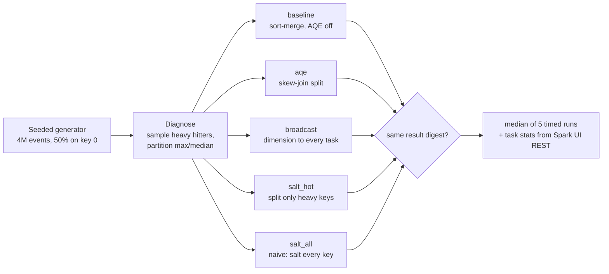

# POC 043: Spark join-skew diagnosis and fixes with benchmarks

**Category:** Data Engineering | **Stack:** PySpark 4, AQE, `local[4]`

## Problem
A join that "usually takes 5 minutes" takes an hour because one key (here the default
`customer_id = 0` for anonymous traffic) owns half the rows. Spark hash-partitions by key, so one
task gets half the data while the other cores sit idle. The fix depends on the data, so this POC
first *measures* the skew (heavy hitters, partition shape), then compares four remedies on the
same workload with the same answer.

## Approach

- **Diagnose first**: `skew.heavy_hitters` samples 2% of the fact table and flags keys whose expected partition would exceed twice an even share; `shuffle_partition_stats` reports max/median, coefficient of variation and the largest partition's share (empty partitions count).
- **AQE skew join**: Spark splits an oversized partition into several tasks at runtime. The default thresholds assume 256 MB partitions, so the demo lowers them for this data (documented in `joins.configure`).
- **Broadcast**: fastest when the dimension fits in memory; the fact table is never shuffled. Not an option when both sides are large.
- **Selective salting**: heavy keys get a deterministic salt (`hash(event_id) mod n`) on the fact side and their dimension rows are replicated once per salt; other keys are untouched. `n` is chosen so each piece is about one average partition.
- **Naive salting** (every key) is included as the cautionary case: it replicates the whole dimension `n` times for no benefit to the cold keys.
- **Correctness**: all variants must produce the same result digest or the run fails the check; tests also cover empty hot-key lists, one salt, and events with no matching customer.

## Run it (no credentials needed)
```bash
# needs Java 17+ on PATH and ~450 MB of PySpark
pip install -r ../../requirements-dev.txt -r ../../requirements-spark.txt
make demo   # ~15 min on 4 cores: 5 variants x (1 warm-up + 5 timed runs); writes results/ and data/generated/
make test   # 16 tests on 200k rows (~1 min); structural checks only, no timing assertions
```

## Evidence status
| Claim | Status |
|---|---|
| Skew diagnosis (hot key found, partition max/median) | Measured |
| Before/after wall-clock for 5 strategies, with run-to-run range and task statistics | **Measured locally**: PySpark 4.2.0, `local[4]`, one JVM, 4M synthetic rows; the machine and settings are printed in the results |
| AQE really split the skewed join; broadcast plan has no sort-merge join | Tested (plan inspection) |
| Behaviour on a cluster (network shuffle, spill to disk, many executors, real data distributions) | **Not tested** |

## Results
<!-- RESULTS:START -->

**Results: measured on this machine (generated by `make demo`; do not edit)**
#### Environment and method

- Spark 4.2.0 `local[4]`, openjdk version "21.0.12.1" 2026-08-18, Python 3.13.16, 4 logical CPUs, 15.7 GB RAM, driver memory 4g, `spark.sql.shuffle.partitions=32`. One JVM, no cluster, no network shuffle, no real disks involved in shuffles beyond local temp files.
- Data (seeded, synthetic): 4,000,000 events (161.0 MB Parquet), 200,000 customers (0.77 MB). Hot key `customer_id=0` holds 50% of events.
- Workload: join events to customers on `customer_id`, then a per-row SHA-256 of the payload and a small group-by (35 output rows). The hash stands in for per-row enrichment cost.
- Timing: for each variant 1 warm-up run (discarded) then 5 timed runs, `collect()` of the result, cache cleared before each run, wall-clock via `time.perf_counter`. We report the median and the min-max range. Variants run in the order shown, in one session, so JIT and OS cache effects are shared; there is no randomised ordering.
- Correctness: every variant produced the same result digest: **True**.

#### Diagnosis before fixing

| metric (hash partitioning on customer_id, 32 partitions) | value |
|---|---|
| rows | 4,000,000 |
| largest partition | 2,093,043 (52% of rows) |
| median partition | 61,178 |
| max / median | 34.2x |
| coefficient of variation | 2.83 |

Heavy hitters (sampled, share of rows): `0` 50.1%. After salting them 17 ways the shuffle keys give: largest partition 330,507 (8%), max / median 5.1x.

#### Before / after

| variant | median s | min-max s | speed-up vs baseline | tasks in busiest shuffle stage | max task ms | median task ms | max/median shuffle records |
|---|---|---|---|---|---|---|---|
| baseline | 8.100 | 7.68-9.5 | 1.00x | 32 | 4033 | 184.500 | 31.150 |
| aqe | 5.790 | 5.35-7.35 | 1.40x | 39 | 806 | 233 | 3.900 |
| broadcast | 3.340 | 3.29-3.81 | 2.43x | 32 | 31 | 16.000 | 4.000 |
| salt_hot | 6.680 | 6.27-6.96 | 1.21x | 32 | 1211 | 318.000 | 4.750 |
| salt_all | 7.270 | 6.42-8.07 | 1.11x | 32 | 1019 | 395.000 | 2.390 |

Task columns come from the Spark UI REST API for the stage that read the most shuffle records in the last timed run. For `broadcast` the fact table is not shuffled, so that stage is only the tiny final aggregation and its task times are not comparable with the join stages above.

Cost of salting on the dimension side: `salt_hot` 200,016 rows (1 hot key x 17 salts) vs `salt_all` 3,400,000 rows (every key x 17) from 200,000.

<!-- RESULTS:END -->

## Limitations
- Local mode only: shuffles never cross a network, so absolute times and even the ranking of strategies can differ on a cluster. The relative benefit of removing one straggler task is the transferable part.
- The workload is synthetic and CPU-bound by design (a per-row hash stands in for enrichment). IO-bound or spill-bound jobs would behave differently.
- Variants run in a fixed order in one session (no randomisation), so warm JIT and OS cache are shared; the min-max range shows run-to-run noise but not systematic order effects.
- With 4 cores a 50% hot key bounds the baseline at about twice the ideal time; with more cores the same skew costs proportionally more.
- Spark's map-side partial aggregation already blunts skew for simple `sum`/`count` group-bys; this POC targets joins. Non-combinable aggregations (distinct counts, collect, windows) need their own treatment and are not covered.
- AQE thresholds were tuned down to fit the data; on production-sized partitions the defaults apply.

## Data and security
Synthetic data only, generated from a seed into `data/generated/` (git-ignored). The Spark UI is bound to localhost and queried without any proxy.
