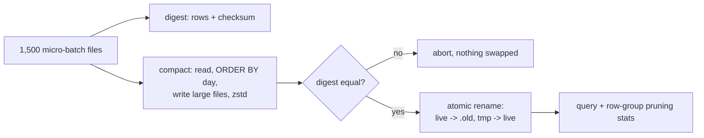

# POC 044: Parquet compaction lab: small files, row groups, sorting and codecs

**Category:** Data Engineering | **Stack:** DuckDB, PyArrow

## Problem
Streaming ingestion leaves thousands of tiny Parquet files; every query pays to open and plan each one, and min/max statistics are useless when every file spans the whole key range. This POC reproduces the problem with 3M events in 1,500 files and measures what safe compaction, sorting and compression buy.

## Approach

- Compaction writes to a temporary directory, verifies row count and an order-independent checksum, then swaps with an atomic rename; the previous version stays as `.old` for rollback.
- Three layouts are compared on the same query (`day BETWEEN 10 AND 14`): small files, compacted unsorted, compacted sorted by the filter column, reporting file/row-group counts, how many row groups min/max statistics can skip, and median query time with range.
- Codec comparison (snappy, zstd, uncompressed) on the compacted table.
- Timings: 1 warm-up + 5 runs, DuckDB 4 threads, local disk, warm cache. Tests never assert timings, only structure and correctness.

## Run it
```bash
make demo && make test   # demo ~20 s, 9 tests
```

## Evidence status
| Claim | Status |
|---|---|
| Layout statistics, pruning counts, checksum-verified compaction, rollback path | Measured / tested |
| Query timings and codec sizes | Measured locally on one machine (see results for the numbers) |
| Object stores, table formats (Iceberg/Delta compaction), concurrent writers | Not tested |

## Results
<!-- RESULTS:START -->

**Results: measured on this machine (generated by `make demo`; do not edit)**
3,000,000 synthetic events (event_id, user_id, day, amount, country) written as 1,500 micro-batch files of 2,000 rows, every file spanning all 90 days. Query: group-by on `WHERE day BETWEEN 10 AND 14` with DuckDB, 4 threads, local disk, warm OS cache. Timing = 1 warm-up then 5 runs, median and min-max. Compaction verifies row count and an order-independent checksum before swapping directories.

| layout | files | median file KB | row groups | row groups skippable by min/max | median ms | min-max ms | same rows & checksum |
|---|---|---|---|---|---|---|---|
| small files (as ingested) | 1500 | 36.100 | 1500 | 0/1500 | 145.500 | 135.7-161.4 | yes |
| compacted, unsorted | 3 | 6869.600 | 12 | 0/12 | 15.300 | 14.9-16.6 | yes |
| compacted + sorted by day | 3 | 7447.900 | 12 | 11/12 | 7.500 | 6.7-8.8 | yes |

Compressed size of the compacted+sorted table by codec (MB): {'snappy': 29.96, 'zstd': 21.81, 'uncompressed': 40.48}.

Sorting by the filter column is what makes min/max statistics useful; compaction alone reduces file-open overhead but cannot skip row groups when every group spans all days.
Local disk, warm cache, one machine: object-store latency (the real small-files penalty) is not included, so the gap here understates cloud behaviour.

<!-- RESULTS:END -->

## Limitations
- Local disk with a warm cache understates the small-files penalty on object stores, where each file open is a network round trip.
- Sorting by one column helps queries on that column only; multi-column pruning needs Z-order or clustering, not covered.
- Compaction here is a full rewrite of a static directory; compacting a table that is still receiving files needs a table format's transaction log.

## Data and security
Synthetic events only; local files; no network.
