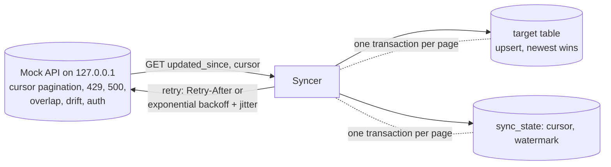

# POC 045: Incremental API ingestion that survives rate limits, crashes and late data

**Category:** Data Engineering | **Stack:** Python stdlib (urllib, sqlite3), local mock HTTP API

## Problem
Pulling a SaaS API into a warehouse fails in boring ways: 429s, 500s, a job killed mid-run, records
that arrive with old timestamps, a vendor adding a field. A naive loader duplicates rows, loses the
late ones or restarts from scratch. This POC is an incremental loader whose correctness is checked
against the API's source of truth under each failure.

## Approach

- **Watermark** = newest `updated_at` seen after a completed run; the next run asks only for newer changes. An optional **overlap window** re-reads the last N ticks to catch records committed late with old timestamps.
- **Checkpoint per page in the same transaction as the upsert**, so a crash can neither lose a page nor advance past unwritten rows; the cursor is only reused if it belongs to the same `since`.
- **Idempotent upsert**: `ON CONFLICT ... WHERE excluded.updated_at >= target.updated_at`, so replays and overlapping pages never duplicate or regress a row; deletes arrive as a flag.
- **Retries**: 429 honours `Retry-After`; 5xx/timeouts back off exponentially with jitter, bounded by `max_retries`; 401/403/400/404 fail fast. Unknown fields are kept in an `extra` JSON column.
- The bearer token is a fixed synthetic string valid only against the mock.

## Run it
```bash
make demo && make test   # 14 tests, ~10 s (a real local HTTP server; no sleeping)
```

## Evidence status
| Claim | Status |
|---|---|
| Exact completeness under 429/500, crash-resume at 3 points, overlap recovery, schema drift, auth failure | Tested against the local mock |
| Real vendor APIs (their pagination quirks, clock skew, rate-limit headers) | **Not tested** |

## Results
<!-- RESULTS:START -->

**Results: local mock API, 1,000 records, page size 50 (generated by `make demo`)**
`complete` = the target table equals the API's source of truth exactly. Retry waits are recorded but not slept.

| scenario | requests_first_run | retries | rate_limited | complete | second_run_rows | second_run_requests | complete_after_change |
|---|---|---|---|---|---|---|---|
| clean full sync + incremental after 22 changes | 20 | 0 | 0 | True | 22 | 1 | True |
| flaky API: 429 every 6th, 500 every 7th request | 27 | 7 | 4 | True | 22 | 2 | True |
| crash after 4 pages, then resume | 16 | 0 | 0 | True | - | - | - |
| schema drift (extra field mid-run) | 20 | 0 | 0 | True | - | - | - |
| late update, no overlap | - | - | - | False | - | - | - |
| late update, overlap of 50 ticks | - | - | - | True | - | - | - |
| bad token | - | 0 | - | - | - | - | - |

Schema drift: 750 rows kept the unexpected `currency` field in an `extra` JSON column instead of failing. A full refresh would re-read all 1,000 rows; the incremental run after 22 changes read only the changed rows plus the overlap.

<!-- RESULTS:END -->

## Limitations
- Offset-style cursors can skip rows if records are inserted mid-run; the overlap window mitigates but does not eliminate this. Keyset pagination is safer where available.
- Late data older than the overlap window is still lost; the fix is a periodic reconciliation (count/checksum) job, not included.
- Single process and SQLite target; no concurrent syncers. Hard deletes at the source are invisible to an `updated_since` pull.

## Data and security
Synthetic records; nothing leaves localhost; the token is a placeholder.
