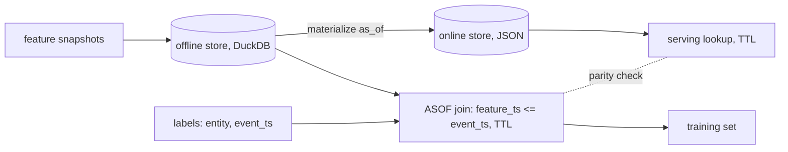

# POC 046: Feature store offline/online with point-in-time joins

**Category:** Data Engineering | **Stack:** DuckDB ASOF joins, pandas, scikit-learn (own implementation; Feast and Redis NOT used)

## Problem
Training sets built with 'latest value' joins leak information from after the label event, so models look excellent offline and fail in production. This POC implements the core of a feature store (registry, offline point-in-time join with TTL, online latest-value store with materialisation) and measures the leakage a naive join creates.

## Approach

- `FeatureView` validates identifiers (SQL is built from them) and TTL; sources with nulls or duplicate (entity, ts) rows are rejected.
- `historical_features` uses DuckDB `ASOF LEFT JOIN` (inclusive boundary), nulls values older than the TTL, and preserves caller row order and extra columns.
- `leaky_join` (newest value overall) exists only for contrast.
- Online store materialises the latest value at or before `as_of`; reads return None when unknown or stale.

## Run it
```bash
make demo PY=python
make test
```

## Evidence status
| Claim | Status |
|---|---|
| PIT join never uses future values; TTL and nulls handled | Tested (real) |
| Leakage demonstration: leaky join AUC vs AUC at serving time | Measured (synthetic data built to leak) |
| Online/offline parity at a materialisation instant (0/50 mismatches) | Tested (real) |
| Feast, Redis, Parquet registry, streaming ingestion, concurrent writers | Not used / not implemented |

## Results
<!-- RESULTS:START -->

**Results (measured by `python -m pit_feature_store.main`)**
Train 400 / test 200 customers. AUC of a logistic regression on [orders_30d, tickets_7d].

| training join | AUC (test, same join: looks great) | AUC at serving time (PIT features) |
|---|---|---|
| leaky_join | 0.976 | 0.623 |
| point_in_time | 0.779 | 0.779 |

- online store materialised 600 entities; parity mismatches vs offline PIT join: 0/50
- stale online record returns None: True; unknown entity returns None: True

<!-- RESULTS:END -->

## Limitations
- The leak is deliberately constructed (tickets after churn); real leak sizes differ.
- The online store is a JSON file: no concurrency, no TTL eviction, no low-latency claims.
- One entity key per view and no feature transformations or on-demand features; Feast is not used or compared.
- Single-machine, in-memory DuckDB; no scale testing.

## Data and security
Synthetic customer snapshots, seeded numpy RNG.
