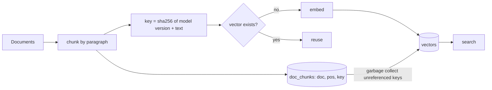

# POC 047: Idempotent vector ingestion: only changed chunks are re-embedded

**Category:** Data Engineering | **Stack:** SQLite, numpy, content-addressed chunks

## Problem
Re-running an embedding pipeline after a small edit usually re-embeds the whole corpus: slow, costly, and it leaves orphan vectors for text that no longer exists. This POC makes ingestion idempotent and incremental, and proves search results equal a from-scratch rebuild.

## Approach

- **Content-addressed chunks**: identical text (even across documents) is embedded once; shared chunks survive until the last document referencing them is removed.
- **Model version in the key**: changing the embedder version forces a re-embed and collects the old-version vectors, so mixed-model indexes cannot occur.
- **Atomic per-document upsert** in one transaction (tested by injecting a crash); `sync(corpus)` also deletes documents that vanished.
- **Parity check**: after each edit round, searches on the incremental store must equal those on a freshly built store.
- The embedder is a deterministic hashing stand-in; the embedding call count is the measured cost.

## Run it
```bash
make demo && make test   # 10 tests
```

## Evidence status
| Claim | Status |
|---|---|
| Embedding calls per round, no orphan vectors, search parity with full rebuild, atomicity, versioning | Measured / tested (deterministic, synthetic) |
| Quality of a real embedding model; large-scale vector DBs (pgvector, FAISS) | Not tested |

## Results
<!-- RESULTS:START -->

**Results: deterministic (generated by `make demo`)**
Synthetic corpus of 120 four-paragraph documents; one chunk per paragraph; a hashing embedder stands in for a real model (the call count is what matters). 'Embedded' = embedding calls made in that sync.

| sync | embedded | new docs | updated docs | unchanged docs | deleted docs | search identical to a full rebuild |
|---|---|---|---|---|---|---|
| initial load | 480 | 120 | 0 | 0 | 0 | - |
| round 1: 6 edited, 2 new, 2 deleted | 14 | 2 | 6 | 112 | 2 | yes |
| round 2: 6 edited, 2 new, 2 deleted | 14 | 2 | 6 | 112 | 2 | yes |
| round 3: 6 edited, 2 new, 2 deleted | 14 | 2 | 6 | 112 | 2 | yes |
| round 4: 6 edited, 2 new, 2 deleted | 13 | 2 | 5 | 113 | 2 | yes |
| re-run with no change | 0 | 0 | 0 | 120 | 0 | - |

A full re-embed of the final corpus would cost 480 calls per round; the incremental rounds cost a handful. Store now holds {'docs': 120, 'chunk_refs': 480, 'vectors': 480}; deleted and edited text no longer has orphan vectors.

<!-- RESULTS:END -->

## Limitations
- Brute-force numpy search; no ANN index. Chunking is by paragraph, so a change that shifts word-based chunk boundaries would re-embed more.
- Single writer; concurrent ingestion would need a lock or a queue.

## Data and security
Synthetic text only; no network.
