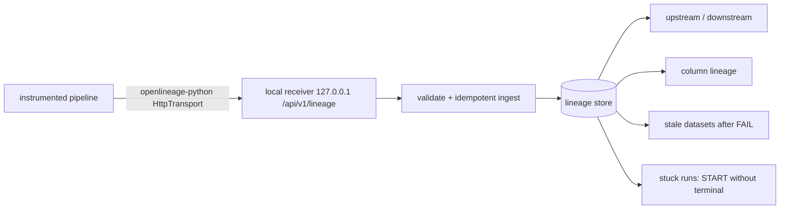

# POC 048: End-to-end lineage with OpenLineage (local receiver, Marquez not used)

**Category:** Data Engineering | **Stack:** openlineage-python 1.54.0 (real client), stdlib HTTP receiver; Marquez and Airflow NOT used

## Problem
When a table breaks, nobody knows what depends on it. This POC emits genuine OpenLineage RunEvents (START/COMPLETE/FAIL, input/output datasets, column-lineage facets) from an instrumented four-job pipeline through the official Python client to a local HTTP receiver that validates events, tracks run state, and answers upstream/downstream, column-level, stale-data and stuck-run questions.

## Approach

- Events are produced by the real OpenLineage client (`event_v2`, `column_lineage_dataset` facet) and delivered over real HTTP to a loopback-only server.
- The receiver rejects malformed JSON, missing fields, non-UUID run ids, oversize bodies and wrong paths; duplicates are ignored; late non-terminal events never resurrect a finished run.
- Graph edges come from COMPLETE events only, so failed runs do not invent lineage; cycles terminate.
- After a FAIL, all datasets downstream of the failing job's outputs are reported stale; a START with no terminal event is reported as stuck.

## Run it
```bash
make demo PY=python
make test
```

## Evidence status
| Claim | Status |
|---|---|
| Official client emits events over HTTP to the local receiver; ingest, validation, graph and column queries | Tested (real client, real loopback HTTP) |
| Stale-data and stuck-run detection | Tested (synthetic pipeline events) |
| Marquez server/UI, Airflow OpenLineage provider, dbt/Spark integrations, JSON-Schema validation of all facets | Not used / not tested |
| Persistence, authentication, multi-tenant use | Not implemented |

## Results
<!-- RESULTS:START -->

**Results (measured by `python -m openlineage_lineage.main`; official openlineage-python client -> local receiver, Marquez not used)**
- **events_accepted**: 8
- **rejected**: 0
- **upstream_of_mart_revenue**: ['warehouse:fct_orders', 'warehouse:raw_customers', 'warehouse:raw_orders', 'warehouse:stg_customers', 'warehouse:stg_orders']
- **downstream_of_raw_customers**: ['warehouse:fct_orders', 'warehouse:mart_revenue', 'warehouse:stg_customers']
- **sources**: ['warehouse:raw_customers', 'warehouse:raw_orders']
- **column_upstream_mart_revenue.revenue**: ['warehouse:fct_orders.amount', 'warehouse:raw_orders.amount_cents', 'warehouse:stg_orders.amount']
- **column_upstream_mart_revenue.country**: ['warehouse:fct_orders.country', 'warehouse:raw_customers.country_code', 'warehouse:stg_customers.country']
- **stale_after_failure**: {'stg_orders': 'stg_orders', 'fct_orders': 'stg_orders', 'mart_revenue': 'stg_orders'}
- **stuck_runs**: ['stg_customers']

<!-- RESULTS:END -->

## Limitations
- The store is in memory and the receiver has no authentication; it is a teaching/verification tool, not a Marquez replacement.
- Validation checks required fields and types only; it does not validate facet payloads against the published JSON schemas.
- The pipeline is synthetic (no real data is processed); events are emitted by hand-placed instrumentation, not by an orchestrator integration.
- Staleness assumes the latest run of a job decides its state; no SLA/time-based freshness.

## Data and security
No data files: the demo pipeline only emits metadata.
