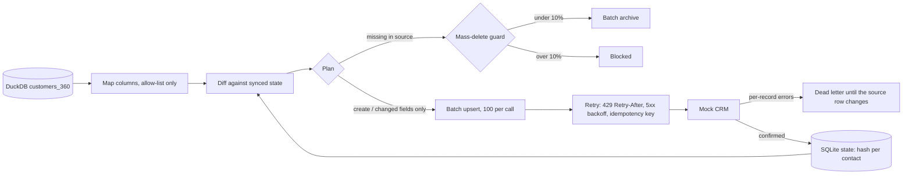

# POC 049: Reverse ETL to a mock CRM with diff-based sync

**Category:** Data Engineering | **Stack:** Python, DuckDB, FastAPI mock CRM (in-process), SQLite state

## Problem
Pushing warehouse data into operational tools sounds simple until the tool rate-limits you, fails mid-batch, rejects a bad record, or the source table is emptied by an upstream incident. A sync that re-sends everything is slow, expensive in API calls and dangerous; one that sends only differences needs state, retries, idempotency and guards.

## Approach

- The warehouse side maps six business columns to CRM fields; internal notes and the SSN fragment are never selected. Rows are hashed and compared with the last synced state, producing create, update (only the changed fields), archive, unchanged and skipped-dead-letter sets.
- The mock CRM is a real FastAPI app with the awkward behaviours of CRM APIs: 100-record batch limit, per-record validation errors, read-only fields, rate limiting with Retry-After, injected 503s, idempotency keys and cursor pagination. Time is simulated so retries cost nothing in tests.
- State is committed per confirmed record, so a crash or an aborted run resumes without duplicates. Batches carry an idempotency key derived from their content. A bad record goes to a dead-letter table and is not retried until its source row changes.
- A guard refuses to archive more than 10% of synced contacts in one run (an accidentally emptied source table), unless explicitly overridden. A dry-run mode returns the plan without calling the CRM. A first draft of the demo helper deleted every row when asked to delete none (`ids[-0:]`); the guard caught it.

## Run it
```bash
make install
make test
make demo
```

## Evidence status
| Claim | Status |
|---|---|
| Diff, retry, rate-limit, idempotency, dead-letter, resume and guard behaviour | Real: tested end to end against an in-process FastAPI CRM |
| Any real CRM (Salesforce, HubSpot) API | NOT tested: the mock mirrors common behaviours, not a specific vendor's contract |
| Network latency, TLS, authentication and OAuth token refresh | Not covered |
| Warehouse scale (millions of rows) | Not tested: 1,000 rows; the state diff holds all rows in memory |

## Results
<!-- RESULTS:START -->

**Results: reverse ETL from DuckDB to a mock CRM (simulated time, rate limits and outages)**
| step | created | updated | archived | dead-lettered | API calls | retries | 429s | bytes sent |
|---|---|---|---|---|---|---|---|---|
| 1. initial load (1000 rows, 3 requests per 10 s window) | 1000 | 0 | 0 | 0 | 13 | 3 | 3 | 243762 |
| 2. nothing changed | 0 | 0 | 0 | 0 | 0 | 0 | 0 | 0 |
| 3. next day: 5% updated, 10 deleted, 20 new, 1 bad email | 20 | 50 | 10 | 1 | 2 | 0 | 0 | 8102 |
| 4. 4 consecutive 503s during sync | 0 | 50 | 0 | 0 | 5 | 4 | 0 | 21470 |
| 5. re-run after the outage | 0 | 0 | 0 | 0 | 0 | 0 | 0 | 0 |
| naive: push every row again | 1000 | - | - | - | 13 | 3 | 3 | 243788 |

After the steps: 1009 of 1010 source rows match the CRM exactly (the rest are the dead-lettered bad email and rows removed). CRM fields ever received: ['churn_risk', 'email', 'first_name', 'last_name', 'lifetime_value', 'segment'] (internal_note and ssn_last4 never leave the warehouse). Archived in CRM: 10. Emptying the source table is blocked by the mass-delete guard: True.

<!-- RESULTS:END -->

## Limitations
- A mock cannot capture a vendor's quirks (field-level permissions, duplicate-detection rules, eventual consistency, bulk API job semantics); validate against a sandbox before production.
- Hashing compares the mapped fields only: changes to unmapped columns correctly cause no sync, but a mapping change requires a one-off full refresh.
- Archiving is the only delete semantics modelled; hard deletes, merges and GDPR erasure propagation (see POC 088) are out of scope.
- State lives in a local SQLite file; running two syncers at once needs a lock.
- Dead-lettered records need a human or a fix upstream: there is no alerting in this POC.

## Data and security
Customers are synthetic (example.com). Only mapped fields leave the warehouse; this is tested.
